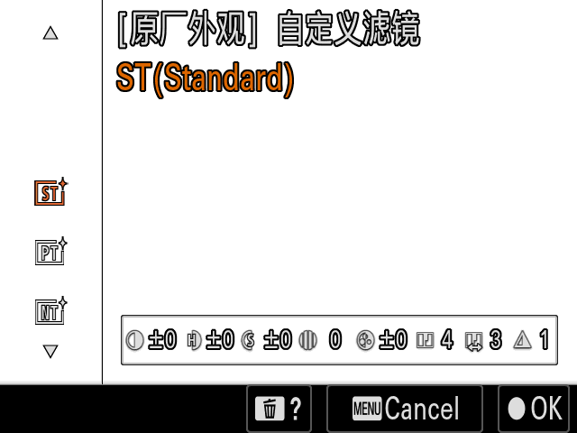
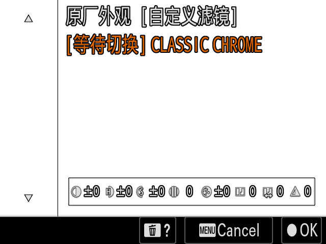
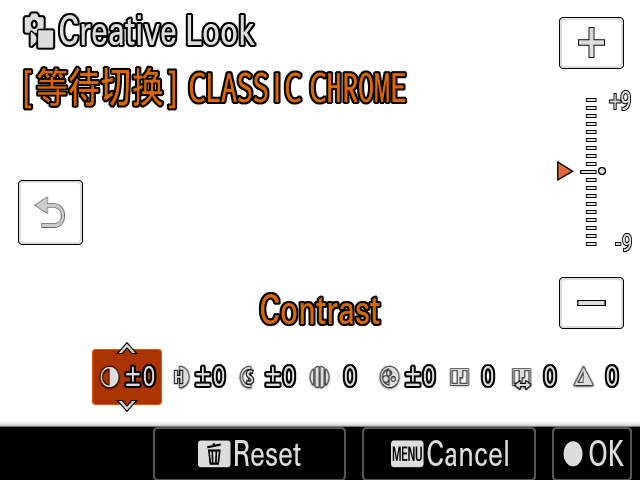
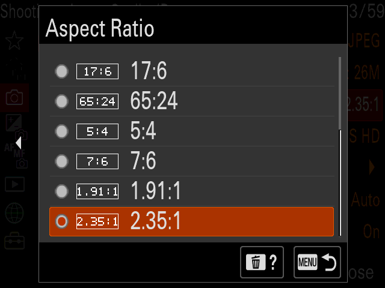
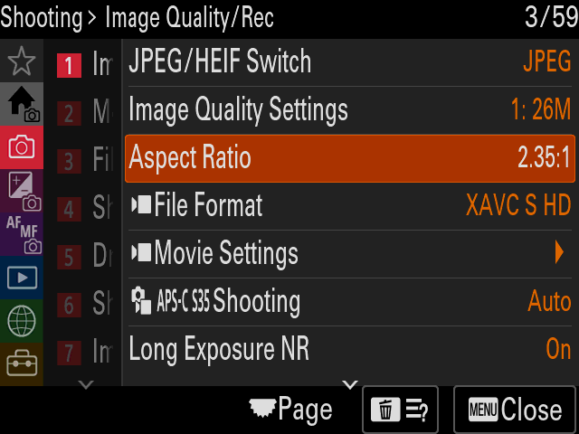
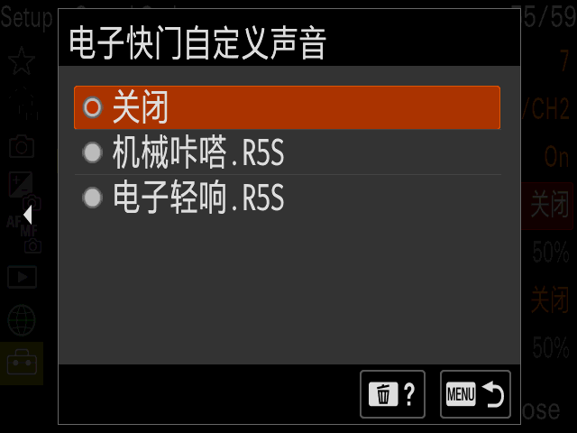
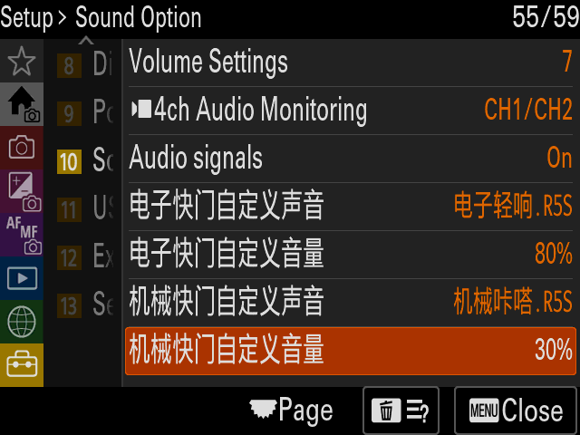
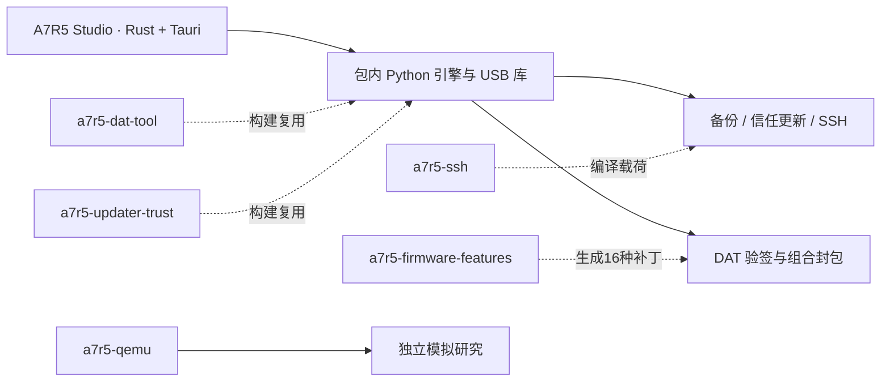

# A7R5 Studio 与固件研究工具

面向 **Sony A7R V / ILCE-7RM5、指定官方 4.00 固件前像、macOS Apple Silicon** 的客户端和脚本工具工程。

主要能力：备份机内更新器分区、修改研究签名信任环境、按需启动 SSH、从官方 DAT 构建自定义功能包，以及独立的协议、转存和 QEMU 研究。日常操作以 **A7R5 Studio** 客户端为入口，底层模块保留独立命令行和源码。

> **本项目仅限个人非商业研究使用，禁止商用。当前仅适配 macOS Apple Silicon，尚未适配 Windows、Linux 和 Intel Mac。** 用途限制适用于作者有权授权的原创内容；第三方代码继续遵循各自许可证。详见[使用范围与非商用声明](#使用范围与非商用声明)和[平台支持与其他系统适配](#平台支持与其他系统适配)。

> 当前客户端为本地测试版，最低构建目标为 macOS 14，实际验证环境为 macOS 27.0.1 / Apple Silicon。客户端运行不依赖 QEMU、Homebrew、Node 或开发虚拟环境。容器验签、离线回归和模拟结果不能证明相机升级接纳、功能效果或断电恢复；当前客户端未完成实机验收。

- **桌面客户端。** `client-update-20261024-01` 的改动和离线验证见 [2026-10-24 更新记录](a7r5-desktop/docs/updates-20261024.md)。需要该批次对应的功能时，可从当前源码启动或按下文构建客户端。
- **固件研究。** 当前主线为基于原厂 **4.00** 的 **4.19 全功能修正版（2026-11-12）**，提供十个可组合模块，已封入 CP 暂存资源修复及 FL2／FL3 机内 RAW 备选目录。桌面工坊保留四项组合和固定 4.17 预设；十模块 4.19 使用 `compose.py`。从[当前能力](#当前已实现能力)、[构建示例](#构建全功能与自定义模块升级包)或[完整功能索引](a7r5-firmware-features/README.md)进入。

## 目录

- [使用范围与非商用声明](#使用范围与非商用声明)
- [当前变更与交付状态](#当前变更与交付状态)
- [当前已实现能力](#当前已实现能力)
- [功能截图与操作说明](#功能截图与操作说明)
- [构建全功能与自定义模块升级包](#构建全功能与自定义模块升级包)
- [平台支持与其他系统适配](#平台支持与其他系统适配)
- [如何选择入口](#如何选择入口)
- [工程结构](#工程结构)
- [环境构建](#环境构建)
- [构建客户端](#构建客户端)
- [客户端使用](#客户端使用)
- [各模块的作用与用法](#各模块的作用与用法)
- [测试与验证](#测试与验证)
- [参考项目与代码来源](#参考项目与代码来源)
- [发布内容与签名身份](#发布内容与签名身份)
- [交给 AI Agent 的完整提示词](#交给-ai-agent-的完整提示词)
- [常见问题](#常见问题)

## 当前变更与交付状态

本页按 2026-11-12 固件构建及验证回执更新；其他工程状态沿用各自记录。提交 GitHub 时仍需将相应新源码、配置、测试和文档一并纳入提交；README 不会替代这些文件。

- **模块化固件工程：** 原厂 4.00 输入，按模块配置、检查依赖与共享组件、构建、独立重建复验；24 槽能力统一为 `look24`，保留旧 ID 的历史复现兼容。
- **滤镜交互：** 原厂／自定义分组、左键切组、分组成功选择记忆、浏览预览与自动保存、八项相对偏移、快速切换保留最后目标，以及后台恢复耗尽后的中键重试。
- **画幅与声音：** 十档画幅的逐张锁存、任务复制、取消恢复、开机记忆和保存失败提示；机械／电子双组自定义快门声独立选择与音量，电子前帘归机械组。
- **4.19 修正版：** 保留此前交互与目录 ABI 修复；新增 CP 失败／取消导入暂存复用、FL2／FL3 的 RAW 十二项备选目录和最终资源门禁。完整冻结快照已恢复，保留原版十二款滤镜的成像处理框架。当前包身份如下表。
- **工具与训练：** 桌面工坊新增 4.17 整合预设；Color Lab 增加量化回读、色卡留出集保护、暗部／中性与连续性检查，以及独立场景验证工具。联合拟合、神经网络教师等实验路径须按训练报告判断，未通过验收的候选回退，不能概括为已优于默认算法。
- **研究资料整理：** Fastboot／4.18 故障材料归入独立模块；旧构建和重复解包产物已清理，必要证据压缩保存。历史回执中的 `.local`、旧包和工作区路径可能不再存在，复验需重新准备输入。

| 项目 | 当前身份与验证范围 |
|---|---|
| 原厂基底 | ILCE-7RM5 4.00，精确 DAT 摘要见[输入准备](#1-准备固定输入) |
| 当前全功能预设 | [`presets/full-4.19.json`](a7r5-firmware-features/presets/full-4.19.json)，十模块，声音变体 `custom-dual-full` |
| 当前输出 DAT | 754525608 字节；SHA-256 `d486853533711a282c5e0794f6e98931608c1d2c581e3b25cd70da8b48ce5503` |
| 模块修订 | `look24` 修订 3；`look-fl2-fl3` 修订 2；`photo-aspect-ratios` 修订 5 |
| 已有离线证据 | 最终包 174 项与色彩对照 6 项通过；完整快照 331 项／源码锁 188 项；独立重建、解包和验签；736841 帧、147 个成员 |
| 已有 QEMU 证据 | 两轮正常客体 86 次 Qt 操作／86 张原帧（含两张基线）；无卡恢复双组声音和 MENU 开关通过。原生 E4 等硬件边界保持 |
| 当前实机状态 | 本次 4.19 修正版未进行相机升级、启动或成像验收；此前 4.16 的用户实机成功反馈不能替代本包验收 |

**源码与本地产物分开。** GitHub 源码不含完整 DAT、固件镜像、QEMU 大客体和真实设备现场。当前包的[说明](a7r5-firmware-features/releases/4.19-full-repaired-20261112/README.md)与[复现记录](a7r5-firmware-features/releases/4.19-full-repaired-20261112/实施与复验.md)记录实际结果；[前版](a7r5-firmware-features/releases/4.19-full-repaired-20261111/README.md)保留。克隆者须自行准备合法输入并恢复固定快照材料。不要按版本号混用历史同名 4.19 包。

## 当前已实现能力

### 十个固件模块

以下是固件构建配置中的十个公开模块，支持范围以 `plan` 的当前结果为准。

| 模块 ID／实施入口 | 实现能力 | 操作与边界 |
|---|---|---|
| [`look24`](a7r5-firmware-features/look24/README.md) | 24 槽自定义滤镜，SD 卡冷启动导入、机内库、分组预览与记忆、八项相对调参、选择保存恢复 | 创意外观内分组；逻辑左键切组，上下浏览，右键调参，中键确认／调参返回；预览成功自动保存。可用槽数取决于导入库，容量不等于内置 24 款 |
| [`look-fl2-fl3`](a7r5-firmware-features/look-fl2-fl3/README.md) | 原厂组开放 FL2／FL3，包含选择器、默认参数、CP 色彩适配及机内 RAW 十二项备选目录 | 原厂组操作；原十款 RAW 子目录保留，真实 ARW／Imaging Edge 与成像待验收 |
| [`look-factory-six`](a7r5-firmware-features/look-factory-six/README.md) | C1–C6：Classic Neg.、Classic Chrome、Nostalgic Neg.、Astia、GR Positive Film、GR Negative Film | 固件内置，在原厂组选择；与 SD 卡导入槽分开，沿用原厂调参页 |
| [`lens-af-compat`](a7r5-firmware-features/lens-af-compat/README.md) | 自动兼容模式保留镜头已上报的 AF 能力，调整能力过滤与发布 | 不为未上报的能力造值；镜头通讯及强制模式保留，实镜 AF-C／连拍待验收 |
| [`photo-aspect-ratios`](a7r5-firmware-features/photo-aspect-ratios/README.md) | 原有 3:2、4:3、16:9、1:1，加 17:6、65:24、5:4、7:6、1.91:1、2.35:1，共十档 | 取景构图遮罩；JPEG／HEIF 实裁；RAW 像素保留完整幅面，内嵌预览按比例处理。确认后台保存，取消恢复原比例；硬件成片待验收 |
| [`photo-framing-markers`](a7r5-firmware-features/photo-framing-markers/README.md) | 照片构图标记开关、透明度及含 2.35:1 的比例 | 构图辅助，与实际裁切模块各自独立；物理取景叠加待验收 |
| [`photo-electronic-shutter-sound`](a7r5-firmware-features/photo-electronic-shutter-sound/README.md) | 普通原厂电子声配方；4.19 另用 `custom-dual-full` 提供双组自定义声音 | R5S 导入、独立选择／关闭／音量及保存恢复；电子前帘归机械组。真实出声、连拍和静音组合待机身验收 |
| [`video-ntsc-prompt`](a7r5-firmware-features/video-ntsc-prompt/README.md) | 关闭两处指定 NTSC 提示 | 保留 PAL／NTSC 制式、帧率和其他警告 |
| [`color-r6-st`](a7r5-firmware-features/color-r6-st/README.md) | 修改十二份 GL 模板中 ST 的 CC1 与矩阵字段 | 此模块会显式改变 ST 模板；生效时点由原厂模板加载决定 |
| [`color-awb-priority`](a7r5-firmware-features/color-awb-priority/README.md) | 修改十二份 GL 模板的白色优先／氛围优先字段 | 与 R6 ST 统一合并并重算校验；现有设置与初始化模板生效分别验收 |

`look24` 的八项值是相对原生基准的偏移，默认显示全零；归零恢复配方原本效果。微调按配方身份保存，相同配方重新导入保留微调，新配方使用自身默认值，不改写原始 `R5NATIVE.BIN`。两组记住最近成功应用的条目，切回时预览该条；无有效记录时回到第一款有效条目。空槽不作为有效配方应用。完整导入、状态恢复和异常分支见[24 槽实施记录](a7r5-firmware-features/native24-combined/实施与复现手册.md)。

### 配套工具

| 工程 | 已实现能力 | 入口 |
|---|---|---|
| A7R5 Studio | 相机维护、研究签名信任更新、SSH 上传／开启／停止、任务记录、四项组合封包与 4.17 整合预设 | [客户端说明](a7r5-desktop/README.md)；不包含十模块 4.19 图形选择器 |
| DAT 工具 | 容器检查、验签、解包、组件替换、归档校验、研究签名封包与回读 | [DAT 说明](a7r5-dat-tool/README.md) |
| 更新器信任 | 离线重建候选与状态分类；独立部署器提供精确前像、单次批准和全量回读流程 | [信任模块](a7r5-updater-trust/README.md)；与客户端直接更新的保护条件不同 |
| Color Lab | 色卡训练、原生参数与整数网格导出、BIN v4／v5、24 槽管理、配对照片预览和量化／留出保护 | [BIN 手册](sony-r5-colorlab/R5NATIVE.BIN使用说明.md)、[训练流程](sony-r5-colorlab/R5ColorLab/TRAINING.md)；电脑近似预览不等于 ISP 成片 |
| QEMU | 原厂应用菜单、真实 Qt 按键、原帧截图、固定客体及协议研究 | [QEMU 说明](a7r5-qemu/README.md)；不等同完整相机模拟 |
| Fastboot／执行工具 | RAM 引导资料与离线预检、短任务执行、SSH 和启动故障研究 | [Fastboot](a7r5-fastboot/README.md)、[短任务](a7r5-exec/README.md)；真实动作按各自授权和门禁执行 |

Color Lab 还可导出标准配方与“原厂多外观通用偏差（实验）”对照版：用八种原厂外观端点差值的中位数生成 A1／A2，只调整相应 CC1 和色相矩阵，保持 B、Gamma、网格和原工程不变。该选项用于多光源对照，不默认优于实测配方。[导出规则](sony-r5-colorlab/R5NATIVE.BIN使用说明.md)

## 功能截图与操作说明

以下均为原厂应用在 QEMU 内生成的真实菜单帧，图片原样复制，未绘制替代界面。声音两图来自 2026-11-12 修正版，其余五图来自历史 4.19 会话，用于说明共同操作；不作为成像／硬件验收。当前声音原帧与回执见[新包截图](a7r5-firmware-features/releases/4.19-full-repaired-20261112/README.md#当前包截图)，历史图来源见[截图来源清单](docs/images/features/sources.json)。

### 创意外观分组、预览与八项调参

| 原厂组 | 自定义组 |
|---|---|
|  |  |

逻辑左键一键切组，上下浏览目标组，右键进入调参，中键确认或从调参页返回。图中的 ST `0/0/0/0/0/4/3/1` 是原厂显示；自定义组显示相对偏移零值，两者含义不同。



历史会话中的“等待切换”如实反映 QEMU 尚缺少原生 E4 完成通知，不能将其解读为滤镜已应用或预览色彩已生效。成功事务与参数提交另有指令回放；真实画面仍须机身验收。

### 十档画幅

| 新增比例列表 | 确认 2.35:1 后返回 |
|---|---|
|  |  |

入口为照片画质菜单的 `Aspect Ratio`。中键确认后后台保存，MENU 取消恢复进入前比例。上图显示菜单状态；JPEG／HEIF 编码、RAW 与回放的离线覆盖见模块文档，不以黑底模拟取景图证明真实裁切。

### 双组自定义快门声音

| 电子组选择声音 | 两组独立音量 |
|---|---|
|  |  |

入口为 `Setup → Sound Option`。两组分别选择声音／关闭和音量；图示电子组 80%、机械组 30%，电子前帘共用机械组。截图验证菜单和设置状态，音频服务使用夹具，未验证扬声器真实输出。NTSC、AF、ST 和 AWB 等底层改动通过模块说明与离线回执呈现。

## 构建全功能与自定义模块升级包

十模块主入口为 [`a7r5-firmware-features/compose.py`](a7r5-firmware-features/compose.py)，不是桌面工坊的四项勾选器。先按[环境构建](#环境构建)和[构建输入](docs/build-inputs.md)准备环境及精确原厂 DAT；包含原生运行时的组合还需要根 `.venv` 和 LLVM／LLD。建议至少预留 10 GiB，每份输出必须使用不存在的新路径。

在仓库根目录执行以下全功能示例，仅操作本地文件：

```sh
set -e
mkdir -p .local
A7R5_RUN=$(mktemp -d "$PWD/.local/full419.XXXXXX")
A7R5_STOCK="$PWD/a7r5-firmware-images/官方升级包/BODYDATA.DAT"
A7R5_DAT_PY="$PWD/a7r5-dat-tool/.venv/bin/python"
A7R5_FEATURES="$PWD/a7r5-firmware-features"

# 新检出时显式下载固定提交的缺失快照材料；已有相同文件只核对。
"$PWD/.venv/bin/python" -B "$A7R5_FEATURES/materials/restore_snapshot.py" --apply --download

"$A7R5_DAT_PY" -B "$A7R5_FEATURES/compose.py" plan \
  --config "$A7R5_FEATURES/presets/full-4.19.json" --base "$A7R5_STOCK"
"$A7R5_DAT_PY" -B "$A7R5_FEATURES/compose.py" build \
  --config "$A7R5_FEATURES/presets/full-4.19.json" --base "$A7R5_STOCK" \
  --version 4.19 --output "$A7R5_RUN/full"
"$A7R5_DAT_PY" -B "$A7R5_FEATURES/compose.py" verify \
  --base "$A7R5_STOCK" --bundle "$A7R5_RUN/full"
```

自定义配置示例选择 24 槽、镜头 AF 和十档画幅。将内容保存到新配置文件，以上命令的 `--config` 改为该路径，`--output` 改为另一个新目录：

```json
{
  "base": "ilce-7rm5-4.00",
  "modules": ["look24", "lens-af-compat", "photo-aspect-ratios"]
}
```

单项配置只填一个模块 ID；新配置不要混用 `look24` 与其历史子 ID。全功能预设显式设置 `"variants":{"photo-electronic-shutter-sound":"custom-dual-full"}`；普通声音模块和该变体的依赖、效果不同，不能只加声音 ID 就认为得到双组菜单。当前支持的是经过适配的组合，并非十模块所有子集都已验证；`plan` 拒绝的组合应先分析原因。例如仅选 24 槽、FL2／FL3 和十档画幅会被当前计划拒绝，不能跳过门禁。

输出包括 `BODYDATA.DAT`、`lock.json`、`verification.json`，启用冷启动导入时还有 `R5NATIVE.BIN`。`verify` 从原厂重建期望结果并比较；再用[修正版复现记录](a7r5-firmware-features/releases/4.19-full-repaired-20261112/实施与复验.md)的独立解包入口验签回读。历史回归中的夹具路径若已清理，应从同一原厂 USR 重新提取，不改摘要或跳过断言。

**启动链仍有已知边界。** 当前全功能包的 WBI 首 512 字节已失效，尾部和长度保持原厂，CRC 为 `dfa823fc`；部分单项配置仍保留原厂 WBI，不能假定任意组合都已采用全功能策略。原厂 NOR 擦写错误漏报尚未修复。自定义组合必须独立审查，构建成功不等于允许实机安装，详见[启动审计](a7r5-firmware-features/specs/4.19-boot-audit/分析报告.md)。

研究签名信任更新见[客户端入口](#2-直接更新研究签名信任环境)和[独立部署器](a7r5-updater-trust/deploy/运行与实机确认清单.md)；存储卡更新见[操作步骤](#6-存储卡更新与状态提示)。先确认本次设备、版本准入、签名身份和候选包；同名 4.19 不代表可同版本重刷。配方 BIN 在固件更新后按模块说明冷启动导入，不替代 `BODYDATA.DAT`。

## 使用范围与非商用声明

**本项目的使用范围为个人非商业研究，禁止商用。** 对于项目作者有权授权的原创代码、文档和整合实现，阅读、运行、修改及借助 AI 进行适配，均应限于个人学习与非商业研究。

禁止将上述内容用于销售客户端或自定义固件、提供收费刷机或解锁服务、集成到商业产品，以及其他商业经营活动。公开源码、提供研究签名公私钥或具备封包能力，均不表示授予这些商业用途。

本仓库同时保留了第三方代码、补丁、数据材料和许可证。**这些部分继续遵循其原有许可证；本声明不修改、撤销或额外限制上游已经授予的权利。** 使用或再分发第三方部分时，仍需保留相应版权、许可证及来源说明，具体范围见[第三方说明](THIRD_PARTY_NOTICES.md)和各模块的许可文件。

本仓库不提供 Sony 官方授权、固件原件的再分发授权或任何机型的升级保证。研究生成的自定义 DAT 与官方更新包有区别；涉及机内写入时，应先理解对应前像、备份和恢复限制，再自行决定是否操作。

## 平台支持与其他系统适配

### 当前适配范围

| 平台 | 当前状态 | 使用边界 |
|---|---|---|
| macOS / Apple Silicon（arm64） | 当前适配目标 | 客户端最低构建目标为 macOS 14；已有本机验证环境为 macOS 27.0.1，未覆盖所有系统版本或所有 Mac |
| macOS / Intel（x86_64） | 未适配、未验收 | 当前包内 Python、动态库和打包流程面向 arm64，不能直接使用现有测试包 |
| Windows | 未适配、未验收 | 缺少本工程对应的权限、USB 接管、依赖封装和安装包实现 |
| Linux | 未适配、未验收 | 缺少本工程对应的设备权限、USB 接管、依赖封装和安装包实现 |

Tauri 和部分 Python 依赖具备跨平台能力，但本工程仍包含 macOS 专用的授权、USB 状态观察、文件权限和打包逻辑。不能仅切换 Rust 编译目标就宣称支持其他系统。DAT 格式处理与补丁算法可以作为移植基础，其命令行入口也需要在目标系统上另行验证。

相机适配与电脑平台适配是两个独立问题：即使完成 Windows 或 Linux 客户端，也仍只对应已适配的 ILCE-7RM5 和指定官方 4.00 前像，不会自动支持其他相机或固件。

### 让 AI 参考本工程进行移植

如需其他系统，可以让 AI 阅读本仓库并协助修改。建议先提供目标系统、CPU 架构和所需功能，例如“Windows 11 / x86_64，需要客户端和 USB 操作，不需要 QEMU”，再要求它分析以下平台边界：

| 位置 | 移植时需要处理的内容 |
|---|---|
| [authorization.rs](a7r5-desktop/src-tauri/src/authorization.rs)、[runtime.rs](a7r5-desktop/src-tauri/src/runtime.rs)、[tasks.rs](a7r5-desktop/src-tauri/src/tasks.rs) | Terminal/`sudo` 管理员授权、固定助手隔离、Unix 文件描述符、属主与权限、提权后任务结果导出 |
| [host.py](a7r5-desktop/engine/host.py) | 基于 `ioreg` 的 USB 身份、端口及 MSC 恢复观察；需要目标系统对应实现 |
| [usb_adapter.py](a7r5-desktop/engine/system_dump/usb_adapter.py)、[session.py](a7r5-desktop/engine/system_dump/session.py) | libusb 设备接管、系统驱动交互、重枚举与会话边界 |
| [prepare.py](a7r5-desktop/scripts/prepare.py)、[build_usb.py](a7r5-desktop/scripts/build_usb.py)、[package.py](a7r5-desktop/scripts/package.py) | 目标系统的独立 Python、原生库和密码库、Mach-O 依赖改写、`codesign`、`.app` 与安装包生成 |
| [bootstrap.sh](scripts/bootstrap.sh)及各模块启动脚本 | Shell、虚拟环境目录和固定 Homebrew 工具路径；Windows 需要对应入口 |
| [platform_backend.py](a7r5-qemu/tools/platform_backend.py) | 可选 QEMU 模块的 macOS arm64 限制和强制沙箱；不使用 QEMU 的客户端移植无需包含此模块 |

建议按以下顺序推进，并要求 AI 保留可观察的验证证据：

1. 先读取源码、模块说明和来源许可证，列出平台专用接口与缺失依赖，明确只移植哪些模块。
2. 保留 DAT 格式、固定输入摘要、机型与前像门槛、单任务锁和失败记录；为目标平台实现权限、USB 及运行资源封装。
3. 保持同一次 USB 会话中的序列号、失步状态和最终 STOP 规则，保留“备份与更新分开、SSH 上传与启动合并”的行为。
4. 在不连接相机的条件下完成单元测试、固件封包回读、目标平台构建和独立应用自检，再检查应用是否依赖开发机目录。
5. 将真实 USB 接管、机内写入、卡刷和恢复列为单独验收，取得明确授权后才执行；仅在目标平台验证通过后标注支持。

不要让 AI 通过删除平台检查、放宽摘要与机型校验、关闭沙箱或忽略失败状态来“适配成功”。当前仓库没有提供已经验收的 Windows、Linux 或 Intel Mac 版本。

## 如何选择入口

| 目标 | 推荐入口 | 是否需要相机 |
|---|---|---|
| 双击操作备份、信任更新、SSH 和固件封包 | `A7R5 Studio.app` | 设备动作需要；固件封包不需要 |
| 开发时直接启动最新源码，无需生成安装包 | [启动A7R5客户端.command](启动A7R5客户端.command) | 启动与离线自检不需要；设备动作需手动发起 |
| 阅读、验签、解包、重新打包 DAT | `a7r5-dat-tool/dattool` | 不需要 |
| 应用四项功能的整合配方或单独关闭 NTSC 提示 | `a7r5-firmware-features/materials/reproduce.py` | 不需要，只修改解包工作副本 |
| 构建 4.19 十模块全功能或自选功能包 | [模块化构建入口](#构建全功能与自定义模块升级包)；历史 4.17 从其实施手册进入 | 不需要 |
| 准备 A7R V RAM Fastboot、查阅接线和 4.18 启动故障证据 | [Fastboot 救砖研究](a7r5-fastboot/README.md) | 离线预检不需要；`probe` 会复位相机 |
| 从完整分区前像重建信任候选、分类本地现场 | `a7r5-updater-trust/trust_tool.py` | 不需要 |
| 在相机内执行短命令或固定脚本 | `a7r5-exec/libjit.sh` | 默认会连接相机；`--prepare-only` 仅本机准备 |
| 使用旧 SSH 分阶段入口 | `a7r5-ssh/quick-ssh.sh` | 默认只读本地状态；显式执行才访问相机 |
| 研究一次性转存或受限 root 执行流程 | `a7r5-implementation-kit/kit.py` | 准备不需要；执行、取回和恢复按模块清单进行 |
| 研究 libJit 加载、分块响应和中断恢复 | `a7r5-libjit/` | 依所选入口；源码测试可以不接设备 |
| 模拟原厂菜单、研究输入和创意外观 | `a7r5-qemu/` | 不需要；必须补齐固定客体材料 |
| 拟合自定义滤镜、导入或导出 R5NATIVE.BIN | [Color Lab 操作手册](sony-r5-colorlab/R5NATIVE.BIN使用说明.md) | 不需要。支持 v4 十二槽和 v5 二十四槽格式 |

本文命令默认在**仓库根目录**执行。`/path/to/...`、`CAMERA_IP`、批准短语和随机会话目录均为占位符。帮助命令、源码测试和本地构建不代表已经批准任何设备操作。

## 工程结构

```text
.
├── a7r5-desktop/               Rust + Tauri 客户端、Python 引擎及独立应用构建
├── a7r5-dat-tool/              DAT 解析、验签、组件替换、签名封包
├── a7r5-firmware-features/     原厂4.00基底、十模块构建与4.19主线，保留历史配方
├── a7r5-fastboot/              RAM Fastboot 工具、接线与启动故障归档
├── a7r5-updater-trust/         更新器信任算法、本地候选及专用部署器
├── a7r5-exec/                  libJit / kit 两种短任务执行入口
├── a7r5-libjit/                一次性加载器、传输协议和恢复研究
├── a7r5-ssh/                   SSH 载荷、按需服务及旧实现源码
├── a7r5-implementation-kit/    固件转存、root 任务和主机校验流程
├── a7r5-qemu/                  可选原厂菜单与 CP / 创意外观模拟研究
├── sony-r5-colorlab/           色彩训练、BIN v4／v5 编解码、24槽适配及固定上游来源
├── a7r5-firmware-images/       本地固件原件与分区镜像，不进入 Git
├── scripts/                   环境准备、本地输入检查和发布检查
├── tests/                     发布边界回归测试
├── docs/                      构建输入、清理、迁移和验证记录
├── requirements-dev.txt       根目录 Python 开发依赖
└── THIRD_PARTY_NOTICES.md      代码来源与许可说明
```

客户端构建从 DAT、信任、功能和 SSH 模块中准备独立运行材料。最终应用使用包内引擎和预编译载荷，不在用户电脑上调用 QEMU 或交叉编译器。



两个原中文模块已改名为 `a7r5-firmware-features` 和 `a7r5-firmware-images`。仅统一了顶层模块目录，内部中文说明、镜像分类和历史回执保留。旧外部绝对路径不再有效，详见 [目录迁移说明](docs/module-renaming.md)。

## 环境构建

### 1. 区分使用客户端与开发源码

- **使用完整 `.app`**：不需要安装 Python、Rust、LLVM、Node、QEMU 或 Homebrew；应用携带运行依赖。设备操作时需要 Mac 管理员授权。
- **仅运行 DAT 和源码基础测试**：需要 Python 3.14、uv 和 Git。项目整体按 Python 3.14 准备；不要因某个子模块声明支持更低版本就改动客户端构建解释器。
- **从源码构建客户端**：另外需要 Rust、Xcode Command Line Tools、LLVM/lld、固定固件材料和 SFTP 依赖。
- **开发 QEMU 模块**：另外准备 Qt、QEMU 构建依赖和固定客体文件；它不是构建客户端的前置条件。

当前仓库不携带完整固件、分区原件、SDK 二进制、开发 `.venv` 或最终安装包。因此，克隆源码后可以先运行基础测试，不能直接把仓库当作完整的独立应用包。

### 2. 安装系统开发工具

在 Apple Silicon Mac 上准备 Xcode Command Line Tools；尚未安装时执行：

```sh
xcode-select --install
```

已有 Homebrew 时，按开发范围安装依赖：

```sh
# Python 环境管理；其余依赖仅在需要构建或使用相应模块时安装。
brew install uv

# 客户端载荷构建与旧 USB 脚本依赖。
brew install llvm lld libusb

# 部分原厂镜像检查、转存取回研究使用 debugfs。
brew install e2fsprogs
```

Homebrew 安装方法见 [Homebrew 官网](https://brew.sh/)。Rust 使用 [rustup 官方安装说明](https://rustup.rs/)，Tauri 的系统要求见 [官方前置条件](https://v2.tauri.app/start/prerequisites/)。本项目直接使用 Cargo 和静态 `web/`，不需要安装 Node、npm 或 Tauri CLI。

现有交叉编译脚本使用 `/opt/homebrew/opt/llvm/bin/clang` 和 `/opt/homebrew/opt/lld/bin/ld.lld`；旧 USB 脚本还使用 `/opt/homebrew/opt/libusb/lib/libusb-1.0.dylib`。不同安装位置需要先适配脚本，不能跳过依赖摘要检查。

上述安装命令会下载软件或修改开发环境，本文编写和验证过程没有执行这些系统安装动作。

### 3. 准备 Python 环境

[uv 安装说明](https://docs.astral.sh/uv/getting-started/installation/)与 [Python 管理说明](https://docs.astral.sh/uv/guides/install-python/)可作为参考。在仓库根目录执行：

```sh
uv python install 3.14
A7R5_BUILD_PYTHON="$(uv python find 3.14)" sh scripts/bootstrap.sh
chmod 600 a7r5-dat-tool/keys/research-signing-private.pem
```

`bootstrap.sh` 创建或复用以下两个虚拟环境，并使用锁定依赖安装：

| 环境 | 用途 |
|---|---|
| `.venv/` | 发布检查、源码测试、信任与载荷构建 |
| `a7r5-dat-tool/.venv/` | DAT 工具，以及客户端构建时复制的 NumPy / 密码库 |

脚本不启动客户端、不枚举 USB、不连接相机。初次安装依赖需要联网；本机缓存完整时可设置 `UV_OFFLINE=1`。Git 不保存私钥的 0600 权限，因此克隆后需要上面的 `chmod`；DAT 工具的依赖安装入口也会处理已有私钥的权限。

首次检出源码后，按[资源恢复说明](docs/source-publication.md)执行 `.venv/bin/python -B scripts/prepare_source_assets.py restore --download`，补齐冻结模型、合成色卡和独立包增量；随后执行同脚本的 `check`。需要联网的恢复只在显式 `--download` 时发生，已有不同文件不会覆盖。

不要用 `sudo pip` 或修改系统 Python。后续命令显式使用 `.venv/bin/python -B`；`-B` 避免在源码或已封装资源中生成字节码缓存。

### 4. 先验证不依赖固件的功能

```sh
.venv/bin/python -B -m unittest discover -s tests -v
.venv/bin/python -B -m pytest -p no:cacheprovider a7r5-dat-tool/tests -q
.venv/bin/python -B a7r5-firmware-features/materials/selftest.py
.venv/bin/python -B scripts/release_check.py
```

前三组测试使用临时文件和临时签名身份，不读取相机，也不要求完整固件。发布检查允许当前已获公开授权的研究私钥，仍会拦截其他私钥、错误路径和禁止发布的产物。

## 构建客户端

### 1. 准备固定输入

| 材料 | 项目中的位置 | 来源与要求 |
|---|---|---|
| 指定官方 4.00 DAT | `a7r5-firmware-images/官方升级包/BODYDATA.DAT` | 754525608 字节；不接受其他版本或同名替换文件 |
| 完整一号明文分区前像 | `a7r5-firmware-images/标准固件_19项/明文分区_17项/cnflasha1.img` | 25100288 字节；必须来自已核验材料 |
| 目标 libc SDK | `a7r5-exec/sdk/libc-2.25.so` | 原厂 AArch64 库，按固定摘要核对 |
| SFTP 服务程序 | `a7r5-ssh/ssh-service/original-view/vendor/sftp-server.arm64` | 从固定 Debian 包提取，按包和二进制摘要核对 |
| 研究签名身份 | `a7r5-dat-tool/keys/` | 当前公私钥随源码提供，权限与配对必须通过 |

官方 DAT 的 SHA-256：

```text
51e1176a255a9a4b4782dfbcfa6c5f332b71173bdfe9ed2bcf4fca6bcbc6c2e2
```

一号明文分区原像的 SHA-256：

```text
acf32d30dd883ed349738e66fb081e85e0d6a3c746f5e3ca169031e8d69ed731
```

其他固定摘要见 [本地输入清单](scripts/local-inputs.json)。仓库不自动下载 Sony 固件或从相机采集这些材料；无法提供精确输入时应停止构建。

SFTP 的固定包地址与摘要见 [依赖来源记录](a7r5-ssh/ssh-service/original-view/vendor/sftp-provenance.json)。取得对应 `openssh-sftp-server_7.4p1-10+deb9u7_arm64.deb` 后执行：

```sh
.venv/bin/python -B scripts/prepare_sftp.py /path/to/openssh-sftp-server_7.4p1-10+deb9u7_arm64.deb
.venv/bin/python -B scripts/check_local_inputs.py --module desktop
```

提取器不联网、不执行 Debian 包内程序、不覆盖已有输出。来源记录没有宣称验证 Debian 发行签名或从源码重建该二进制。更多输入细节见 [构建输入说明](docs/build-inputs.md)。

### 2. 生成运行材料并构建

确认每一步成功后再执行下一步。首次构建会下载 libusb 源码、Rust 依赖和部分版权资料；整个流程不需要相机。固件封包建议至少预留 8 GiB 空闲空间，Rust 构建缓存还会额外占用空间。

```sh
# 固定版本 libusb，构建最低系统目标为 macOS 14 的动态库。
.venv/bin/python -B a7r5-desktop/scripts/build_usb.py

# 准备独立 Python、USB 依赖、信任载荷、SSH 载荷及16种功能组合。
.venv/bin/python -B a7r5-desktop/scripts/prepare.py all

# 先取得锁定 Rust 依赖的源码，版权收集器需要本机 Cargo registry。
cargo fetch --manifest-path a7r5-desktop/src-tauri/Cargo.toml --locked
.venv/bin/python -B a7r5-desktop/scripts/notices.py

# 版权文件写入后重新封存摘要，再构建主程序。
.venv/bin/python -B a7r5-desktop/scripts/prepare.py seal
MACOSX_DEPLOYMENT_TARGET=14.0 cargo build --manifest-path a7r5-desktop/src-tauri/Cargo.toml --release --locked

# 输出必须是新的交付目录；不覆盖已有 final 安装包。
.venv/bin/python -B a7r5-desktop/scripts/package.py a7r5-desktop/dist/local-build
```

输出包含：

```text
a7r5-desktop/dist/local-build/
├── A7R5 Studio.app
├── A7R5-Studio-0.1.0-mac-arm64-test.zip
└── package.json
```

`prepared/engine/` 是生成的运行材料，`src-tauri/target/` 是 Cargo 构建产物，`dist/` 是安装包，三者均不进入 Git。`web/` 是直接嵌入的 HTML/CSS/JavaScript，不运行前端依赖安装。

2026-11-05 工作区清理已移出 Rust 的 `target/debug/`、`target/release/` 和普通开发缓存。下次需要编译时，Cargo 会重新生成对应产物。准备材料存放在 `prepared/engine/`；`dist/` 在重新封装后生成，旧包已清理。

### 3. 检查构建结果

```sh
codesign --verify --deep --strict 'a7r5-desktop/dist/local-build/A7R5 Studio.app'
'a7r5-desktop/dist/local-build/A7R5 Studio.app/Contents/MacOS/a7r5-desktop' --selfcheck
```

自检检查包内材料、签名身份配对和运行依赖，不枚举相机。当前打包脚本使用临时签名，没有 Developer ID 签名和公证；其他 Mac 的系统放行结果不属于已验证范围。不要通过关闭系统安全机制解决应用无法打开的问题。

修改引擎、依赖或版权文件后，需要重新准备、封存和构建，不能继续使用旧资源摘要。不要在已签名 `.app` 内随意增删文件，也不要用 `codesign --deep --force` 改写内层签名后沿用旧摘要。

## 客户端使用

### 1. 启动与准备

取得完整应用后，先正常退出旧客户端，再解压 ZIP，双击 `A7R5 Studio.app`。旧 `dist/` 测试分发包已清理；当前可使用[源码启动入口](启动A7R5客户端.command)，或按[客户端构建步骤](#构建客户端)生成新包。每批包的版本和验证范围以随包的 `package.json` 与 `offline-verification.json` 为准。

应用启动时不枚举相机。只有点击设备动作、阅读准备提示并继续后，才申请管理员权限、定位唯一相机并校验型号、接口、版本、端口和相关内容摘要。未知状态会停止。

每次 USB 操作前：

1. 保持相机稳定供电，用可靠数据线连接 Mac。
2. 在相机选择「海量存储器 / MSC」。
3. 如果没有模式选项，仅在任务尚未开始、或已核实完成时重新拔插。
4. 继续操作后，在自动打开的**终端**中按 `sudo` 提示输入这台 Mac 的管理员密码；输入时不显示字符。

Mac 管理员密码与相机 SSH 密码是两套不同凭据。管理员密码由终端内的系统 `sudo` 接收，客户端不接收或保存；固件封包不申请管理员授权。执行中、协议失败或结果未知时，保持供电和连接，不重复点击、不拔插、不关机。

### 2. 直接更新研究签名信任环境

在相机选择 MSC 后，进入「相机维护」，点击 **直接更新信任环境**，确认后按终端提示授权。客户端重新识别当前相机和 USB 端口。更新沿用原有强制安装流程，跳过备份文件和原厂前像匹配，核对设备、版本、写前资源、固定 258 个计划扇区及写后结果。

机内核对整分区摘要并重开校验，电脑回读全部计划扇区的 132096 字节（9 块）。最低可用内存为 32 MiB。直接写入可能覆盖已有修改，未知内容的兼容性待验证，且没有自动回滚。详见[更新说明](a7r5-desktop/docs/updates-20261024.md)。

这是更新器的研究签名信任配置。需要安装定制固件时，另按固件工坊生成的卡刷说明执行。

设备任务完成后，客户端观察本次 MSC 恢复，也可按需记录屏幕确认。历史失败和待恢复记录保留，每次新任务使用当前连接。

### 3. 查看已有备份

任务记录中的历史备份卡片仍可打开备份目录。需要独立备份时，可正常退出界面后使用 `./启动A7R5客户端.command --backup`。

### 4. 开启和停止 SSH

进入「SSH 服务」，输入两次本次相机密码，点击 **上传并开启 SSH**。本机历史启动记录不影响发起请求，端口占用由相机检查。客户端将三个程序的上传、校验和服务启动合并到同一次 USB 会话，完成后统一退出。

- 密码支持 8–128 个非控制字符，最多 512 个 UTF-8 字节，可含字母、数字和符号。
- 界面不保存明文；任务材料仍保留机内认证所需的口令哈希和配置载荷，不应公开任务目录。
- SSH 用户为 `root`，端口为 `2222`。应用不自动设置 Wi-Fi、不探测 IP、不自动完成 SSH 网络登录。
- 根据相机实际网络环境确定 `CAMERA_IP`，先核对任务中的 `device/session/host-public-key`，再连接。

```sh
# 将路径和 IP 替换为本次任务的实际值；不执行主机密钥检查绕过。
ssh-keygen -lf '/path/to/task/device/session/host-public-key'
ssh -p 2222 root@CAMERA_IP
```

启动成功表示机内身份、公钥、监听回执及心跳等门槛通过，不代表电脑已经能通过网络登录。要结束服务，退出自己的 SSH 会话，再在客户端点击 **停止本次 SSH**；仍需 MSC 和管理员授权。客户端从当前连接确定端口，只停止同一电脑记录、会话号及主机公钥匹配的实例，不要求沿用启动时的端口。

### 5. 生成自定义固件

桌面工坊目前提供两种模式，十模块 4.19 请使用上文模块化构建入口：

- **四项自由组合：** 下表四项，共 16 种组合，默认输出容器版本 4.06。
- **固定 4.17 预设：** 选择「24 槽自定义滤镜 + 照片构图标记」，包含既有整合能力，输出 DAT、说明及十二款 `R5NATIVE.BIN`；24 槽容量不表示预装 24 款。此模式固定包版本和摘要，不能输入 4.19 冒充当前全功能包。

四项组合模式进入「固件工坊」：

1. 选择精确匹配的官方 4.00 `BODYDATA.DAT`。
2. 选择不存在的新输出文件路径。
3. 独立勾选四项功能，可形成 16 种组合。
4. 核对输出容器版本，默认 `4.06`，点击 **封装更新包**。

| 功能 | 实现内容 |
|---|---|
| FL2 / FL3 | 启用对应创意外观选择与参数 |
| 六款自定义滤镜 | Classic Neg.、Classic Chrome、Nostalgic Neg.、Astia、GR Positive Film、GR Negative Film |
| 关闭 NTSC 提示 | 跳过已定位的提示，不改变视频制式 |
| 电子快门声音 | 加入已适配条件下的声音包装逻辑，不承诺所有拍摄模式均生效 |

后台从官方原包构建，独立验签并回读解密帧，原文件不修改。生成结果旁有 JSON 回执和更新说明 HTML。关闭某项恢复其对应入口，部分组合仍共享必要的数据布局；全不选仍会使用研究签名。

`4.06` 只是输出容器版本，不表示获得官方同号版本的功能，也不保证机身接纳。首次操作应先阅读生成回执与说明，不把“封包成功”视为可直接刷入任意 A7R5。

### 6. 存储卡更新与状态提示

先完成与当前研究公钥配对的更新器信任配置，再依照本次生成的 HTML 指引核对机型、前像、供电和存储卡：

1. 备份存储卡资料，使用充足电量，按官方要求取下竖拍手柄。
2. 将输出文件命名为 `BODYDATA.DAT`，放在存储卡**根目录**，不要放进 `DCIM`，不要有“副本”或额外后缀。
3. 安全弹出卡，关闭相机后插入 **SLOT1**。
4. 开机进入 `MENU → 设置 → 设置选项 → 版本 → 软件更新`，部分布局先选择“机身”，核对屏幕显示后操作。

当前[随包卡刷指引](a7r5-desktop/engine/card-guide.html)将黑屏、存取灯按 1→3→5 次分组闪烁、约 6 分钟后自动重启列为官方 4.00 流程的参考现象；5 慢＋6 快或 7 慢＋7 快反复出现列为异常。参考来源为 [Sony 官方 4.00 升级说明](https://service.sony.com.cn/download/firm/00003037.html)。这些描述不能证明自定义包进度正常；不能仅凭计时或黑屏决定断电。

应用不会自动写存储卡或启动机身升级。异常时保留 DAT、回执和灯号/画面记录，不盲目拔电或重复刷写。完成后核对机身版本，并逐项验证所选功能。

### 7. 任务记录和恢复

客户端任务位于：

```text
~/Library/Application Support/local.a7r5.studio/tasks/
```

「任务记录」用于查看回执、备份、失败现场和可选恢复检查。历史待恢复记录不再作为新任务门禁，无需删锁或改写旧结果。活动SSH实例仍须通过停止任务核对身份与结束回执；本地记录不证明当前网络登录或机内服务状态。

## 各模块的作用与用法

### a7r5-desktop：桌面客户端

- `src-tauri/src/`：Tauri 命令、口令哈希、任务状态、系统授权与资源完整性。
- `web/`：中文界面和操作提示。
- `engine/`：设备事务、MSC 恢复观察、DAT 功能封包及卡刷指引。
- `sources/`：应用专用原生载荷源码。
- `scripts/`：依赖准备、载荷编译、版权收集、封装和独立验证。

构建和使用见上文；具体实现说明见 [客户端 README](a7r5-desktop/README.md)。应用中的备份、更新和 SSH 流程不能与旧脚本的一次性操作包混用。

### a7r5-dat-tool：DAT 容器工具

负责查看、验签、解包、定向替换组件、更新相关校验、加密签名封包。它没有 USB、SSH、写卡或刷机入口。

```sh
./a7r5-dat-tool/dattool --help
./a7r5-dat-tool/dattool inspect /path/to/BODYDATA.DAT
./a7r5-dat-tool/dattool verify /path/to/BODYDATA.DAT

mkdir -p .local/examples
./a7r5-dat-tool/dattool unpack /path/to/BODYDATA.DAT --output .local/examples/dat-work

# 修改工作目录中已有的组件后，写入新的 DAT；不传版本则保留输入版本。
./a7r5-dat-tool/dattool pack .local/examples/dat-work --output .local/examples/custom.DAT --version 4.06
./a7r5-dat-tool/dattool verify .local/examples/custom.DAT
```

`inspect` 检查外层 CRC、签名和首段格式头；`verify` 还验证全部解密帧与归档成员。解包生成 `manifest.json`、`archive/`、`components/` 和 `format/`；常用组件为 `components/usr/lib/appFw.so`、`components/cpapp-b.bin` 与菜单 UXC 资源。

输入、工作目录和输出有严格边界：新目录/文件不能已存在；同一分区的原始镜像与内部组件不能同时修改；`INCOMPLETE.json` 表示失败现场，不能继续封包。详见 [DAT 工具说明](a7r5-dat-tool/README.md)。

### a7r5-firmware-features：功能配方与研究材料

**当前主线是 4.19 十模块工程。** 以原厂 4.00 为输入，使用 `compose.py plan/build/verify` 配置、构建和独立复验，见[能力表](#当前已实现能力)与[构建示例](#构建全功能与自定义模块升级包)。历史 4.17 和早期配方继续用于对应预设及旧锁复现，见[实施手册](a7r5-firmware-features/native24-combined/实施与复现手册.md)；不要混用历史摘要、包版本与当前结果。

**早期四项功能配方**供桌面客户端的 16 种功能组合及独立复现使用。独立 `reproduce.py` 支持 `all` 和 `ntsc-only` 两种入口。

```sh
# 先用 DAT 工具从指定官方原包生成全新工作目录。
.venv/bin/python -B a7r5-firmware-features/materials/reproduce.py \
  --workspace .local/examples/dat-work \
  --feature all \
  --receipt .local/examples/features.json

# 补丁回执成功后，再按 DAT 工具流程封包到新的输出。
```

仅关闭 NTSC 提示时，在另一份从官方原包新解出的工作目录使用 `--feature ntsc-only`。两种配方都保留该实现规定的 WBI 标记变化；四份正文对应同一整合实现，不能把其中的 CP 补丁当作相互独立的文件任意覆盖。`materials/source/` 是审阅快照，其中保留旧路径，不作为新的执行入口。

实现文档：[FL2/FL3](a7r5-firmware-features/look-fl2-fl3/01_FL2和FL3启用实施细节.md)、[六款外观](a7r5-firmware-features/look-factory-six/02_六款自定义滤镜实施细节.md)、[NTSC 提示](a7r5-firmware-features/video-ntsc-prompt/03_关闭NTSC提示实施细节.md)、[快门声音](a7r5-firmware-features/photo-electronic-shutter-sound/04_电子快门声音启用实施细节.md)。

### a7r5-updater-trust：更新器信任环境

`src/` 提供 FAT / SquashFS 读取、库修改和扇区计划。`trust_tool.py` 只处理本地普通文件：

```sh
.venv/bin/python -B a7r5-updater-trust/trust_tool.py --help
.venv/bin/python -B a7r5-updater-trust/trust_tool.py inspect \
  --image a7r5-firmware-images/标准固件_19项/明文分区_17项/cnflasha1.img

mkdir -p .local/examples
.venv/bin/python -B a7r5-updater-trust/trust_tool.py build \
  --source a7r5-firmware-images/标准固件_19项/明文分区_17项/cnflasha1.img \
  --public-key a7r5-updater-trust/public-key.pem \
  --output .local/examples/trust-candidate
```

输出为候选镜像、前后扇区、写入计划与回执；它不写相机。`classify` 根据 `--source`、`--candidate`、`--observed` 分类本地现场，不能代替恢复写入。

`deploy/deploy.py` 是独立设备部署器，具有 `prepare`、`check`、`authorize`、`terminal`、`execute`、`status` 和 `confirm-screen`。它使用精确 profile，历史端口模板不能直接代表新用户相机状态。需要脚本部署时先阅读 [专用部署清单](a7r5-updater-trust/deploy/运行与实机确认清单.md)；普通客户端用户优先使用「相机维护」，不要将写入任务交给通用短命令执行器。

### a7r5-exec：短命令与脚本执行

提供 libJit 和 kit 两条路径。`libjit.sh` 默认准备后直接执行，会接管 USB；`kit-root.sh` 仅准备，保留独立批准和恢复流程。

```sh
./a7r5-exec/libjit.sh --help

# 仅本机准备，不查询设备、不提权、不执行相机任务。
./a7r5-exec/libjit.sh --command '/bin/cat /version.txt' --prepare-only

# 仅本机检查既有材料封印。
./a7r5-exec/a7r5-exec.sh check-tool
```

只有已完成环境核对、明确允许接设备时，才去掉 `--prepare-only`。脚本参数为 `--script /path/to/task.sh --timeout 15`，当前时限 1–60 秒、输出上限 32 KiB；它是相机内 root 执行，不是安全沙箱，也不是交互终端。

该模块依赖本地 SDK、`TOOL.json` 和冻结依赖。新克隆缺少这些材料时，`check-tool` / 准备失败是预期结果，不能直接复制旧批准。详见 [执行工具说明](a7r5-exec/README.md)。

### a7r5-libjit：加载协议与恢复研究

研究精确 `/tmp/jiritsu/libJit.so` 写入触发加载的路径，并提供无 libc 依赖的载荷、32 KiB 传输边界处理、终态核对和中断恢复协议。

```sh
.venv/bin/python -B a7r5-libjit/build.py --help
.venv/bin/python -B scripts/check_local_inputs.py --module libjit
.venv/bin/python -B a7r5-libjit/run_offline_tests.py
```

构建入口支持 `--output /new/package`，可指定候选和验证证据；生成包内的 `runner.py` 提供 `check / approve / execute / confirm-screen`。它绑定生成包位置，不能把源码目录的 `runner.py` 当作已有实例执行。

固定加载库夹具、部分历史配置与恢复证据留在本地忽略的 `packages/` 中；新克隆未携带，不能直接运行全部历史恢复测试或重新生成旧包。先核对 [模块说明](a7r5-libjit/README.md)，不要删除旧尝试锁重跑。

### a7r5-ssh：按需 SSH 服务与旧实现

保留服务载荷、账户隔离、RAM 主机密钥、SFTP 和阶段操作器。客户端支持界面输入混合字符密码；旧快捷脚本仍使用本地 `ssh-service/fixed-password-input`，不能把二者的密码处理与 USB 会话数量混为一谈。

```sh
# 以下只读本地状态或显示计划，不连接相机、不探测网络。
./a7r5-ssh/quick-ssh.sh status
./a7r5-ssh/quick-ssh.sh start

# 只准备新会话包；依赖本地口令文件、SDK 和构建材料。
./a7r5-ssh/quick-ssh.sh prepare
```

实际旧脚本启动为 `start --execute --ip CAMERA_IP`，仍要求终端批准、sudo 和阶段屏幕确认。该入口的上传与启动分成两次 USB 阶段；客户端已合并为一次。`--ip` 只用于生成登录命令，不配置相机网络。存在活动或待恢复记录会拒绝新启动，不自动清空。

详见 [SSH 模块](a7r5-ssh/README.md)和[快捷脚本说明](a7r5-ssh/快捷SSH使用说明.md)。旧会话包、账户材料和活动记录不入库，源码克隆不是已有 SSH 会话的操作凭据。

### a7r5-implementation-kit：转存与受限 root 流程

统一入口 `kit.py` 提供：

| 子命令 | 用途 |
|---|---|
| `prepare-dump --profile standard` | 准备 17 个明文分区＋2 个启动区的转存，默认 19 项 |
| `prepare-dump --profile extended` | 显式准备 37 项双视图转存 |
| `prepare-root` | 封存一次固定脚本任务 |
| `prepare-collect` | 绑定已完成转存会话的按文件取回 |
| `check / approve / execute` | 检查材料、批准特定操作、执行 |
| `confirm-recovery` | 观察主机恢复并记录人工屏幕确认 |
| `classify-images` | 核对本地原件，生成分类链接和索引 |

```sh
.venv/bin/python -B a7r5-implementation-kit/kit.py --help
.venv/bin/python -B a7r5-implementation-kit/tests/run_offline.py
```

准备类命令需指定新 `--operation` 目录，具体参数见子命令帮助。实机转存与取回需要本人的存储卡身份、精确配置和本次批准；公开源码不带这些资料。已有原件无需重新转存，不直接执行 `engine/mac/` 中封存的旧格式化入口。详见 [实施说明](a7r5-implementation-kit/README.md)。

### a7r5-firmware-images：仅本地原件目录

该目录不进入 Git，不是一个待安装的程序。克隆后需自行建立所需分类位置；现有本地材料包括：

- `官方升级包/`：指定官方 `BODYDATA.DAT`。
- `标准固件_19项/明文分区_17项/` 和 `启动区_2项/`：标准分析视图。
- `额外物理视图_18项/物理分区_17项/` 和 `整闪存_1项/`：额外物理视图。
- 分类清单、摘要和历史采集回执。

37 个分区/整闪存视图约 5.69 GB，官方 DAT 另计。明文与物理视图含义不同，不能只凭长度相同就当作重复文件删除。构建只读取原件，修改应在新工作副本上进行。输入位置与摘要见 [构建输入说明](docs/build-inputs.md)。

### a7r5-qemu：独立可选模拟研究

用于原厂菜单导航、输入、CP 和创意外观参考研究；不参与客户端 USB 操作或 DAT 封包。当前没有实现取景、实际拍照、录像、完整 CP / 电源管理，也不证明固件可安全回刷。

```sh
# 只读检查，不启动模拟器。
.venv/bin/python -B scripts/check_local_inputs.py --module qemu

# 可选开发环境。
uv venv --python 3.14 a7r5-qemu/.venv
uv pip install --python a7r5-qemu/.venv/bin/python \
  -r a7r5-qemu/requirements.txt -r a7r5-qemu/requirements-desktop.txt
```

还需要固定 QEMU 源码包、内核、初始化归档、DTB、SDK 库。当前本地清单中的 initrd 和 DTB 已缺失，输入不全时会停止；仓库不提供自动补齐方案。补齐并通过清单校验后，才可以在模块目录运行 `tools/build-native.py`、`tools/build-guest.py` 或 `client/main.py`。

部分研究实验还依赖 `build/` 中固定的照片标记客体基底和 CP 模拟器。当前工作区缺少这些产物，`runs/` 也缺少原始运行回执。复现时需先按相应实验的清单恢复或重建固定输入。照片标记实验源码及其归档见[照片标记研究包](a7r5-firmware-features/aspect-guide406/README.md)。

Qt 源码入口为 `a7r5-qemu/client/main.py`；网页与终端入口见 [模块说明](a7r5-qemu/README.md)。旧 `.app` 路径和旧验收数字属于历史记录，不能直接作为当前源码副本可启动的证明。不要绕过沙箱和输入摘要校验。

## 测试与验证

基础测试见环境构建章节。以下模块回归需要对应本地 SDK、准备材料或固定夹具，不适合在空白克隆中直接全量执行：

```sh
.venv/bin/python -B a7r5-exec/run_offline_tests.py
.venv/bin/python -B a7r5-libjit/run_offline_tests.py
.venv/bin/python -B a7r5-implementation-kit/tests/run_offline.py
.venv/bin/python -B -m pytest -p no:cacheprovider a7r5-desktop/tests -q
```

客户端测试依赖 `prepared/engine/` 的模板、扇区计划和 PMCA 源码，普通文件测试还需要精确分区前像。正常完成客户端材料准备后再运行。

2026-10-24 客户端批次通过 250 项离线回归和 13 项界面验证，并检查了发布编译、签名、ZIP 解压及脱离工程的受限离线自检。对应源码和证据见[该批次更新记录](a7r5-desktop/docs/updates-20261024.md)。新资源预算下的相机安装和 USB 超时行为仍待实机验收。

2026-10-23 已有本机回归、独立源码副本重建与应用自检记录，见 [发布整理验证](docs/verification.md)。本次英文目录迁移又通过发布边界、功能配方、客户端引擎和 QEMU 路径测试，见 [迁移验证](docs/module-renaming.md)。这些结果与真实相机操作分开记录。

修改 Rust 或完整资源封印后，可按客户端说明运行 Cargo 测试与 `scripts/verify_independent.py`；独立验证会生成较大的临时 DAT、执行 16 组合并在沙箱中检查隔离，不连接相机。不要在仅改文档时反复重建全部缓存。

## 参考项目与代码来源

这里区分直接保留的代码/材料、技术路线参考与常规依赖。下表依据仓库内的来源清单、源码注释和许可证编写；上游当前主分支不等于本工程使用的固定版本，不能直接套用其他机型的补丁。

### 研究项目与材料

本节按 2026-11-11 的本地来源记录整理，并核对新增项目的公开仓库入口。**固定源码来源、A7R5 定向适配、方法参考和外部目标图生成分别标明。** 同一上游在不同模块中采用的提交可能不同；本次只更新引用说明，没有同步上游代码或替换配方。

| 项目 | 本工程的使用或参考范围 | 固定版本与本地依据 |
|---|---|---|
| [Hearts-Ace/sony-a7r5-custom-firmware](https://github.com/Hearts-Ace/sony-a7r5-custom-firmware) | **固定来源与定向适配。** DAT 容器／加密封包、FAT／ext2 修改；原版十二款滤镜运行时与原生成像框架；自定义快门声、画幅及启动研究。当前 24 槽、交互和模块组合另有本地实现 | 滤镜导入基线见 [4.36 源码布局](a7r5-firmware-features/native24-combined/dependencies/native12-combined/upstream/SOURCE_MANIFEST.json)；声音采用 `be3dc9a622a7`，见 [4.55 来源清单](a7r5-firmware-features/photo-electronic-shutter-sound/upstream.json)；画幅对照 `1f7d53763889`，见 [4.58 来源清单](a7r5-firmware-features/photo-aspect-ratios/upstream-reference.json)。DAT 单独保留[文件摘要](a7r5-dat-tool/SOURCE_FILES.json)和[原许可证](a7r5-dat-tool/licenses/reference-LICENSE)，没有补造其未记录的提交号 |
| [Hearts-Ace/sony-r5-colorlab](https://github.com/Hearts-Ace/sony-r5-colorlab) | **固定源码快照与本地扩展。** Color Lab／Grid Calibrator、原生色彩模型、色卡、拟合和 BIN 编解码；本地增加 24 槽、量化回读保护、场景验证与其他训练实验 | 首次导入提交 `fb464bdef54cae7b56092bd35d35dc3542793ff3`，见 [快照身份](sony-r5-colorlab/UPSTREAM_SNAPSHOT.json)、[逐文件清单](sony-r5-colorlab/SOURCE_MANIFEST.json)、[本地整合说明](sony-r5-colorlab/本地整合说明.md)。快照中的“未修改”只描述首次导入；当前训练行为以 [TRAINING.md](sony-r5-colorlab/R5ColorLab/TRAINING.md) 为准 |
| [Erlla/sony-a7m4-custom-firmware](https://github.com/Erlla/sony-a7m4-custom-firmware) | **跨机型方法参考。** 自定义 LUT 的训练与量化回读保护、R5S 声音生命周期、自定义画幅、任务复制及回放处理；相关能力在本工程按 A7R5 地址、布局和消费者重新适配 | 声音参考 `68878118af81`，见[声音设计](a7r5-firmware-features/photo-electronic-shutter-sound/自定义声音整合方案.md)；复制／回放对照提交见[画幅源码说明](a7r5-firmware-features/photo-aspect-ratios/src/README.md)；训练借鉴范围见[色卡留出保护](sony-r5-colorlab/R5ColorLab/TRAINING.md#正式训练的色卡留出保护)。不表示直接使用 A7M4 固件或其全部 LUT 算法 |
| [OsmoticDuck/a7r5-openpano](https://github.com/OsmoticDuck/a7r5-openpano) | **画幅方案对照。** 全景画幅、原生枚举与 AF 相关边界的研究入口；本地保留十档画幅、逐张锁存及任务复制路线 | 本地参考快照 `fb6accf6a2919638ee5b6bf86098100f4d3c6a74`，见[画幅参考清单](a7r5-firmware-features/photo-aspect-ratios/upstream-reference.json)的 `openpano` 项。该记录明确 `implementation_copied: false`，未复制其核心 AP／CP 实现，不将其列为已完整移植 |
| [QAQLeonard/a7c2-fl23-research](https://github.com/QAQLeonard/a7c2-fl23-research) | **固定配方材料来源。** 六款默认自定义外观及相关研究资料，用于本地 C1–C6；SD 卡导入的 24 槽库另行管理 | `v3.0.1`、提交 `c8328ad5ee485efec4f6aa51314f6062d79533e1`；见[材料说明](a7r5-firmware-features/materials/NOTICE.txt)、[六款材料](a7r5-firmware-features/materials/upstream-default-six/)及 [C1–C6 模块](a7r5-firmware-features/look-factory-six/README.md) |
| [QAQLeonard/a7c2-tools](https://github.com/QAQLeonard/a7c2-tools) | **补充对照资料。** A7C II 的 FL2／FL3、自定义创意外观和桌面操作路线，可作为跨项目研究入口 | 本工程尚无该仓库独立的固定导入清单；不将其列为直接移植来源，也不据此宣称当前 A7R5 已采用其 LUT／DCP 实现 |
| [JamesQiu2005/SpektraLab](https://github.com/JamesQiu2005/SpektraLab) | **外部目标图生成引擎。** 使用宿主端 C ABI／Metal 渲染胶片与相纸目标，批量生成 16 位 sRGB TIFF 色卡和同源实拍验证图；未嵌入相机固件 | 已记录验证组合为 `spektralab-v2.3.1`、提交 `0b5acfc4e45b7a946ed33a3c4b4e60429d208b66`。引擎源码和对应资源由使用者另行准备；见[目标图生成说明](sony-r5-colorlab/R5ColorLab/scripts/SPEKTRALAB.md)与[构建脚本](sony-r5-colorlab/R5ColorLab/scripts/build_spektralab_renderer.sh) |
| [chocotan/a7c2-re](https://github.com/chocotan/a7c2-re) | **技术路线与定向适配参考。** libJit 入口、QEMU 实验和 SSH 可行性；按 A7R5 前像单独适配 | libJit／QEMU 参考提交 `5ec277d8aa50704c1211a7c114730391fcd25a40`；SSH 参考提交 `433737ae5a8a241ae86eb307a12bb6a2c33600c7`，见 [SSH 来源](a7r5-ssh/reference/upstream.json) |
| [ma1co/Sony-PMCA-RE](https://github.com/ma1co/Sony-PMCA-RE) | **冻结协议代码来源。** `pmca.usb` 认证、协议常量和辅助代码 | 位于多个模块的依赖快照，客户端构建从信任模块复制；文件摘要见[依赖来源清单](a7r5-updater-trust/deploy/source-provenance.json)，版权由 `scripts/notices.py` 收集 |
| [Jannchie/llr](https://github.com/Jannchie/llr/blob/main/sony_repro/PIPELINE.md) | Sony 颜色管线及 CC1 耦合的技术参考 | [look_chroma.py](a7r5-qemu/tools/look_chroma.py) 注释和独立公式实现；不是引入外部拟合染色资产，也不是相机像素效果验收 |
| [DavidBuchanan314/ILCE-7M4-RE](https://github.com/DavidBuchanan314/ILCE-7M4-RE) | **RAM 引导资料与序列对照。** Fastboot 串行引导流程及 BootROM 记录参考 | 本地说明引用 `e85e137fc3b88b7cb26e69faa9f1304184678ff7` 的串行引导源码；与 Erlla、Hearts-Ace 的记录对照范围见 [Fastboot 来源与构建](a7r5-fastboot/README.md#来源与构建)，不构成任意机型可用的救援保证 |
| [DavidBuchanan314/Sony-ILCE-7M4-Linux](https://github.com/DavidBuchanan314/Sony-ILCE-7M4-Linux/tree/fa5c6f6aba58f675691e5adf291b155b76e6e93e) 与 [Linux](https://github.com/torvalds/linux) | CP / PCIe / DMA / 时钟及 Linux ABI 的文档、寄存器和行为参考 | 依据 [CP 研究规格](a7r5-qemu/specs/003-virtual-media-and-imaging/)，不表示本客户端编译或分发完整上游内核 |

DAT 的冻结来源还记录了 `vendor/fwtool/sony/constants.py`。相关公开格式工具为 [ma1co/fwtool.py](https://github.com/ma1co/fwtool.py)；本仓库没有为该间接常量来源单独锁定提交，不将其描述为整体移植或独立第二套验收解析器。

以上提交和版本用于追溯本工程已使用或已对照的材料，不能替代各模块的本地修订与最终构建锁。跨机型地址、分区布局、版本准入和信任部署步骤仍需独立核对；参考项目的功能清单或实机记录不作为本工程验收结果。源码、模型、配方与胶片／相纸资源分别遵循原有许可，见[第三方说明](THIRD_PARTY_NOTICES.md)。

### 框架与运行依赖

| 项目 | 用途 | 当前锁定或来源 |
|---|---|---|
| [Tauri](https://github.com/tauri-apps/tauri) 与 [插件工作区](https://github.com/tauri-apps/plugins-workspace) | Mac 桌面外壳、原生命令与文件选择 | `tauri 2.12.4`、`tauri-build 2.7.3`、`tauri-plugin-dialog 2.8.3`，完整锁定见 `Cargo.lock` |
| [RustCrypto sha-crypt](https://github.com/RustCrypto/password-hashes/tree/master/sha-crypt) | Rust 内部计算相机 SSH 密码哈希 | `0.5.0`；不通过命令行传明文密码 |
| [PyUSB](https://github.com/pyusb/pyusb) / [libusb](https://github.com/libusb/libusb) | USB 传输接口和原生动态库 | PyUSB `1.3.1`；客户端固定构建 libusb `1.0.30`，源码摘要见 `build_usb.py` |
| NumPy、PyCryptodome、cryptography、cffi | 固件数据处理、加解密和独立回读验证 | 版本见 [DAT 锁定依赖](a7r5-dat-tool/requirements-lock.txt) |
| pyelftools、Capstone、Unicorn | ELF / 机器指令与离线执行研究 | 版本见 [根开发依赖](requirements-dev.txt) |
| OpenSSH / Debian openssh-sftp-server | 目标相机上的固定 SFTP 子系统依赖 | 包和文件摘要见 [SFTP 来源](a7r5-ssh/ssh-service/original-view/vendor/sftp-provenance.json)，版权副本同目录保留 |
| QEMU、DTC、PySide6 / Qt、Pillow、Nuitka | 可选模拟后端、菜单界面、帧处理和独立包 | 固定源码清单、补丁、许可证位于 `a7r5-qemu/source/qemu/`，Python 版本见其 requirements 文件 |

更多许可证与出处见 [第三方说明](THIRD_PARTY_NOTICES.md)。项目原创内容按[个人非商业研究用途声明](#使用范围与非商用声明)提供，不应将公开托管理解为不受限制的开源授权；上游代码保留其原有许可证。

## 发布内容与签名身份

**进入源码发布：** 自有源码、测试、配方、说明、必要的依赖源码快照，以及持有人明确授权公开的研究公私钥。

**仅留本地：** `a7r5-firmware-images/`、其他 SSH 私钥与口令文件、真实设备操作包、活动记录和锁、`.venv/`、构建缓存、生成材料及最终 `.app` / ZIP。不要把任务日志或完整镜像当作示例提交。

研究私钥不是 Sony 官方私钥。这一身份已经按公开身份处理，任何取得源码的人都可以使用它签名，不能据此认证固件作者；不要将其用于其他秘密或认证用途。更换身份需要同时适配公钥与机内信任规则，详见 [密钥说明](a7r5-dat-tool/keys/README.md)。

```sh
.venv/bin/python -B scripts/release_check.py --report .local/release-check.json
# 目标目录必须不存在且位于工程外。
.venv/bin/python -B scripts/release_check.py --export ../a7r5-source-release
```

发布检查按精确路径与固定摘要仅允许当前研究私钥，其他私钥仍会被拦截；已有 Git 仓库中被错误跟踪的忽略文件也会参与检查。工具不扫描历史、不创建提交、不设置远端、不上传。不要用 `git add -f` 绕过规则。

2026-11-11 已完成原 109 项发布问题整改：本地证据和生成模板取消跟踪、文档与研究脚本修正路径、必需大资源按固定摘要恢复；凭据、二进制和大小门槛保持。新检出源码后先按[源码发布与资源恢复](docs/source-publication.md)准备资源，再复跑发布检查。此前的[README 验证记录](docs/readme-update-20261111.json)保留当时检查结果，后续整改结果见[发布整改验证](docs/source-publication-verification-20261111.json)。

最终安装包仍为本地临时签名测试包，源码公开不代表这些安装包已经获准对外发布。清理和保留策略见 [清理记录](docs/cleanup.md)。

## 交给 AI Agent 的完整提示词

这是一个“调查 → 离线构建验证 → 具体设备计划 → 获得本轮授权后执行”的工作流提示词。适用于支持 Git、终端和本地文件的 Agent 工具；默认没有设备授权。先复制全文，再填写模块、输入与设备范围。仅要阅读项目时，将任务限定为分析即可。

[单独打开并复制 Prompt](docs/AI_AGENT_PROMPT.md)。GitHub 网页中展开下方内容，可直接复制代码块；两份正文保持一致。

<details>
<summary>展开完整 Prompt：信任分析、全功能／自选封包与相机更新</summary>

```text
你是本次 Sony A7R V 固件研究任务的工程 Agent。请从源码调查开始，完成研究签名信任方案分析、全功能或指定模块的升级包构建、离线校验，并给出相机更新和验收步骤。用简体中文沟通，所有结论必须对应当前代码、实际命令输出或回执。

任务参数（未填写则使用括号中的默认值）：
- 仓库：https://github.com/Liwenru88/a7r5-rea.git
- 工作目录：（新建 a7r5-rea；已有目录则保留全部改动）
- 构建范围：（全功能）；也可填写明确的模块 ID 列表。
- 输出版本：（4.19）；仅为自定义包标识，不代表 Sony 同号固件能力或相机允许同版本更新。
- 原厂 BODYDATA.DAT：（先查本地输入清单，缺失后向我索取合法取得的文件）
- 更新器完整分区前像／本机材料：（先检查，不能用历史设备记录代替）
- 本轮设备授权：（无；默认只做离线工作，不枚举 USB、不连 SSH、不写卡、不操作相机）

一、获取与理解工程
1. 新目录使用 git clone 拉取上述仓库，记录分支、提交 SHA 和工作区状态。目录已存在时先检查 remote、分支和未提交改动；可 fetch 获取远端信息，但不得 reset、清理、覆盖或自动合并用户改动。需要切换基线时先说明差异。
2. 先读适用的 AGENTS.md、根 README、THIRD_PARTY_NOTICES.md，以及：
   - docs/build-inputs.md、docs/source-publication.md、scripts/local-inputs.json、scripts/release_check.py；
   - a7r5-updater-trust/README.md、a7r5-updater-trust/deploy/运行与实机确认清单.md；
   - a7r5-desktop/README.md、a7r5-desktop/docs/updates-20261024.md、a7r5-desktop/engine/firmware.py、a7r5-desktop/engine/card-guide.html；
   - a7r5-firmware-features/README.md、a7r5-firmware-features/构建工程实施手册.md、a7r5-firmware-features/compose.py、a7r5-firmware-features/core/、a7r5-firmware-features/bases/ 和所选模块的 module.json／README；
   - a7r5-firmware-features/presets/full-4.19.json；
   - a7r5-firmware-features/releases/4.19-full-repaired-20261112/README.md、实施与复验.md（存在时）；
   - a7r5-firmware-features/specs/4.19-boot-audit/分析报告.md。
   清理后不存在的历史产物只作为记录；不得假装克隆仓库就拥有完整固件、设备现场、QEMU 客体或全部回执。
3. 输出简短调查结论：当前支持的平台／机型／前像、模块表、两种信任入口的差异、输入缺口和验证计划。不要把桌面工坊的四项组合／4.17 预设当作十模块 4.19 构建器。

二、离线准备与构建（在授权范围内连续完成）
4. 优先复用项目 .venv；缺少依赖时按锁文件准备环境，不全局安装 Python 包。新检出源码先按 scripts/source-assets.json 恢复固定模型、合成色卡和独立包增量并运行 check；含24槽固件还需执行 a7r5-firmware-features/materials/restore_snapshot.py --apply --download，补齐固定提交的13项易漏快照材料。仅显式 --download 才联网，无网络可提供同摘要本地副本。未知前像停止；根 .gitignore 漂移只能在明确恢复并指定新备份目录时还原。不能改清单、摘要或取消快照检查。当前主线是 macOS Apple Silicon；不通过删除平台检查伪装跨平台支持。含固件模块需要 LLVM／LLD、OpenSSL 和相应文件系统工具，以当前源码要求为准。
5. 原厂基底必须是适配的 ILCE-7RM5 4.00 DAT：754525608 字节，SHA-256 为 51e1176a255a9a4b4782dfbcfa6c5f332b71173bdfe9ed2bcf4fca6bcbc6c2e2。核对研究公私钥配对；不生成新身份替代机内已有身份，不输出私钥、密码或设备认证载荷。
6. 全功能使用 presets/full-4.19.json：十个模块及声音 custom-dual-full 变体。自定义组合新建配置，base 为 ilce-7rm5-4.00，modules 为明确 ID；新增配置不覆盖原预设。先运行 compose.py plan，再 build，最后 verify，均使用新的输出目录。不要自行启用未选择的模块或强行绕过组合拒绝。
7. 新配置优先用 look24，不能同时填入其历史六个子 ID。需要与全功能相同的双组自定义声音时，必须核对 custom-dual-full 的组合依赖；省略 variants 会使用普通声音配方，不能将两者混称。
8. 从原厂独立重建期望内容，独立解包生成包，验证研究签名、解密帧、归档成员及允许变化集合、USR 文件系统和组件摘要；记录实际命令、退出码与测试跳过项。保留 lock.json、verification.json、源码锁、DAT SHA-256 和随包 R5NATIVE.BIN（启用导入时）。
9. 特别核对 WBI：nflasha5 是一个快照分区，WBI2／WBI3 是头标记。当前全功能策略清零首 512 字节，保留尾部和长度并更新 CRC；不得擦除整个分区。单项／自定义组合不能推定已采用该策略；当前部分单选仍保留旧头，必须逐包检查并报告。发现启动链缺口时停止设备交付，不擅自改策略、取消校验或加成功标记。
10. 按所选模块跑最小充分回归：滤镜切组／最后目标／失败恢复／身份保存，画幅取消／逐张锁存／保存失败／横竖屏，声音双组／原厂静音及共享组件等。缺失夹具先从合法原厂输入重建，不修改测试断言绕过。
11. QEMU 可用时按其 AGENTS.md 校验固定输入并复验真实菜单、按键和原帧；不可用则明确缺失材料。不得扩大为 CP／ISP 硬件模拟，不伪造 0x2040、滤镜应用成功或物理出声；“等待切换”的截图不能作为成像成功证据。

三、研究签名信任分析与具体操作准备
12. 区分三件事：更新器接受研究公钥、用配对研究私钥签 DAT、相机执行存储卡升级。签名成功不代表已修改机内信任，也不保证启动。
13. 分析并列出可选信任入口：
   - 当前客户端“直接更新信任环境”：跳过备份／完整原厂前像匹配，固定写入 258 个计划扇区并做写后核对，有覆盖未知修改的风险；不得因方便自动选用。
   - 独立 deploy.py：精确完整前像、当前设备 profile、prepare → check → 本次单次批准 → 专用执行 → 完整回读／恢复。历史 profile 的版本、端口、媒体和预加载不能照搬。
   依据本次设备材料推荐一条路径并解释原因；没有精确基线或设备授权时，只完成离线分析和可行的候选准备。不得自动降级到直接更新、改前像摘要或套用历史批准。
14. 写入前给我可审核的具体结果：候选 DAT 路径／摘要、模块及变体、目标机型与实际版本、所用公钥指纹、信任候选和固定扇区计划、当前设备绑定、已有备份和恢复边界、未解决的 WBI／NOR 问题及实际将执行的步骤。明确这是非原子机内写入。
15. 仅在我明确授权本轮连接或只读采集后，才可使用对应设备工具核对当前机身。机内信任写入、写卡和启动升级分别以明确授权的具体范围为准；不要把这段 Prompt、本地 approval 模板或历史回执当作授权。确认一次具体计划后，范围不变就持续执行，不为每个子步骤重复索要批准。

四、获得本轮设备授权后的更新与验收
16. 严格执行选定入口的机型、当前前像／版本、端口与媒体、权限、任务互斥、固定资源和写后回读检查。管理员密码只由系统授权终端接收，不经聊天或命令行参数传递。信任环境已等于目标时，依据当前入口规则处理，不重复写入。
17. 协议失步、短读／短写、摘要不符、设备变化、写后验证失败或状态未知时，立即停止后续自动动作并保存原始现场；不要重试写入、删锁、伪造屏幕确认、自动回滚或重启。已进入机内的任务可能仍在运行，停止主机流程不等于停止设备写入。
18. 在实际写卡或相机更新前，再核对 DAT、研究公钥、版本准入、稳定供电和卡身份。由我完成插拔卡、供电或菜单确认时，给出明确步骤并等待，不假装已完成物理动作；不要按猜测选择磁盘或执行 dd。
19. 存储卡流程以当前卡刷指引为准：精确文件名 BODYDATA.DAT、卡根目录、SLOT1、机身版本／软件更新菜单；自定义配方 R5NATIVE.BIN 是滤镜数据，不是固件。更新完成后再按模块说明放卡冷启动导入。相同版本被拒绝时停止，不自动抬高包版本或改机内版本记录。
20. 更新中不拔电、不自动重启或自动重复刷入。记录灯号、屏幕、完成提示及重新开机结果；原厂 NOR 错误漏报尚未修复，不能仅凭“更新完成”宣称所有介质写入成功。
21. 实机验收按所选模块记录：正常启动；原厂／自定义外观切换和画面变化；八项偏移归零／保存／重启恢复；JPEG／HEIF 实裁与 RAW 完整幅面；声音双组及静音；AF 与横竖输入。不能用 QEMU 或历史用户反馈替代本次结果。

五、交付格式
最终必须提供：源码提交身份和本次修改；所选模块／变体；输入与产物 SHA-256；构建和验证命令及退出状态；截图来源；信任入口和当前是否真正执行；相机更新步骤；未完成项和恢复边界。将“已实现、离线验证、QEMU、历史实机记录、本次实机验收”分别表述。
缺少材料或被门禁阻断时，明确阻断位置、已完成产物和最小补充输入，不把部分完成写成全部成功。没有授权时，结束于可审核的离线结果和下一步操作说明，不连接相机。

正确示例：缺少原厂 DAT → 完成代码分析，列出精确输入要求，停止构建；已具备输入 → 自动完成 plan／build／verify，再展示候选及具体设备计划。
错误示例：克隆后直接运行历史刷写脚本、把原厂公钥改成临时密钥、为消除等待伪造 E4 成功、未经授权自动写卡或因同版本拒绝而改版本号。
```

</details>

提示词先要求产出可审核的包、摘要和写入范围，再申请真实设备动作；一旦明确批准同一具体计划，后续按该范围持续执行。出现前像不符或状态未知时停止，避免自动换路径写入。私钥、设备现场和认证资料不应跟随报告公开。

## 常见问题

**源码克隆后为什么不能直接构建客户端？**

缺少未分发的官方 DAT、分区前像、libc SDK 或 SFTP 程序时会停止。先运行输入检查，依照清单准备精确材料；不要用同名文件替代。

**为什么运行 `libjit.sh` 会要求管理员密码？**

它默认实际执行 USB 任务。只准备材料请显式加 `--prepare-only`；图形客户端会打开系统终端，由 `sudo` 接收管理员密码，应用不接收或保存密码。

**为什么还要在相机上选择 MSC？**

USB 服务完成后可能恢复到连接模式选择状态。每个独立设备动作仍需 MSC，客户端只将 SSH 上传和启动合并，备份与信任更新保持分开。

**为什么固件已经验签通过，还不能保证卡刷？**

验签和解密回读检查容器及输出一致性；机身版本准入、完整启动、功能效果和故障恢复需要独立实机验证。

**换 USB 端口后旧脚本不能运行怎么办？**

部分旧脚本固定绑定开发时的端口、媒体和版本，不能通过放宽检查或编辑旧批准解决。客户端会从当前唯一相机重新建立绑定，但未知机型、版本和分区仍拒绝。

**换 USB 端口后客户端可以使用吗？**

可以。备份、更新信任环境、开启/停止SSH及独立MSC检查都会在每次操作时重新识别当前唯一A7R5和当前端口。历史待恢复记录及屏幕确认不阻止新任务。

一次正在执行的USB会话仍绑定本次设备和物理端口，执行中位置变化时停止，不自动切换设备。维护任务不因历史SSH实例记录而要求先停服，也不会自动停止SSH；需要执行SSH停止任务时，可以使用当前新端口，但必须匹配原实例的会话号与主机公钥。换端口行为目前只完成离线验证，没有连接相机验收。

**QEMU 提示输入缺失怎么办？**

当前 initrd、DTB 和部分研究工作副本未随源码分发，且现有本地默认客体文件也不完整。补齐固定摘要材料前仅阅读源码，不改清单或以其他镜像绕过。

**能让 AI 帮忙适配 Windows、Linux 或 Intel Mac 吗？**

可以将本仓库作为个人研究中的实现参考，让 AI 协助分析与修改，具体落点见[平台适配说明](#平台支持与其他系统适配)。现有源码和测试包只适配 macOS Apple Silicon，移植结果必须在目标系统独立验证。

**能直接支持其他相机固件，或增加任意功能吗？**

当前没有这些兼容性承诺。功能配方、目标库、版本内容和分区前像均是固定适配，新增目标需要独立实现和验证，不能仅修改版本号或取消校验。

**可以把客户端、修改版或生成的固件用于收费服务吗？**

不可以将本项目作者有权授权的原创内容用于商业用途，本项目仅限个人非商业研究。第三方代码的独立权利以其原许可证为准，见[用途声明](#使用范围与非商用声明)与[第三方说明](THIRD_PARTY_NOTICES.md)。
