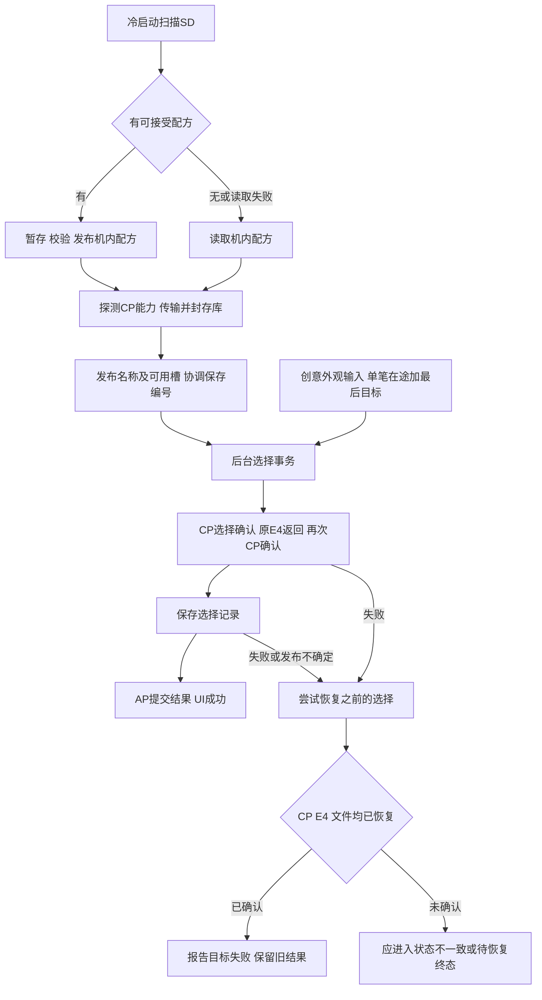

# 二十四槽统一创意外观稳定性审查

审查日期：2026-11-03。结论状态：分析完成，发现项尚未修复，整体仍为 `NOT_VERIFIED`。

当前设计已具备完整功能链的基础：统一创意外观入口、缺槽隐藏、单笔在途与最后目标合并、严格文件校验、不可变CP库，以及CP确认、原E4执行返回和选择保存共同约束成功。最需要补齐的是失败后的状态协调、启动恢复终态和24槽读取预算。继续增加功能或单纯延长等待时间不能解决这些缺口。

本次审查对象是独立24槽研究候选，AP `c4efcaa0ac1578a719f11f36d6a316c63ff1d76aa8fb145c78895005b723cda1`，CP `31f85fa3d3015d3d553abb6540a98ae67e280631c0bff73cd4eada7fe02db0b2`。它尚未生成DAT，不能用旧4.11包的验收代表本候选。13～24号合成测试配方只验证容量，尚不是十二款新增成品滤镜。

本次使用 `analysis-report` 组织链路与证据，使用 `ai-regression-testing` 选择故障场景，使用现有Python环境执行机器码回放。没有修改固件源、构建器、AP／CP或历史证据，没有连接相机或实体存储介质。

## 当前链路及必须保持的约束

最后一个分支是目前主要缺口：代码保留AP上次成功编号，但没有独立记录回退是否完整成功。机内配方发布、CP库发布和所选编号也不构成跨文件、跨处理器的同一提交。

保持已经确认的产品决策：冷启动导入SD、无卡读机内、休眠只读机内；不增加热导入菜单；原厂ST是退出自定义覆盖后的正常外观；快速拨动保留最后目标；空槽隐藏且不重排编号。

## 已取得执行证据的问题

以下P1表示进入稳定发布前应处理，P2表示随后补齐。编号表示槽位；CP值仅证明控制状态和发布视图，不证明传感器、ISP或画面已经完成切换。

### S01 P1 回退失败后AP与CP分离

复现步骤：成功应用13号，切换24号时注入前向E4超时，再丢弃回退到13号的CP报文。

| 状态 | AP已提交编号 | CP选中编号／视图 | 可见选择文件 |
|---|---:|---:|---:|
| 故障前 | 13 | 13 | 13 |
| 仅前向失败、回退可用的对照 | 13 | 13 | 13 |
| 前向失败且回退报文丢失 | 13 | 24 | 13 |

两种失败都只有命令状态3，父菜单仍依据AP的13号。当前实现没有把“目标失败且已恢复”与“目标失败且恢复未完成”区分出来。它没有错误报告成功，但继续把旧AP编号当作已知整体状态仍不足以闭环。

根因落点：[r5_filter_runtime423.c](../../.local/native24-runtime-20261103-05/work/import/r5_filter_runtime423.c) 第187～201行。回退是尽力执行，CP／E4任一步失败即停止，AP保留旧编号。

建议：新增明确的协调状态，分别记录目标、最后已确认结果、CP确认结果、E4见证和回退结果。回退未确认时界面显示需要恢复，阻止原厂调参在状态未知时提前写入。提供受控重新同步路径；只有退出覆盖、E4、保存均确认后才委派原厂ST。不能仅把AP编号改0或显示ST当作恢复成功。

证据：[回退可用对照](../../.local/native24-stability-audit-20261103-01/rollback-transport-control.json)、[回退丢包](../../.local/native24-stability-audit-20261103-01/rollback-transport-lost.json)。

### S02 P1 选择文件发布不确定且回退保存失败

复现步骤：13号成功后切24号；24号选择文件rename已成功，再注入目录同步失败；随后恢复13号时，再注入选择暂存文件创建失败。

结果为 **AP=13、CP=13、可见文件=24**，命令仍为3。用这份当前可见文件重新建立运行态，恢复结果为24号。这里没有模拟物理掉电，不能据此推导掉电后文件一定保留24号；能够确认的是正常可见文件已与失败后的AP／CP不一致。

根因落点：[r5_filter_selection423.c](../../.local/native24-runtime-20261103-05/work/import/r5_filter_selection423.c) 第62～63行，rename之后目录同步仍可能失败；上层把发布不确定与发布前失败统一为-1，且回退中的 `save(previous)` 返回值被忽略。

建议：保留“未发布／发布已确认／发布不确定”三种结果；发生不确定时重新读取并校验活动记录，协调CP和持久化结果。回退保存失败必须进入独立终态。后续可增加带提交代号与配方身份的双记录或日志方案，但需先验证目标文件系统的同步和恢复语义，保留旧记录读取兼容性。

证据：[发布不确定及干净重启](../../.local/native24-stability-audit-20261103-01/uncertain-selection-publication.json)。

### S03 P1 二十四槽继承的64次读取预算过紧

Fsys适配器每次最多请求1024字节，总调用预算仍为64。满24槽文件58976字节，在每次完整返回1024字节时需要59次调用，含EOF；余量只有5次。

本次注入每次成功返回512字节的合法短读：十二槽29552字节在59次调用后导入成功；二十四槽在64次、32768字节处耗尽预算，最终读取旧机内十二槽库。有效新文件没有被导入，且数据本身并未损坏。真实SD驱动是否出现这种分段尚未测量。

根因落点：[r5_fsys_adapter.c](../../.local/native24-runtime-20261103-05/work/import/r5_fsys_adapter.c) 第30～31、43～49行。扩容了文件容量，没有同步调整进度预算。

建议：按最大字节数、读取进展、截止时间和停滞次数共同约束；允许合法短读，保持超长、错误和无进展防护。保留失败读取旧库的保护，并向诊断暴露未导入原因，避免用户误以为新库已经加载。

证据：[十二槽对照](../../.local/native24-stability-audit-20261103-01/512-byte-short-reads-12.json)、[二十四槽拒绝](../../.local/native24-stability-audit-20261103-01/512-byte-short-reads-24.json)。

### S04 P2 自动恢复耗尽后缺少明确终态

已保存13号，在新运行态中持续拒绝E4外部完成。实际尝试恢复13号30次后，后续服务调用不再发起恢复，状态为 **AP=0、CP=0、文件=13、command=0、pending=1**。显式重新选择13号，在服务恢复后可以成功，因此并非永久卡死。

根因落点：[r5_filter_runtime423.c](../../.local/native24-runtime-20261103-05/work/import/r5_filter_runtime423.c) 第166～174、194～201行。自动恢复有有限重试，但只有显式请求设置失败终态。

建议：将配置已加载、正在恢复、恢复成功、恢复失败分开；以原生就绪事件和有限总体恢复窗口驱动重试，预算耗尽后给明确状态与手动重试入口。当前单次E4可等待5秒，30次尝试不等于30秒；同步原厂调用也不受轮询截止时间直接打断。不要仅继续加次数或延长超时。

证据：[自动恢复预算耗尽与手动恢复](../../.local/native24-stability-audit-20261103-01/implicit-restore-exhaustion.json)。

## 资源与长时间运行风险

### R01 CP库内存接近当前模拟预算

单库947000字节，在1 MiB模型中只余101576字节。真实共享堆、其他模块占用和碎片情况未知，这个模型不能当作实机总堆测量。

当前匹配库会复用，不因每次滤镜切换分配新库，这是应保留的设计。不同内容需要新库，旧库为保护读者不会被释放。[既有资源失败证据](verification/2026-11-03-01/tests/retained-bank-resource-rejection.json)覆盖CP保留旧库而AP重新建立运行态、SD配方改变的情形：新库被拒绝，旧CP视图保持；AP可用列表不发布。它证明没有破坏旧读者，同时暴露了新AP／机内新库／CP旧库之间尚缺统一恢复策略。不能把这一条件情形解释为每次整机冷启动都泄漏。

此外，[cp_stage413_probe.c](../../.local/native24-runtime-20261103-05/work/cp/cp_stage413_probe.c) 第29～40行将首次分配失败锁存，本CP生命周期内后续探测不再重新申请。是否需要对瞬时不足重试，应由实际启动资源时序决定。

建议先测实际可分配余量及峰值，再决定缩减重复数据或重构库寿命。任何Gamma去重都必须保持完整记录、原厂尾字段与对齐；旧读者仍可能持有指针时，不能原地覆盖或直接释放旧库。

### R02 原厂网格恢复缓存只有31种不同快照

本次执行真实CP恢复函数，31种不同快照可以保存，第32种返回空指针，旧快照仍可复用。这是已有显式资源保护，不是新发现的越界。控制器遇到恢复失败会禁用对应网格阶段，不能据此声称原厂色彩已经完整恢复。

尚未建立真实界面操作与这32种不同快照之间的映射，不能说“切换32次就必然失败”。风险在于不同源内容、强度和变换组合可能累积，界面应用成功门禁没有检查这一运行时消费诊断。

建议建立原厂ST／FL2／FL3、强度／模式切换的长序列，并观察恢复诊断。按真实可达键集合选择预计算、压缩或安全寿命管理方案；禁止覆盖已发布缓存指针。

证据：[缓存容量复现](../../.local/native24-stability-audit-20261103-01/native-restore-cache-capacity.json)。落点：[native_color.c](../../.local/native24-runtime-20261103-05/work/cp/native_color.c) 第110～155、191～199行。

### R03 代码与栈余量需要整体预算

CP当前7540字节，原接收器窗口剩28字节。后续修复可能触及容量门禁，应继续严格拒绝越界，不通过覆盖原厂数据或放宽窗口规避。

AP已知单帧为启动工作线程66160字节、保存函数65776字节、服务112字节；这条嵌套链仅这三层就约132048字节。线程配置262144字节，外部调用及其他栈帧尚未计入。现有“最大单帧小于100000”测试不足以证明整条调用链安全，也没有证据证明目前已发生溢出。

建议增加调用链栈预算和实际高水位／边界保护，把大暂存缓冲按单工作线程所有权复用。先保留行为和失败保护，再依据测量优化内存。

## 冷启动导入与保存的产品设计

这些是当前真实行为和优化建议，不能未经确认当成Bug直接改掉。

| 当前行为 | 风险或不便 | 建议 |
|---|---|---|
| SD与机内配方完全相同仍重写 | 增加启动I/O与发布失败机会；实际介质寿命影响未量化 | 两边均严格校验后比较，完全相同则跳过发布；旧文件坏时仍允许SD修复 |
| 零字节SD文件表示清空 | 复制中断留下0字节也可能清掉机内库 | 将零字节视为无效；清空改用可验证的显式空配置语义，并明确提示 |
| 选择记录保存槽号，不绑定配方身份 | 替换库后同编号可能变成另一配方 | 保存稳定配方标识或摘要；库未改变时保持原选择，库改变时按显式策略协调 |
| 双卡优先选择先满足就绪条件的有效文件 | 两卡放不同库时，导入来源可能受时序影响 | 定义稳定优先级和有限等待／回退规则，记录来源卡和库摘要 |
| 配方已落盘后才传输CP | 传输失败时“机内库已更新”和“当前CP仍旧库”可并存 | 区分机内已保存、CP已接受和当前已应用，记录上一套已知可用库 |

“相同文件重写”“零字节清空”“按槽恢复新配方”均已执行复现。[重复发布](../../.local/native24-stability-audit-20261103-01/unchanged-recipe-republication.json)、[零字节清空](../../.local/native24-stability-audit-20261103-01/zero-byte-sd-clears-library.json)、[13号从测试槽改为CLASSIC CHROME后仍自动恢复13号](../../.local/native24-stability-audit-20261103-01/saved-slot-new-recipe-identity.json)。缺失编号目前归0以解除覆盖，不能把这个数值自动等同于原厂ST属性已成功设置。

## 现有功能各自的验收边界

| 功能 | 当前有效证据 | 稳定发布仍需补齐 |
|---|---|---|
| 24槽、统一入口、缺槽隐藏、快切合并 | 当前机器码事务、43行菜单、实际Qt画面；旧证据18项及96帧 | 本次失败协调、真实原E4和成像完成 |
| ST及FL2／FL3往返 | 当前CPU路径和有限QEMU菜单 | 完整原厂调参、静态／视频／回放上下文、实际颜色恢复 |
| NTSC提示 | 指定分支的定向CPU证据 | 目标制式、语言、启动与设置变更场景的实际行为 |
| 电子快门声音 | 限定type1选择器和寄存器／原路径证据 | 实际声音、音量、相关静音／拍摄模式 |
| 照片2.35:1标记 | 登记、参数范围、菜单 | 取景画面的线条、横竖屏、LCD／EVF及不同拍摄模式 |
| Fn、R6 ST、白平衡默认调整 | 冻结上游／旧整合包对应路径及模板证据 | 新统一候选Fn全链路与完整封包、个人设置兼容；模板字段不等于实机迁移已验证 |
| 冷启动、无卡恢复、休眠复用 | 当前CPU及服务边界的启动回放 | 实体介质时序、完整电源事件、原生同步调用阻塞行为 |

QEMU既有96帧证明菜单显示和真实失败回退画面。该轮原E4仍受初始化模型缺口影响，不能当作24款成功成像。用户对旧实机E4正常的反馈与新候选验收分开。完整LCD／EVF／JPEG、实际资源、升级／掉电与恢复验证尚未进行；后续设备工作需要另行明确授权，本次不操作。

## 构建、诊断与交付优化

1. 将槽数、协议版本、文件容量和布局偏移集中定义，生成AP／CP共享头及构建期断言。原厂十二基底、75行Gamma和32条缓存是不同维度，不能一并替换成24。
2. 派生字符串替换应锁定匹配次数和输出结构；当前[derive.py](derive.py)第40～45行只检查存在。现有完整冻结源锁是有效保护，但不能替代派生规则本身的精确性。派生账本的前像含原冻结源身份，应明确它不是逐步连续的可逆补丁链。
3. 新构建应把编译器版本、命令、输入、派生源、AP／CP、两份图形资源和测试身份绑定到同一清单，减少依赖散落的`.local`前置目录。源码目前大量未纳入Git管理，稳定交付前需要形成可追踪版本；本次没有暂存或提交。
4. 诊断记录事务阶段、目标、旧编号、库摘要／代号、电源epoch、失败原因、回退结果及保存状态。正常工作避免依赖SD日志成功；限制日志容量和I/O，防止诊断阻塞应用。
5. 成功需区分控制面与成像面。离线可确认确切CP回执、原E4执行边界和文件一致；不能用截图标题、消息已提交或任意延时替代真实成像验收。
6. 发布包必须绑定同一候选的AP、CP、两份图形资源和配方兼容版本，独立解包比较。旧4.10／4.11封包与当前24槽组件不同，不能混用其签名或测试回执作为当前候选安装依据。

## 推荐实施顺序与闭环标准

| 阶段 | 目标 | 最小充分验收 |
|---|---|---|
| 1 | 修S01／S02失败协调与回退终态 | 前向失败、回退CP失败、E4失败、保存失败／发布不确定后，要么恢复已知一致状态，要么明确进入待恢复状态；不能继续宣称旧选择已确认 |
| 2 | 修S03短读预算及S04启动恢复终态 | 12／24槽、正常／分段／错误读取；自动恢复成功、耗尽与显式重试；保留坏文件回退 |
| 3 | 明确导入幂等、清空、库变更及双卡规则 | 相同库不重复发布；错误／空文件不误清空；新旧库与选择身份一致；导入来源确定 |
| 4 | 收敛CP库、恢复缓存、代码和栈预算 | 实测资源或明确安全预算；同库复用；新代不足的协调终态；原厂长期切换的缓存诊断；完整调用链边界 |
| 5 | 新候选集成与发布门禁 | 原E4／菜单生命周期、本地四项与原厂路径回归；后续获准的机身／介质／成像验收；最后独立封包核对 |

对每个中断点，检查“下一次启动如何恢复”而非只看当次返回码。测试重点是CP确认丢失、应用与回退双重失败、文件发布前后中断、电源epoch变化、库身份变化、原厂长序列和资源不足。按独立风险选择层级，不为追求数量重复相同测试。

闭环目标是：结果可确认；失败能区分已恢复与未恢复；重启能解释并恢复持久化状态；资源不足有确定行为；原厂功能保有可验证路径。它需要故障策略和对应证据，不能通过“所有正常路径能点通”或绝对稳定的承诺替代。

## 本次验证证据

新增10个独立审查场景：回退可用／丢包2项、发布不确定1项、相同库重复发布1项、零字节清空1项、库替换沿用槽号1项、缓存容量1项、自动恢复耗尽1项、512字节短读12／24槽2项。断言通过表示当前行为已被复现，**不表示缺陷已修复**。

- [汇总与组件摘要](../../.local/native24-stability-audit-20261103-01/results.json)
- [7项审查XML](../../.local/native24-stability-audit-20261103-01/audit.xml)，113.34秒。
- [启动首次XML](../../.local/native24-stability-audit-20261103-01/startup.xml)，自动恢复场景通过；两项短读首次夹具断言错误保留。
- [短读修正后XML](../../.local/native24-stability-audit-20261103-01/short-read-final.xml)，2项通过，13.72秒。
- [主要复现脚本](../../.local/native24-stability-audit-20261103-01/test_audit.py)、[启动及短读脚本](../../.local/native24-stability-audit-20261103-01/test_startup_audit.py)。

短读首次错误是验证代码比较了AArch64完整X0，而C函数返回值应取低32位；修正夹具比较后两项通过，固件没有修改。失败原始回执保留，未覆盖成成功记录。自动恢复测试函数在夹具修正时没有变化，其成功证据复用。

执行命令、边界和每个证据文件的大小／SHA均在汇总中。OS、目录锚定、Fsys、时钟、UI和原E4外部执行为明确夹具；使用真实候选AP／CP机器码，不提供ISP或掉电文件系统模型。当前AP／CP摘要复核与构建收据一致。
