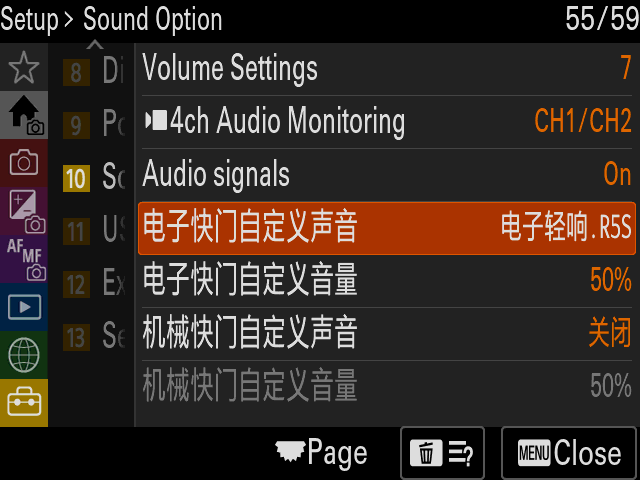
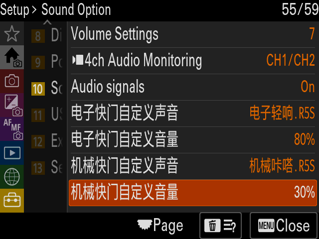

# 4.19 全功能修正版（2026-11-11）

本目录是原厂 4.00 基底的新 4.19 离线升级候选，包含十个模块、最新交互修复和机端目录 ABI 修复。原 `releases/4.19-full` 保留，未覆盖。两个包都叫 4.19，必须按目录与 SHA-256 区分。

- [BODYDATA.DAT](BODYDATA.DAT)：754525608 字节。
- SHA-256：`9b6919ce47c8224efd591945a88849832da0bae01ef4a74dfdbeb85f9675d5dc`。
- CRC32：`60737b7e`。
- [随包 R5NATIVE.BIN](R5NATIVE.BIN)：正式十二款配方，运行时容量 24 槽；现有合法外部 17／24 款库仍按冷启动导入逻辑使用。
- [总验证回执](verification.json)、[配置](config.json)、[构建锁](lock.json)、[文件校验表](SHA256SUMS)、[复现说明](实施与复验.md)。

## 功能与本次变化

保留全部十个模块：24 槽自定义滤镜、FL2／FL3、C1–C6、十档画幅、照片构图标记、机械／电子双组自定义快门声、镜头 AF 能力过滤、NTSC 提示、R6 ST、AWB 模板。电子前帘与机械快门共用声音组。

本次封入：

1. 滤镜恢复预算耗尽后，同组中键可请求后台恢复，再处理最后目标；保留原生 E4 在途及库状态保护。
2. 画幅启动临时读取失败后限次补读，用户显式选择优先。
3. 画幅确认后后台保存，保存／读取失败有原生菜单提示，重试成功后自动恢复原标题。
4. 修正画幅配置读取和保存的 AArch64 目录打开标志；目标文件服务夹具也核对 ABI，避免宿主平台的标志假设漏测。

`look24` 修订 2，`photo-aspect-ratios` 修订 5。原版十二款成像逻辑、配方、八项相对偏移与配方身份保存规则保持。CP、AVCAM、MPR 和 WBI 与原封存全功能包一致，原厂外观和 FL2／FL3 的参数路线保持。

## 本轮验证

- 最终包相关回归 **116 项通过**，无当前必验跳过。覆盖画幅模块、目标 ABI、冷启动恢复、异步保存、取消、横竖屏和按键、滤镜重试、CP 页表与声音页保护、模板及 AP 共存。
- 新 ABI 用例在修复前稳定失败，修复后通过。首个候选未作为交付包，相关失败证据保留。
- 从原厂重新构建并独立重建复验；再用冻结的另一份解包入口独立解包。736841 帧、147 个成员、USR 文件系统、研究签名及 OpenSSL 验证通过。
- WBI 首 512 字节为零，尾部和长度保持原厂，CRC32 `dfa823fc` 匹配分区清单。
- 最终包实际 AP／CP 的 QEMU 正常初始化通过，54 次真实 Qt 操作完成，53 张客体原帧与 PNG 逐像素一致。双组声音设置／保存和四轮 MENU 开关通过，QEMU 与 CP 侧车均正常退出。
- 69 份原全功能发布文件的摘要保持。未连接相机。

没有把前一轮 239 次组件测试叠加为本轮的新测试数量。首次候选的普通和隔离初始化均因画幅配置错误进入失败恢复，再向未提供服务的原生消息入口发起请求而停止；旧包对照通过。修正目录 ABI 后，使用相同 QEMU 流程正常通过，没有添加硬件完成替身或补写成功位。证据见 `audit/`。

## 必须区分的边界

**原厂更新器的 NOR 擦写错误漏报尚未修复。** 本包沿用原厂更新器，不能把封包验签和 eMMC 分区 CRC 当作物理 NOR 写入成功证明。[离线启动审计](../../specs/4.19-boot-audit/分析报告.md)中指出的独立模块 WBI 策略缺口也未改动，但本全功能包已使 WBI 首扇区失效，不受该单选策略影响。

本包完成离线封包及菜单验证，没有实机升级或启动验收。QEMU 原生 E4 `0x2040` 完成、ISP 成片、扬声器、真实断电恢复、物理横竖输入和动态 AF／MF 坐标仍受既有验证边界限制。这里的声音安装是音频服务替身的结果。签名沿用研究身份，不是索尼官方签名。

## 当前包截图

以下来自本包实际 AP／CP 的正常初始化会话，原始 `.bin` 与元数据一并保留：

