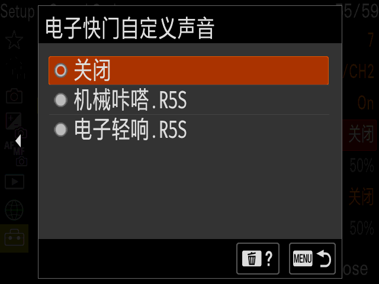
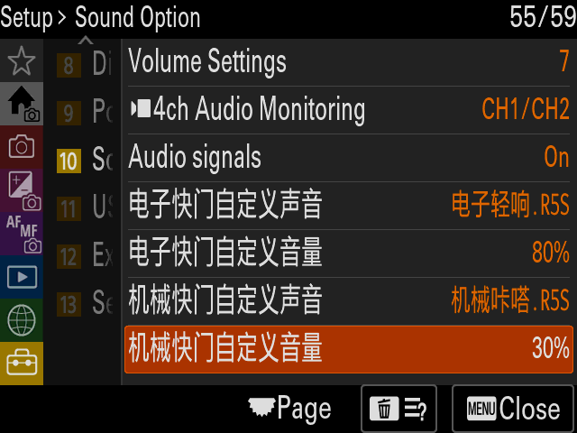
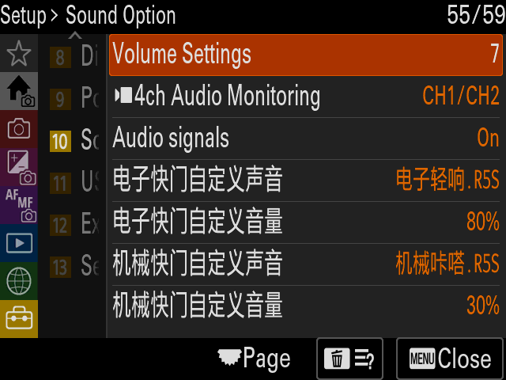

# 4.19 全功能修正版（2026-11-12）

基于 ILCE-7RM5 原厂 4.00，从完整冻结快照正常重建。包含十个模块、本轮 CP 暂存资源修复、FL2／FL3 机内 RAW 备选目录和最终包资源检查。历史 `4.19-full`、`4.19-full-repaired-20261111` 保留；同名版本必须按摘要区分。

- [BODYDATA.DAT](BODYDATA.DAT)：754525608 字节。
- SHA-256：`d486853533711a282c5e0794f6e98931608c1d2c581e3b25cd70da8b48ce5503`。
- CRC32：`6fdd9a05`。
- [R5NATIVE.BIN](R5NATIVE.BIN)：随包正式十二款配方，运行时容量为 24 槽。
- [配置](config.json)、[构建锁](lock.json)、[总验证回执](verification.json)、[校验表](SHA256SUMS)、[完整复现步骤](实施与复验.md)。

## 本次封入的内容

保留十个模块：24 槽自定义滤镜、FL2／FL3、C1–C6、镜头 AF 能力过滤、十档画幅、照片构图标记、双组自定义快门声、NTSC 提示、R6 ST 和 AWB。电子前帘与机械组共用声音设置。两组滤镜记忆、浏览预览、八项相对偏移与配方身份保存沿用当前逻辑。

本次 `look24` 为修订 3，修复失败导入、取消导入并返回原库时遗弃未发布暂存区的问题；只复用未发布缓冲，保留不可变已发布库及 16 代上限。FL2／FL3 为修订 2，RAW 备选目录由十项扩为十二项，保留原十项及 R5 原生构造器，新增两项使用已有 FL2／FL3 参数路由和正确 Gamma。未改变原十二款 SD 配方成像算法。[源码实施记录](../../specs/longrun-resources-raw/实施与验证.md)

相对 2026-11-11 的 `9b6919ce…` 包，归档只改变 CP 分区与 `part_image.sum`。AP、AVCAM、MPR、画幅资源、模板、配方及 WBI 均保持。

## 离线验证

- 完整冻结清单 331 项、源码锁 188 项通过，未修改清单或降低校验。构建锁记录 197 项构建来源。
- 从原厂正常构建、独立重建复验和另一冻结解包入口通过。736841 帧、147 个归档成员、USR 文件系统、研究签名及 OpenSSL 验签均通过。
- 最终包回归 **174 项**、色彩共存对照 **6 项**通过，共 180 项，无失败、无跳过。恢复清单扩展后又单独复验其 5 项，不重复累加测试数。
- 原厂 4.00 上的 `look24` 单项组件也正常构建，四个固定目标摘要全部匹配。
- 最终 USR 的 68 份横竖文字、两份图标银行及 7202 个图标载荷通过资源门禁；包括独立 4 KiB 分块和编号检查。
- WBI 首 512 字节全零，长度与后续内容保持原厂，CRC32 为 `dfa823fc`，与分区校验清单一致。
- 两个 QEMU 会话正常通过，共 **86 次 Qt 操作、86 张原帧**，帧数含两张基线。原容器 SHA／FNV 与 PNG 逐像素一致；无卡新客体恢复机械 30%、电子 80% 的双组设置。两轮 QEMU 和 CP 侧车均正常退出。

证据保存在 `audit/` 与 `qemu/`。首轮未绑定恢复文件的客体被清单保护拒绝；随后用包含同一导出配置的新客体复验通过。混合目录测试的局部回执范围问题已修复并保留失败前像，没有修改固件来掩盖测试失败。

## 当前包截图

图片来自本包实际 AP／CP 的正常初始化会话，原始 `.bin` 与元数据随本地交付保留。

## 验证边界

本轮未连接相机，未写卡或分区。没有实体机启动、真实 ARW／Imaging Edge 重选导出、ISP 成片或扬声器验收。QEMU 的音频服务使用明确替身，原生 E4／完整硬件模拟的既有边界保持。

沿用已有研究签名身份，不是索尼官方签名。原厂 NOR 擦写错误漏报尚未修复，不能用离线验签代替物理写入成功证明。包头 4.19 不代表机身允许同版本更新；本轮没有改变版本准入或更新器信任策略。
