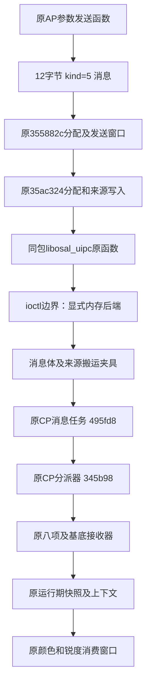

# 第十四批：AP/CP消息与参数银行、JPEG资源寿命

- Feature ID: `001-fixed-custom-filters`
- Updated: `2026-10-26`
- Status: `OFFLINE_NATIVE_MESSAGE_CHAIN_VERIFIED_NOT_INSTALLABLE`

## 已实现与仍未实现

新增同包原AP消息、OSAL库、原CP消息任务/分派器到原参数快照及颜色/锐度消费的离线联验；新增参数银行发布和最后JPEG请求退役执行器。相比第十三批，已跨过“直接把参数塞进CP接收器”的边界，实际执行原消息封装、来源写入、ioctl封装及原CP任务/表查找。

内核ioctl、消息搬运、互斥与驱动结果是显式隔离后端。没有实际物理IPC、原厂完整请求包装器、机内菜单或相机运行结果，没有安装CP挂钩。相机EVF流身份和整帧最后引用仍未证明，整套状态保持`NOT_VERIFIED`。

正式结果：[完整审计](../../../.local/fixed-custom-filters/cp-ui-access-406-14-final.json)、[命令及源码指纹](../../../.local/fixed-custom-filters/audit-command-14-final.json)。额外[静态窗口](../../../.local/fixed-custom-filters/comm-frame-static-14.json)只作候选入口，不当作已执行的帧释放。

## 原消息通路

两端使用相同目标队列`0x90030001`；AP来源为`0x80020002`。AP基底发送函数`0x35614b4`调用原转换`0x3550354`，八项发送器沿用`investigate.PARAMETERS`中的地址。原消息为12字节：`+0`为5，`+2`为16位命令ID，`+4`透传原输入首字，`+8`含参数值；本批用`0x11223344`作首字夹具，未认定它的业务含义，不能擅自改作新协议版本号。

| 原入口 | 已执行内容 | 未执行边界 |
|---|---|---|
| 八项发送器及`0x35614b4` | 原指令打包，FL2转换为CP 19；对比度/高光/阴影等负值字节保持 | 输入记录是夹具，未由真实AP工作槽事件发起 |
| `0x35589a4..0x35589dc`、`0x35ac324` | 原请求包装器内实际分配/发送窗口及分配助手 | 未执行整个`0x355882c`的future对象、外层锁和回执处理 |
| `libosal_uipc.so` | 原`osal_valloc_msg_wait`、`osal_set_msg_src`、`osal_snd_msg`及`u_osal_*` ioctl封装 | 虚拟fd=37；分配/发送ioctl只读写隔离内存，不调用宿主或相机 |
| AP来源写入`0x7e20`、CP读取`0xbaaaa6` | 两者实际访问消息指针`-0xc`的32位来源字段 | 不推断其他内核消息头字段格式 |
| CP任务`0x495fd8`中的`0x496018..0x49606e` | 原来源读取、消息类别选择、0x24互斥及参数分派 | 接收等待、任务无限循环和`0x53c31c`消息释放未执行 |
| CP分派器`0x345b98` | 原表`0x10ff5f4`的333项查找、原接收器及额外标记 | 未分配任何新命令或扩展消息类别 |

同包库`/lib/libosal_uipc.so`为43752字节，SHA-256 `09ebf5980237fc473077dc844763dcb00cba423f431646e3be7c0ca49ea70ff3`。从同一已验签DAT只读获取，单列辅助组件身份，不改原71项目标基线。执行前同时核对AP、CP及此库摘要。

CP表本身有原写入操作。`enable_initialized_data`先核对本包数据段描述符`(0xf57000,0x117f5c,0x107f000)`，仅把匿名映像中显式指定、完全位于初始化数据段的整页改为RW并去掉执行权限。本批只开放`0x10ff000..0x1101000`；CP代码仍不能写，真实文件和机身权限均未修改。测试覆盖非法范围、重叠、预算、坏描述符和数据页执行拒绝。

## 三个不能省略的接入条件

**逐条消息不是整预设原子提交。** 本批从原AP发送基底及八项共9条消息。基底及对比度到达后，执行原运行快照，得到`[-3,0,0,0,0,0,3,0]`；全部发送后才得到`[-3,4,-5,2,6,7,4,8]`。这是实际原指令的交错窗口，不是已观察到的设备竞态。仅按顺序发送九条原命令无法保证任一帧都使用整套新值。

**字段写入还伴随分派副作用。** 原分派器在高光、阴影、褪色消息后经`0x969df8`把`0x19c999d`置1，其他本批参数未触发这一标记。标记的后续消费语义尚未穷尽，不能只覆盖`0xe70`前缀而绕过它。第十三批纯参数适配器仍只证明字节编码，不等于已完成全部更新调度。

**发送结果不能当成应用回执。** 原OSAL窗口正确保留注入的发送错误−7；原参数发送器在下层错误注入后仍把输出状态写0。失败消息由离线驱动拒绝搬给CP，不能说CP或硬件报告了失败。新界面必须分别处理保存回读、消息发送和对应版本成像生效。

消息类型2会进入另一路`0x49826c`；未知`0x4167`触达原错误日志边界。本批在这些入口前停止，参数状态保持；没有冒充任务完成/清理或把未知ID当作自定义通道。

## 参数银行如何进入操作上下文

本批执行原`0x4be0ca..0x4be120`及`0x4be158..0x4be196`。它们根据消费者是否待处理，分别更新操作上下文`0x165d758`及master根`0x164eef0`中的派生参数指针。

| 内容 | 原getter与银行 | 待处理位 | 发布落点 |
|---|---|---|---|
| 颜色参数 | `0x7195b0`，`0x1efb7d0 + index*0x19d8` | 掩码`0x8` | 根`+0x4b34`、上下文`+0x44`；派生`+0x74/+0xa0` |
| 锐度参数 | `0x9075ac`，`0x1f52cf8 + index*0x1270` | 掩码`0x40` | 根`+0x4b3c`、上下文`+0x4c`；派生`+0x7c/+0xb8` |

两种银行索引、掩码0/8/64/72共8组通过。某消费者待处理时保留旧指针，另一已完成消费者可更新到其当前银行；没有“这些银行属于同一滤镜版本”的原生校验。旧指针与待处理状态为显式夹具，未运行并发工作线程。

因此，仅把输入9字段合成一条消息仍不足以完成新滤镜接入：还需证明各参数消费者的成功、对应输出银行版本、统一发布点及银行最后使用者。完成标记可能由队列拒绝清零，原getter的当前索引也不等于版本确认。这里没有识别`0x165d758`究竟对应EVF、照片还是多模式操作上下文。

## 取景与照片资源身份

原RTTI、虚表及全局阶段对象建立了以下对应：

| 原类型/对象 | 原执行入口 | 本批证据 |
|---|---|---|
| `ScalarInfraSequenceLiveViewStageAutoexec_jpeg`，`0x1183e94` | `0x581ae8` | 原类型、虚表与对象指针静态绑定 |
| `...jpeg_ack`，`0x1183e98` | `0xbe8dc8` | 同上 |
| `...jpeg_comp`，`0x1183e9c` | `0xbe8de2` | 同上 |
| `...wait`，`0x1183ea0` | `0x581f0c` | 同上 |
| `Camera::Capture::CapRsrc_JPG`，虚表`0xe40794` | 最后请求方法`0x4665ac` | 原虚表调用及请求退役执行 |

不能把带LiveView名字的ScalarInfra JPEG通路直接称为相机EVF；其真实输入、输出到显示/远程通路的路由尚未证明。照片侧的`Sequence_Capture_ENC_ENC`、`DEVEXIT_EXPORT_JPG`及编码函数有原窗口，但与全部捕获状态和参数版本尚未完整串联。

## 最后JPEG请求仍不等于最后帧引用

原`0xae2afa`在请求计数`resource+0x28=1`时，通过实际照片资源虚表调用`0x4665ac`。后者依次调用`0x506dec`、`0x507074`、`0x50689c`；本批只在这三个驱动入口提供明确的0/−7返回夹具，未运行硬件服务。

| 场景 | 原指令执行结果 |
|---|---|
| 三步成功、节点仍持有 | 请求计数1→0，资源身份17→−1，节点在用位清零；独立持有计数`+0x6c=1`保持，不归还资源池 |
| 三步成功、节点不再持有 | 请求1→0；原节点摘链、活动计数递减和节点池回收通过，再独立执行原资源归还`0xae3f6a` |
| 第一步失败 | 后两步不调用；请求/身份/节点/持有引用保持，原错误传播 |
| 第二步失败 | 第三步不调用；同上 |
| 第三步失败 | 不进入成功退役；同上 |

成功后原资源池reset虚调用是`0xae2d1e`的`bx lr`，没有帧析构动作。因此，资源池归还并不证明像素缓冲、参数银行或其他输出的最后引用已释放。

另发现`0xae416a/0xae4170`建立/清理成对的调用者与资源字段，后者调用`0x462734`；该函数会分别检查节点的使用位`+0xc`和持有位`+0xd`，再进入请求退役`0xae2afa`与持有退役`0xae2bda`。这些后续释放链本批保留静态窗口，未完整执行。`0x47ff64`之后的多资源清理是下一步具体入口，不能先把某一条返回绑定到`af_versions_release`。

## 实际实施清单及剩余门槛

| 落点 | 本批完成 | 仍需完成 |
|---|---|---|
| `ap_cp_messages.py` | 原封装/来源/OSAL ioctl/CP任务分派→快照→原颜色/锐度窗口 | 实际AP工作槽事件接入、完整请求包装器/回复、物理IPC及会话握手 |
| `cp_machine.py` | 锁定数据页RW/NX及阻塞互斥模型，未获锁停机 | 实际RTOS/跨核同步和资源预算 |
| `cp_frame_stages.py` | 类型/阶段定位，银行独立发布、最后JPEG请求与两类计数 | EVF与拍照流实际身份、全部输出消费者/持有退役和真正最后帧释放 |
| 纯参数成像切换 | 九字段传输及快照消费已联验 | 整预设原子切换、额外标记消费、每个消费者的版本成功与统一发布；当前不安装挂钩 |
| LUT拟合 | 原生解析/求值及完整载荷容器保持 | 各基底ISP模型/色域、原生色表量化、独立误差计算；尚未实现 |
| 菜单闭环 | 固定列表、原生保存/另存/清空核心保持 | 实际机内路径、SD浏览/候选预览/取消、动态名称、两类回执及完整4.06页面 |

本批没有新增未经证明的消息类别、地址、LUT schema或可写存储位置。新增CP宏观版本协议必须同时解决输入原子性、输出银行一致性和最后引用，不能靠额外一次“刷新”完成。

## 验证

- `pytest-14-final.json`：149项通过，6.37秒；新增数据段权限/阻塞锁、库身份及消息长度拒绝，原C保存/两种目标ISA闭环保持。
- `audit-command-14-final.json`：46.649秒；指定修改4.06重新验签、736841帧、147归档成员、71目标及同包库/103资源通过；原24 AP分支、1218刷新查询、864快照消费保持，新增消息与资源执行通过。
- 原生C、原AP挂钩及研究ELF逐字节未改，复用第十三批2万次ASan/UBSan证据，不重复运行未变代码。
- 最终源码、文档、产物、输入及证据复用检查见`verification-continuation-14.json`。未修改DAT，未操作相机，未生成可安装固件。
