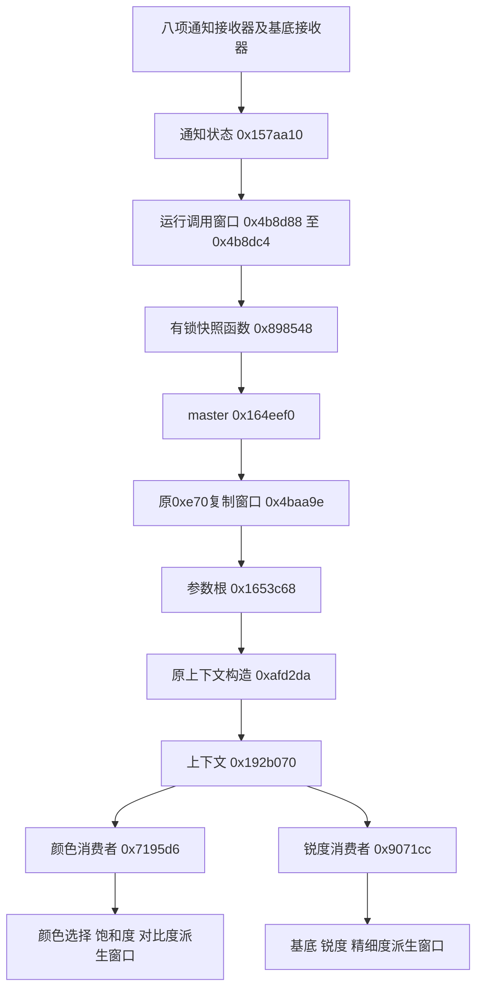

# 第十三批：CP实时参数与照片链路接入证据

- Feature ID: `001-fixed-custom-filters`
- Updated: `2026-10-26`
- Status: `OFFLINE_PARAMETER_ADAPTER_VERIFIED_NOT_INSTALLABLE`

## 本批结果与边界

已找到并执行运行期有锁参数快照，补齐颜色/锐度消费者、任务完成、队列拒绝、JPEG回调及部分资源退役证据。新增纯参数C适配器，将12种原厂基底及八项用户参数编码到4.06参数前缀；在ARMv7执行适配器，再执行同包原CP的上下文、颜色与锐度窗口。没有安装AP→CP传输或CP挂钩，不能宣称取景/JPG已采用新槽位，更没有生成可安装固件。

所有执行均基于指定修改版4.06。输入DAT SHA-256为`3cb87fd41de7bf6693375bac66d780556d87e1f73270cadb1a8f02eb8c0f24c2`；AP为`d15933ceb5ff9ad0b4f789cbabd6ff0a51526472dd35c90db97196dd227820e9`；CP为`18b265c589eb4201d3b3680857d897b693d06c6dd491d795dbb3a616d6182e97`，CP平坦映射起点`0x108000`。未修改这些文件，未操作相机、USB、SSH、真实SD或私钥。

正式证据为[同包完整审计](../../../.local/fixed-custom-filters/cp-ui-access-406-13-final.json)。`native_paths.cp_realtime`记录原指令执行，`target_cp406_parameters`记录新C适配器与原AP/CP联验。额外[字段候选窗口](../../../.local/fixed-custom-filters/cp-static-13.json)仅作后续检索线索，不充当成像结果。

## 实时更新链

图中是已执行的数据窗口；外层调度、完整算法和像素输出没有执行。相较此前只找到的启动复制`0xafcb5c`，新入口`0x898548`确实在运行函数的调用窗口被执行，但尚未证明完整调度器在所有取景/拍摄模式的调用时序。

`0x898548`先获取信号量`0x24`，复制`0xdbc`字节，处理一处待转移记录，再释放锁。执行中使用原ARM `memcpy 0x5f51bc`；互斥服务`0x5b8f58/0x5b8910`使用明确的持有/拒绝模型，未执行原RTOS。三组合法参数及CP基底3、19、20通过完整字段、旧快照保持和复制保护区验证。

**锁拒绝时原函数仍可能返回0，但目标未更新。** 新协议不能直接把这个返回值转为`af_versions_finish(...,1)`。字段回读可以证明特定前缀相符；仍缺版本身份、完整消费和帧引用证明。

## 八项字段及下游证据

顺序沿用当前`AfPreset.params`。表中“复制通过”指接收→master→快照，不等于最终算法或像素验证。

| 参数 | UI属性ID | CP通知ID | CP接收函数 | 相对参数根偏移 | 本批下游证据 |
|---|---|---|---|---|---|
| 对比度 | `0x1670` | `0x4030` | `0x33f600` | `0xa44` | 复制通过；原`0x241278`写颜色派生字段`+0x33` |
| 高光 | `0x1682` | `0x40f3` | `0x33f6e4` | `0xa46` | 复制通过；后段完整运算/图像效果未证明 |
| 阴影 | `0x1694` | `0x40f4` | `0x33f730` | `0xa45` | 复制通过；后段完整运算/图像效果未证明 |
| 褪色 | `0x16a6` | `0x40f5` | `0x33f778` | `0xa47` | 复制通过；后段完整运算/图像效果未证明 |
| 饱和度 | `0x16b8` | `0x4031` | `0x33f64c` | `0xa48` | 复制通过；原`0x241260`写颜色派生字段`+0x30` |
| 锐度 | `0x16ca` | `0x4032` | `0x33f698` | `0xd2e` | 复制通过；原`0x905436`写锐度派生字段`+0x24` |
| 精细度 | `0x16dc` | `0x40f6` | `0x33f7c0` | `0xd2f` | 复制通过；原`0x90543e`写锐度派生字段`+0x25` |
| 清晰度 | `0x16ee` | `0x40f7` | `0x33f80c` | `0xd30` | 复制通过；后段完整运算/图像效果未证明 |

`0x314cbc..0x314cd8`也读取对比度/阴影/高光/褪色，但目前仅保留静态窗口。`0x71aa52`读取清晰度时基址是`0x16afd14`，另一类访问器使用`0x1f18320/0x1f12bb0`；这些基址与当前帧参数根的更新关系未证明，不能因偏移相同就拼成成像链。原`0xd0f3bc`表仍把`0x16afd14`列为独立`0x02a40000`记录。

两套操作上下文的选择函数`0xafc7d4`在输入0时返回`0x165d758`，非零时返回`0x165d820`。输入0、1、2均已执行；这些上下文的取景/照片/JPG语义仍未确定。

## 原厂基底编码与新C适配器

同包AP函数`0x3550354`及表`0x4b724d0`给出以下编码。不能把UI基底号直接传给CP，也不能沿用当前六款滤镜的249～254标记来表示20个新槽。

| UI基底选择值 | CP值 |
|---|---|
| 0 / 1 / 2 / 3 / 4 / 5 | 0 / 3 / 2 / 1 / 16 / 15 |
| 6 / 7 / 8 / 9 | 17 / 18 / 5 / 13 |
| 17（FL2）/ 18（FL3） | 19 / 20 |

新增[`af_cp406.c`](../../custom-filters/native/af_cp406.c)和[头文件](../../custom-filters/native/af_cp406.h)：

- `af_cp406_overlay`复制当前帧`0xe70`字节前缀，仅替换基底小端32位及八字段；源/目标须独立，调用方保证源稳定及生命周期。非法参数、短缓冲、溢出、重叠和LUT拒绝后不写输出。
- `af_cp406_matches`只返回字段是否相符，不能当应用或帧完成确认。
- 不写固定CP全局地址，不申请新IPC身份，不改现有六款或FL2/FL3代码，不提供固件安装入口。

`target_cp406.py`先核对AP/CP完整摘要，在隔离CP内映射无重定位、只读/可执行的ARMv7研究ELF。12基底由原AP计算参考值，新C实际执行编码，原CP构造上下文并执行颜色/锐度消费窗口；LUT拒绝也在目标CPU执行。深层帧/校准字段是显式零夹具，不冒充真实帧。研究ELF 66996字节，SHA-256为`ffaddb4ce265ae9acdf5abf5dd7b14397f3c53c8855b09e882778cc283cde7b2`。

20槽原生UI→参数编辑→保存→目录重建→参数前缀适配，分别在AArch64和ARMv7实际机器码中通过；最终前缀SHA与独立Python构造相同。这里的保存后端是内存，不是实际AP/CP传输或机内文件系统。

## 消费者、完成标记和引用风险

原`0xafd2da`构造`0xc4`字节上下文，包含许多参数根/深层元数据指针，构造时还读取根`+0x4b2c`等字段。**`0xe70`参数前缀不是完整根，也不能拿它独立构造真实帧上下文。** 原复制至`0x15787e4`、`0x157ce28`、颜色`0x1214e98`和锐度`0x157c278`的窗口均保留第一层根指针；属于浅复制。

已实际复现：保持锐度消费者的`0xc4`字节完全不变，沿原更新路径将共享根锐度/精细度改为9/5后，旧消费者再读时也读到9/5。没有运行并发任务，因此这是数据借用反例，不是已观察到的真实竞态；它足以否定“复制上下文就锁定参数版本”的方案。

完成路径为`任务尾部 → 0x60daa4 → 0x4bf3e0`。后者仅经`dmb sy`清零`0x192b030[index]`，合法身份0～12均验证，身份13在原日志入口前停止且不改标记。`0x4bdf54`汇总13项；输入模式1还保留旧掩码的位2，这一特殊语义已验证。

颜色/锐度队列入口为`0x4e8a90`，工作入口分别`0x71965b/0x907251`。显式注入队列返回0后，原拒绝分支也调用完成回调、清零标记，工作函数完全未运行。另已执行两种缓冲索引的工作函数尾部，确认翻转后再回调；函数主体仍未执行。因此不能凭标记为0断言应用成功或释放版本银行。

## JPG结束与资源退役

| 位置 | 已验证事实 | 不能推断 |
|---|---|---|
| `0x4831b4`，字符串`EncCallbackEnd_JPG`在`0x4831f4` | 回调把两个输入状态字存到用户记录`+4/+8`；准备事件ID`0x2f`与记录掩码 | 没有观察硬件回调；状态字含义未穷尽；事件置位不是整帧释放 |
| `0x472f22/0x472f68 → 0x466174` | 外层可准备两个JPEG请求、两份回调记录；后续驱动入口为`0x506914` | 一个回调不代表两个请求均结束或JPG已写盘 |
| `0x473048/0x473072 → 0x462110 → 0xae2afa` | 显式夹具中计数2→1、输出ready=1、节点在用位清零、资源身份保留 | ready=1时仍可能有其他请求；不是最后释放 |
| `0x473062/0x473092 → 0xae3f6a`，池更新窗口`0xae3fd4..0xae3fe0` | 原链表头/next/计数更新通过 | 未执行虚表等待、池锁或完整归还；编码器资源未证明是整帧所有者 |

后续仍需串起最后一次JPEG请求、失败/取消/超时、缩略图/其他输出、文件完成/索引和帧所有者释放。原先的`RecordStill`返回和文件完成事件也不能单独作为这一证据。

## 剩余实际改动与放行条件

| 实际改动 | 当前可复用部分 | 接入前必须补齐 |
|---|---|---|
| AP用户槽工作值→CP | `af_ui/af_slots`及纯参数适配 | 合法IPC身份、会话/版本握手、线程及调度点；不得写`0x690`或复用旧六标记凑20槽 |
| 帧参数冻结 | `af_versions`不可变预设/引用；本批浅复制反例 | 找到每个帧所有者和全部借用者；稳定捕获动态帧字段；不能只为每个预设银行复制一份含不同帧状态的根 |
| CP应用回执 | 精确字段匹配、原颜色/锐度派生验证 | 对应版本身份、全部必要消费者成功及回滚；拒绝/超时不能转为成功 |
| 参数银行释放 | JPEG回调、计数与归还窗口 | 取景/拍照/JPG与其他输出的最后使用证据，以及取消/失败路径；标记清零、ready、单个回调均不满足 |
| 高光/阴影/褪色/清晰度成像 | 接收/复制字段和后段候选地址 | 沿同一帧根证明算法输入及下游；补齐色调/清晰度与LUT先后顺序 |
| LUT转换和原生输出 | `af_cube`解析/求值，`af_document`完整字节容器 | 各基底ISP模型/域、实际色表/曲线/矩阵格式、整数模型、量化与独立误差测量；`kind=1`在新CP适配器继续拒绝 |
| 菜单完整闭环 | 固定列表、编辑/保存/另存/清空核心 | SD浏览/读取、候选预览取消、两个独立回执、动态名称与原厂页面生命周期；转换或应用未成功时不能显示可用 |

当前六款色表的冻结实现`cp_runtime.py`使用每表1215字节、六表FNV头和已有data/BSS间隙，且含ST归一化与照片条件。只把“6”改为“20”既超出既有空隙，也无法提供独立基底/帧版本。20表字节本身为24300，不含其他状态；不能认定CP有这么多可用连续RAM。活动版本与帧上下文的空间需分别测量，不从文件预算倒推出机身容量。

机内保存位置与32槽完整画面的限制沿用[persistence.md](persistence.md)和[ui-access.md](ui-access.md)：未选定机内存储区，现QEMU默认仍4.00且固定CPIO/DTB缺失。没有改标客体或模拟安装成功。

## 验证与复算

- [pytest回执](../../../.local/fixed-custom-filters/pytest-13-final.json)：143项通过，2.16秒；包含实际C编译、两种目标ISA的20槽闭环、适配错误边界及CP执行器隔离测试。
- [消毒器回执](../../../.local/fixed-custom-filters/native-sanitizer-13-final.json)：ASan+UBSan下20000次输入/状态/记录/UI/文档/CP前缀探测与20槽保存/版本/参数闭环通过。
- [完整审计命令回执](../../../.local/fixed-custom-filters/audit-command-13-final.json)：43.529秒，重新验签、736841帧、147归档成员、71目标及同包资源；原24处AP分支、1218刷新查询、864快照消费及资源加载保持。CP扫描13个直接调用、595个立即数候选，保留152个有界窗口；静态候选仍不等于可达性证明。
- 最终指纹、链接检查及旧批次未修改代码核对见`verification-continuation-13.json`。整套状态保持`NOT_VERIFIED`。

构建与实际审计复算命令见[第十三批交付](continuation-13.md)。重跑应使用新输出路径，不覆盖已有回执。新研究ELF仅供离线执行，不可安装到机身。

第十四批继续补齐原AP/OSAL/CP消息、独立参数银行发布、照片资源类型与最后JPEG请求/持有关系，见[消息及帧接入证据](communication-frame-access.md)。实际物理通信、EVF与拍照流身份及最后整帧释放仍未闭环。
