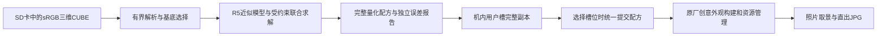

# A7R5 与 A7C2 参考实现综合分析和当前项目复用清单

日期：2026-10-31。本文是实现方案分析，不变更需求、任务完成状态、程序或固件。基线仍为用户现有修改版4.06，不操作相机，不恢复硬件模拟。

随后按用户授权的实际实现与验证见[参考转换和导入实施](integration-37-reference-import.md)。本文保留方案背景，不作为最新完成状态。

## 结论

采用“R5 原生颜色算法及本机型数据为主，A7C2 拟合方法为辅，当前项目承担机内转换、32槽界面和存储”的组合。已有解析器、记录格式、菜单、文件事务和原厂八项参数路由继续使用。

两参考项目都具备实际算法，当前缺口不能归结为“对方没有转换模型”。R5 的训练源已迁到独立 ColorLab；其中网格响应也已从早期 A7C2 代理换为 R5 实拍模型。不过，两套参考模型的适用域、基底和自由度不同，不能直接把数值拼接成当前4.06已验证的完整预测器。

现有资料足以继续实现并验证一个明确标注条件的离线近似后端，以及机内求解器移植；不必先恢复整个 ISP，也不必把用户新增照片作为全部工作的前置条件。它与“当前4.06取景和JPG误差已经验证”是两个验收结果。真实消息、配方发布和原消费者接入也必须独立完成。

## 参考版本和能力分工

| 来源 | 本次分析版本 | 提取用途 |
|---|---|---|
| [A7C2 研究项目](https://github.com/QAQLeonard/a7c2-fl23-research/tree/ef7db116e13e37be91e9af20360dc9bba8d64a9b) | `ef7db116…` | 低维联合拟合、零增量校正、颜色分组留出、量化后评估、原生记录语义 |
| [R5 ColorLab](https://github.com/Hearts-Ace/sony-r5-colorlab/tree/8bd8564f8f63ad04c25f87c08fa849498a5e31a2) | `8bd8564f…` | R5 颜色子链、构表、成对网格响应、训练策略和格式对照 |
| [R5 固件接入源码](https://github.com/Hearts-Ace/sony-a7r5-custom-firmware/blob/bf71d789262d53ff5fcd23d87aea5bdc07a46f19/firmware/r5/src/cp/native_color.c) | `bf71d789…` 的已核文件 | 不可变配置发布、原控制器后的网格接入、原表恢复思路 |
| [当前需求](requirements.md)与[当前接入状态](integration-36-core.md) | 现有修改版4.06 | 12原厂＋20用户槽、机内导入、显式保存、原厂调参和成像接入 |

这是固定版本对照，不把上游版本名称当作原厂固件版本或当前包兼容证明。

### 能力对照

| 能力 | A7C2 | R5 参考项目 | 当前项目及处理结论 |
|---|---|---|---|
| LUT 求解 | 原生控制与残差网格联合搜索 | 原生颜色参数拟合及405节点网格训练 | 已有C联合搜索框架，补完整预测后端和高效候选生成 |
| 原生颜色模型 | A7C2 实测局部响应代理 | Edit 颜色子链＋R5 实拍网格响应 | R5 数值优先；A7C2 数值用于研究对照 |
| 参数自由度 | 3明暗＋6共享矩阵＋8共享色度 | Gamma、CC1、含色相扇区的 block13 等 | 先采用受约束基函数，完整四组件仍共同选优 |
| 误差 | 量化后预测、独立颜色组 | 整数参数检查、训练和留出评价 | 保留现有报告，明确模型预测与本机实测区别 |
| 配方落地 | 桌面编译工具和本机型格式 | 桌面训练、BIN、固件侧配置应用 | 转换移入机身，导出当前 AJR1／AFD1，不照搬 BIN |
| 槽位 | 非本项目32槽实现 | 配置格式最多12项，独立于原 Creative Look | 保留本项目32槽原厂列表，不移植对方槽位体系 |
| 菜单与持久化 | 不能替代本项目所需闭环 | 不能替代本项目所需闭环 | 复用本项目菜单、中文名、SD浏览和完整副本存储 |
| 成像接入 | 机型和地址不同 | 有 Gamma／矩阵／CC1／原生网格接入代码 | 借鉴结构，逐处映射当前4.06原函数和生命周期 |

上游范围见 [R5 工具说明](https://github.com/Hearts-Ace/sony-r5-colorlab/blob/8bd8564f8f63ad04c25f87c08fa849498a5e31a2/R5ColorLab/README.md)、[A7C2 联合求解](https://github.com/QAQLeonard/a7c2-fl23-research/blob/ef7db116e13e37be91e9af20360dc9bba8d64a9b/src/looks/looktool/nativefit.py)及[R5 配置格式](https://github.com/Hearts-Ace/sony-a7r5-custom-firmware/blob/8b563d46f800679abd3f215950cb541fc81da2a6/R5ColorLab/compilers/custom_filter_v4.py)。

## 应提取的算法与数据

### 从 R5 提取

1. **原生颜色子链和构表定义。** 参考矩阵、Gamma、CC1、AreaComp、色度抑制、YGamma及RGB输出，继续使用当前已经独立实现的 `af_edit_reference`、`af_edit_context`、`af_edit_joint`。这些模块有确定的整数输入域，不直接等同照片sRGB。
2. **R5 成对网格响应。** 提取 `coordinate_affine`、`response_weights`、节点插值、裁剪和整数系数约束，用于有来源标记的近似预测。当前已有 `af_grid` 和数值夹具，不必另起一套网格数学实现。
3. **优化策略。** 提取明暗与颜色分阶段初始化、整体复评、邻域平滑、保留最佳候选及量化后局部修正。电脑端大量起点、GPU和长训练预算不进入机内依赖。
4. **真实原生接入方式。** 提取共同不可变配置视图、原构造器的校准语义、原控制器后选择打包网格，以及切回原厂时恢复原表的结构。

重要限定：公开 paired-v2 的来源是固定 PT 非网格参数，11对观测、42/256区域覆盖；其公开留出 RMSE 约3.696是该标定报告的结果。它不证明 ST、FL2、FL3或变化 Gamma／矩阵后的联合效果。当前[夹具](../../custom-filters/tests/fixtures/r5_paired_v2.json)已记录这个范围，不能改个摘要或基底掩码就赋予新适用性。[网格模型实现](https://github.com/Hearts-Ace/sony-r5-colorlab/blob/8bd8564f8f63ad04c25f87c08fa849498a5e31a2/R5ColorLab/web/paired_response.py)

### 从 A7C2 提取

1. **低维原生控制基函数。** 以明暗3项、共享矩阵6项、共享色度8项为起点，减少无数据支持的独立自由度。R5 基函数须从当前原生格式重新构造，不导入 A7C2 的响应数值充当 R5 标定。
2. **零增量校正。** 用候选相对基底的预测差值叠加到基线，避免把代理模型自身的往返偏差算成滤镜效果。恒等LUT、零网格、零原生增量应作为独立结果检查。
3. **完整整数配方评估。** Gamma、矩阵、色度及网格全部量化后重新预测，最终报告不采用浮点最优值。
4. **按颜色区域划分训练、选择和最终测试。** 当前导入器已排除训练／验证完全相同的颜色，但这还不等于颜色区域独立；采用分组划分可避免相邻颜色泄漏。

[A7C2 的模型快照](https://github.com/QAQLeonard/a7c2-fl23-research/blob/ef7db116e13e37be91e9af20360dc9bba8d64a9b/src/looks/looktool/measuredmodel.py)包含可执行的数值代理，限定 ILCE-7CM2 2.01、单色卡、ISO800、5000K。它适合验证移植后的数学计算，不能提供当前 R5 的误差保证。17维的定义见[测量协议](https://github.com/QAQLeonard/a7c2-fl23-research/blob/ef7db116e13e37be91e9af20360dc9bba8d64a9b/src/looks/looktool/photomeasure.py)。

## 推荐组合方式

### 转换和拍摄分开执行

求解只发生在导入／重拟合任务期间。拍摄阶段使用已经转换好的原生配方和原厂八项参数；不逐帧运行优化器或 Python 模型。模型数据用于机内转换和报告，拍摄消费者只接收最终原生参数。

### 建立单一完整预测入口

在现有 `AfJointModel.predict` 后实现一个版本明确的近似模型：输入为指定基底的参考照片颜色，输出为同一完整候选配方的预测照片颜色。域映射、参考参数、白平衡、基底、模型数据及配方量化方式均成为模型身份的一部分。

R5 的 Edit 颜色子链、sRGB输出映射和经验网格可以组合成研究预测器，但“将网格响应用于已改变颜色参数的结果”属于额外近似，须在模型定义和误差报告中明确。不得称为已恢复的硬件处理顺序。

公开资料尚未给出当前4.06完整的照片域桥及网格联合交互定义；这限制本机精度结论，不妨碍明确实现、比较和测试上述近似假设。不能把现有 `af_edit_joint_eval` 的整数输出简单除16383，就宣称完成显示sRGB映射。

### 收敛求解维度

建议先采用 R5 原生基底上的3项明暗、6项共享矩阵、8项共享色度，加405×3网格；四组件共同参与整体选优。这个17项基函数是求解策略，不是要求R5与A7C2具有相同响应。待模型支持时，再增加独立端点或更多Gamma自由度。

目前 `af_joint_fit` 会搜索独立Gamma节点、18矩阵项、24色度项和1215格系数。用有限机内预算均匀遍历全部方向效率较低。应保留分批让出、取消和最佳结果发布机制，改用低维原生步骤与稀疏网格步骤交替，并复用同一采样点的插值索引。

现有上限16384次候选×512个训练色，最多约839万次预测调用；这只是调用量计算，不是机内耗时测量。不能照搬电脑端2000预算、12起点及多轮大数据训练后承诺几秒完成。

### 基底和八项调参分别管理

PT作为R5公开数值的离线对照起点；现计划中的ST纯参数单槽贯通继续保留。PT通过不能替代ST、FL2、FL3的模型核验，也不取消最终12种基底的要求。

每次拟合记录选定基底、参考八项参数和LUT身份。改变LUT槽基底须重新拟合；后续在预览界面调节八项参数可复用原厂操作，但原导入误差不再覆盖改变后的画面。原厂12项始终走原路，不因用户槽参数或LUT改变而覆盖原表。

八项仍为对比度、高光、阴影、饱和度、褪色、锐度、锐度范围、清晰度。LUT模型里的明暗／色度控制不能据此命名成原厂已支持的额外亮度／色相滑块。

## 原生成像接入应借鉴什么

R5 的 `native_color.c` 在每个自定义阶段读取不可变配置视图，但各阶段会重新acquire，跨阶段是否同代仍须另证。网格包装器先调用原控制器，再选已打包结果，切回时恢复原生表，并同步原快照相关字段；这是可借鉴的局部接入方式。

在当前4.06实施时须重新定位相同职责的调用点，保留原校准、profile、场景门控和资源管理。上游绝对地址、12配置编号、原银行尺寸及退役策略均不直接复制；其 `r5_render_binding.h` 也明确仍需要适配器提供真实调用身份和门控。

当前[原消费者审计](../../../.local/fixed-custom-filters/continuation36-cp-owner/README.md)已发现：排队消息可以继续读取后来刷新过的源。版本必须绑定原快照／C4及同份不可变配方，而不能仅读取“当前全局版本”。原packer返回也不能当作最后图像引用结束。

上游保留已发布旧代内存的策略不能无限套用到允许反复替换的20槽。应核实原消费者复制边界，复用原打包银行；新增配方仅在证明借用结束后回收，必要时明确返回忙。无需为此默认重写整条取景／JPG管线。

若将20槽全部预打包为8档网格，仅网格就需 `20×8×405×4=259200` 字节；一份当前 AJR1 为1943字节。当前CP尾部剩余924字节不足以直接放完整配方。需要有所有权的工作区及实际预算，不能把固定槽数误当成可用内存保证。[当前传输与空间审计](../../../.local/fixed-custom-filters/continuation36-lut-transport/report.md)

## 具体复用与改动落点

以下为后续实施清单，本轮没有修改这些模块。

| 工作 | 现有落点 | 应补的具体内容 | 验证结果 |
|---|---|---|---|
| 完整近似预测 | [af_edit_joint](../../custom-filters/native/af_edit_joint.c)、[af_joint](../../custom-filters/native/af_joint.h) | 域映射和经验格组合；显式标记固定条件与外推；现有非零格SKIP不能直接删除冒充实现 | 恒等和单组件、混合组件的独立数值对照；数值移植误差与模型误差分列 |
| R5网格模型 | [af_grid](../../custom-filters/native/af_grid.c)、[来源夹具](../../custom-filters/tests/fixtures/r5_paired_v2.json) | 复用数学和数据，保留PT范围；构建模型身份和覆盖标记 | 原公开样例数值一致；未覆盖区域不计作新实拍证据 |
| 高效联合搜索 | [af_joint_fit](../../custom-filters/native/af_joint_fit.c) | 受约束基函数、稀疏网格步骤、量化后整体复评和预算退出 | 同预算对照现有搜索；保留最优值，取消不发布 |
| 独立报告 | [af_joint_report](../../custom-filters/native/af_joint_report.c)、[af_import](../../custom-filters/native/af_import.c) | 颜色区域划分、模型版本、参考条件和外推信息 | 训练数据不进入最终报告；保存与恢复后报告身份不变 |
| 导入和机内副本 | [af_repository_import](../../custom-filters/native/af_repository_import.c)、[af_persist](../../custom-filters/native/af_persist.c) | 绑定选定模型和驻留工作区；将完整结果交现有事务 | 读取→转换→回读→槽发布；错误／取消保留旧槽 |
| 完整配方传输 | [af_apply_wire](../../custom-filters/native/af_apply_wire.c)、[af_hs_cp406](../../custom-filters/native/af_hs_cp406.c) | 当前128B纯参数包之外的有界完整载荷、拥有权、事务身份与提交回执 | 损坏／陈旧／乱序拒绝；完整接收前不更新活动配方 |
| 四组件同代应用 | [af_cp_override406](../../custom-filters/native/af_cp_override406.c)、[af_grid406_source](../../custom-filters/native/af_grid406_source.c) | 原快照与配方绑定；统一应用Gamma／矩阵／CC1／网格；原厂恢复 | 原组件输入属于同一代，旧引用未结束不覆盖，切回原厂无残留 |
| 32槽与保存操作 | [af_ap_ui](../../custom-filters/native/af_ap_ui.c)、[af_repository_service](../../custom-filters/native/af_repository_service.c) | 复用原厂界面与当前服务；按实际转换／保存／提交结果显示状态 | 选中不误报生效，保存失败保留工作值，成功后能恢复完整副本 |

## 不应移植的内容

- 两项目的USB／刷写器、完整固件、绝对地址和本机型服务模式操作。
- R5 的12配置列表、BIN v4或 A7C2 的导出容器作为当前槽位存储格式。继续保留当前 AJR1／AFD1和32槽身份。
- A7C2 的数值标定作为R5默认标定，或R5固定PT响应作为任意基底、任意参数的已验证响应。
- 桌面 Web、Python／SciPy／PyTorch运行时和GPU依赖。电脑端只作为离线数值对照，机内使用有界C实现。
- PC专用补偿网格作为机身原生网格的同义替代；任何压缩结果仍须经过最终原生格式和完整模型复评。
- 为扩大可调项而虚构原厂属性；或使用固定原厂表作为所有用户槽共用的可变临时区。

## 推荐实施顺序与完成标准

1. **取得可执行的完整近似后端。** 固定R5来源和上下文，实现候选预测、基函数与分组样本；优先完成原数值对照。交付是能生成非零四组件配方及独立模型误差的C模块，不是新的空回调。模型不满足当前准入契约时，明确保留研究身份，不伪造CP标定声明。
2. **完成完整配方到原消费者的单槽应用。** 复用既有真实消息和原厂资源管理，补完整载荷、工作区、同次身份和恢复。交付是完整同代配方被原组件消费的证据；HELLO或队列发送成功不等于成像完成。
3. **接回现有导入与保存菜单。** 复用当前SD选择、中文名称、覆盖确认、取消、显式保存、另存、导出及机内副本。C01～C06只有在旧内容安全继承后开放替换，不能静默丢失原六槽内容。
4. **扩到全部基底与槽位并完成相关回归。** 分别验证原厂路径保持、12种基底适用性、20用户槽隔离、坏记录恢复和资源上限。最终机身取景／JPG、换卡重启和掉电验证仍需之后的设备操作授权。

1与2可独立推进，3在二者结果明确后合流；不要用反复扩展硬件模拟、通用银行管理或周边测试替代这两条主线。

## 误差和验证口径

| 结果 | 本项目应如何报告 |
|---|---|
| C实现与参考算法的差异 | 数值移植误差，不能当作相机精度 |
| LUT与最终整数配方的独立预测差异 | 模型内拟合误差，带模型、基底和参考条件 |
| 公开R5网格标定的留出结果 | 上游特定条件结果，本轮未复跑其照片采集 |
| 取景和JPG实际输出差异 | 当前4.06设备验收，现阶段未取得 |

继续使用现有8位sRGB／D65的ΔE76均值、P95、最大值、灰阶／肤色均值，以及RGB RMSE和裁剪数量；算法类型要写明。不要把ΔE76标成ΔE00，也不能把RGB MAE与RMSE直接比较。阈值和机内耗时没有测量前不填写“已达标”。

本轮验证级别为V0：24个本地引用全部存在，代码围栏配对、空白检查通过；核对此前软件回执的261份源码摘要全部未变化。不运行固件或相机。此前[统一软件回执](../../../.local/fixed-custom-filters/continuation36-final-software/verification.json)记载289项通过，仅代表该回执对应的宿主软件范围，不是本轮新测试或完整功能验收。

## 复用来源记录

实现时记录源提交、文件、模型数据摘要、参数域和许可。A7C2根目录为PolyForm Noncommercial，旧子目录还存在其他许可文本；R5训练目录采用AGPL v3。不能只据仓库根MIT文字认定所有源码与数据都可按相同条件分发。现阶段提取数学定义、格式和有来源的对照数据，不将缓存源码或整包模型自动加入产品。

更详细的既有核对见[A7C2来源分析](../../../.local/fixed-custom-filters/reference26-a7c2/findings.md)、[R5迁移核对](../../../.local/fixed-custom-filters/continuation36-color-refresh/README.md)和[当前参考总表](../../custom-filters/REFERENCE.md)。
