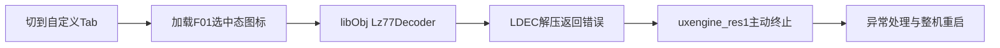

# 4.13切入自定义Tab重启：新增图标触发硬件解压失败

已从相机保留的`/proc/klog`找到两次一致的异常：界面资源线程加载F01选中态图标时，LDEC硬件解压返回错误，原厂`libObj.so`主动执行终止，随后整机重启。故障发生在图标加载阶段，与用户“只切Tab、尚未选择滤镜”的描述一致。

本地已修复图标编码并完成针对性验证。**修复尚未写入相机，新编码的实机LDEC验收仍未完成。**旧4.13包维持故障标记，不推荐继续反复触发。不能把本次软件解码或QEMU通过当作机身修复完成。

## 机身证据与根因

SSH只读确认机身4.13、AP、CP、两份资源和正式十二款BIN与原交付一致；加载中的13436字节新增RX区域也与原包逐字节相同。机内名称表已经发布十二款有效配置，排除了“机内未导入”的解释。本次采集没有触发菜单、重启、进程附加、内存写入或文件替换。

两次异常具有不同的进程加载地址，但归一化后对应同一条调用链：

| 证据 | 两次记录的共同值 |
|---|---|
| 线程／异常 | `im.elf(uxengine_res1)`／`Abort` |
| 关键调用点 | `libObj.so+0x156654`，上层返回点`+0x115330` |
| 原库错误文本 | `false: ldec decompress error <UX_LOG_ERROR>` |
| 资源编号 | `0x02001ea5`，F01选中态 |
| 资源文件／载荷偏移 | `image_00_32_IPSX.uxc`／`0x97ecf4` |
| 输入／输出长度 | 5604／5600字节 |
| 原载荷头 | `0f00e015`，包含5600字节像素的长原样块 |

从堆栈恢复的源地址、长度、资源编号，与旧4.13资源中该记录精确对应；其载荷SHA256为`a7232f40e05bb38ebb41d955cd898d8d0eea7d6976602e74273650a34d3b80b2`。现场原库和LDEC驱动的MD5均与离线输入一致。脱敏结果见本目录`root-cause.json`，解析入口为`analyze_klog.py`；含其他机身信息的原日志只保留在本地`.local/incident413-tabs-20261103-01/`。

证据证明本项目生成的这份长`0x0f`流在实机失败，尚未区分其块语义、分页或硬件约束的更底层原因；不据此断言所有`0x0f`块都不受支持。

## 为什么此前QEMU未发现

QEMU客体设置了`QEMU_SOFTWARE_LZ77=1`，在原厂资源加载入口使用基于第三方fwtool的有界软件解码器替代硬件LDEC。旧原样块能被这个解码器正确展开，因而真实菜单截图、像素检查均可以通过，却没有覆盖实机硬件的接受条件。

原测试名称中的“原厂解码器”不准确；本轮已将当前24槽图标测试命名改为“fwtool软件解码器”，并增加实机失败格式的独立门禁。历史回执和冻结源码不重写。

## 最小修复

1. `native24-combined/icon_codec.py`新增确定性的F0编码器，使用原厂图标流相同的`0xf0`压缩块、4095字节回看距离和显式结束标记，替换新增图标的长原样流。
2. 构建器严格派生48个新图标，保持像素、编号、尺寸及选中态一致；载荷起点四字节对齐，填充不计入流长度。每个新载荷为218～242字节，原来为5604字节。原厂图标载荷及属性保持，未编辑冻结的十二槽实现或上游。
3. 另行修补一个已经离线复现的导航上下文缺口：原生属性发布过程中，同步索引查询也使用当前Tab分组。回归用例在旧实现得到19，修补后得到0。**这项保护不是本次解压崩溃的根因结论。**

AP、CP、原厂外观色彩、配方BIN、八项默认值和存储协议没有因图标编码修复而改变。AP另含上述索引保护，CP保持原4.13字节不变。

## 实际验证

| 层次 | 结果与边界 |
|---|---|
| 失败回归 | 同步索引旧实现失败；图标格式门禁在保留旧图标的候选上失败。一次旧构建因源码身份漂移被门禁拒绝，未把该工具拒绝当作行为复现 |
| AP／事务相关回归 | 36项通过，560.53秒；覆盖Tab、稀疏／空槽、后台失败回退、最后目标、八项调参及原注册树。测试AP与最终候选AP摘要一致，后续只更换图标编码，复用该证据 |
| 最终图标回归 | 2项通过，1.89秒；两份资源共96份新增载荷的F0／对齐／结束检查，48种编号状态逐像素解码检查，原载荷保持检查 |
| QEMU固定身份 | 最终候选2项通过，拒绝旧图标身份及未知输入 |
| 最终QEMU | 正式十二款BIN，103次真实Qt操作及103原帧与PNG一致；Tab只浏览、中键确认、右键调参、十二款往返、八项编辑／重置及四轮MENU通过；Qt／AP／CP正常退出 |
| 独立重建 | 两次最终构建的四组件摘要一致 |
| 机身 | 只读采集及故障归因完成；新组件未上传、未写入、未启动，硬件解码和实机切Tab未复验 |

最终QEMU场景为`a7r5-qemu/runs/native-native12-410-frzr6wsy`。其中仍存在原E4初始化缺口，不能据此声称滤镜应用、保存或实际成像通过。原长列表偶发标题缺失的限制也不在本次解压修复中宣称解决。

## 新组件与回退边界

最终构建位于`.local/native24-tabs-incident413-fix-20261103-02/`，独立重建为`...-03/`；审查材料见`native24-combined/verification/2026-11-03-incident413-fix-01/`。没有生成新的DAT，也没有覆盖原4.13交付。

| 文件 | 新SHA256 |
|---|---|
| `appFw.so` | `1f7fda3baf1afbe2badaee5007383839c5843b67023e546c10edbc70d28da58e` |
| `cpapp-b.bin`，保持 | `35eb911d27be4a8aab8a0a5fe9a8f028c16453d5ab79605fe36dbd199b833300` |
| `image_00_23_IPSX.uxc` | `202a5aa8fb0e3a26b7d2018c56c2ea8ab048ed2dc622179c9f092467f52646f6` |
| `image_00_32_IPSX.uxc` | `7adc49cf46a99802e8e68e06455d813730ff0f32c4efe96f76bd80161e442b2c` |

机身`/usr`当前只读，下一阶段持久替换不能直接沿用只读采集步骤。若用户确认执行SSH修复，限定为以下三份文件及一次正常重启：

- `/usr/lib/appFw.so`。
- `/usr/share/app/image_00_23_IPSX.uxc`。
- `/usr/share/app/image_00_32_IPSX.uxc`。

执行前重新识别机身和四组件，将原文件读回电脑并核对，检查文件系统及空间条件。相机停留在正常界面；同目录写入独立新文件，完整校验后原子改名，保留原文件回退副本，刷盘并恢复只读挂载。只读挂载更改、持久替换和重启需先确认。中途断电或文件系统异常仍可能需要离线恢复，不能承诺零风险。

正常重启后由用户先做一次切Tab验收，再验证十二款与原厂往返及菜单退出；出现异常立即停止，保存新`/proc/klog`，不反复触发。如果新编码仍失败，则保持“未修复”的实机状态并回退原文件，不继续增加机身改动。回退原4.13只能恢复原文件，不会消除其已知Tab故障。
