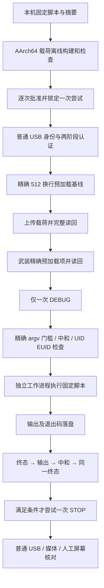

# A7R5 4.00 机内 root shell 脚本执行实施

第二版说明：本轮调整的是固件转存的标准19项/扩展37项范围及本机镜像分类；独立root脚本执行器的行为不变。旧包和旧批准不复用，仍须在第二版最终目录准备新root任务。第二版相关回归45项通过，新root入口仍未实机复验。

## 1. 能实现什么，哪些已经验证

本流程在相机内部以 UID/EUID 0 启动 `/bin/sh -c`，执行**构建时固定的一份 shell 脚本**，取回合并的标准输出/错误输出及退出码，核对预加载中和与终态后，符合门槛时仅尝试一次退出服务。

它适合运行 `cat`、盘点、状态查看等短任务，也允许把需要的多条命令写入同一个脚本，脚本内的 `cd` 和变量可以在这次 shell 内生效。不必重新转存固件，不需要挂载或格式化 SD 卡。

已有 A7R5 实机转存载荷通过 `/bin/sh -c` 执行脚本，工作进程多次报告 `uid=0 euid=0`，成功完成挂载、dd、校验、同步及卸载。这证明 root shell 执行链已经实际成立。

**本包把该链改造成独立的一次性脚本入口；该新入口仅完成离线验证，尚未在相机执行。** 新载荷的启动、输出收集和退出门槛还需一次明确批准的实机复验。不能用旧转存成功回执冒充新 root 入口成功。

本包不提供 SSH、Telnet、常驻命令邮箱、PTY 或保留至下一次连接的交互式终端。a7c2-re 的常驻 shell/FIFO 源码放在 `historical/a7c2-reference/` 供参考，没有直接移植成 A7R5 默认入口：FIFO 所在文件系统、生命周期、输出增长与退出清理均需另行验证。

## 2. 实现链与关键门槛



认证及部署复用 `engine/mac/system_dump/session.py` 和 `restricted.py`。新执行器为 `payload/root_once.c`，新主机流程为 `tools/root.py`。

触发门槛要求 `/proc/self/cmdline` 精确等于已研究的 DEBUG 子进程 argv；其构造函数中和本次条目后 `_exit`，阻止原固定 date 命令继续执行。此机制已在旧 A7R5 载荷验证；新执行器实现了相同门槛，不将“用了预加载”描述为无需进一步验证的普遍 root 漏洞。

## 3. 环境、脚本限制与依赖

相机必须是本人的 ILCE-7RM5 / A7R5 4.00，处于正常屏幕和 `054c:0e0a` 普通 USB 身份，连接原物理端口 `0x01100000`。保持电池/独立供电，Mac 接电并防休眠。不得从上次未恢复的服务状态强行开始。

依赖路径、材料摘要及 Python 设置见 README。本包已携带认证源码、Python 通信/ELF 解析依赖和目标 glibc 2.25 构建样本；不需要 Linux 虚拟机。没有要求备用卡或相机里一定有卡，但连接前后媒体应保持一致，不在执行中拔插卡。

| 限制 | 具体行为 |
|---|---|
| 脚本 | 1–8192 字节，UTF-8，无 NUL，使用 LF 换行；准备时做 `/bin/sh -n` 检查 |
| 执行环境 | `PATH=/bin:/sbin:/usr/bin:/usr/sbin`、`LC_ALL=C`；不继承预加载变量 |
| 工具 | 使用实测路径；不能假定目标 shell 有 `command -v` 或 GNU 工具全集 |
| 超时 | 默认 60 秒，可在构建时设 1–300 秒；运行时不能换任务或修改期限 |
| 输出 | stdout/stderr 合并，严格少于 32,768 字节；饱和/被信号终止视为失败 |
| 文件大小限制 | 子进程 `RLIMIT_FSIZE=32768`，影响该脚本写出的所有普通文件，不能用于大文件生成或固件转存 |
| 输入 | stdin 指向 `/dev/null`，无交互输入 |
| 后台任务 | 不使用 `&`、守护进程或主动脱离进程组；本包不提供可靠的后台生命周期管理 |
| 任务变化 | 脚本、载荷、会话或依赖变化必须重新准备和批准；不重用旧操作 |

固定 PATH 和 BusyBox 的必要差异已经在转存研究中暴露并修正。示例使用目标已有的 `/bin/cat` 和 shell 内建 `echo`，不依赖此前失败过的 `command -v`。

## 4. 先使用固定只读示例离线准备

`examples/root-info.sh` 只读取当前进程身份、版本和挂载信息，不执行相机配置修改。其内容如下：

```sh
set -eu
echo A7R5_ROOT_INFO_BEGIN
/bin/cat /proc/self/status
/bin/cat /version.txt
/bin/cat /proc/version
/bin/cat /proc/mounts
echo A7R5_ROOT_INFO_END
```

`/proc/self/status` 是此处 cat 进程自己的状态；root 权限的主要验收证据是工作进程状态中的 UID/EUID，不能只看脚本输出的字符串。

在校验过材料包的最终目录中，设置 README 中的 `TASK_PY`，执行：

```bash
TASK_ROOT="$HOME/A7R5-Operations/root-info-next"
"$TASK_PY" -B kit.py prepare-root --operation "$TASK_ROOT" --script examples/root-info.sh --timeout 60
"$TASK_PY" -B kit.py check --operation "$TASK_ROOT"
```

这两条命令不枚举 USB，不读取原始卡，不请求 sudo。它们生成新 run_id、脚本副本、`root_config.h`、载荷源码副本、对象文件、`a7r5_root.arm64.so`、构建日志、ELF/符号/GLIBC 检查、预加载精确字节、操作摘要和未批准模板。

审阅 `task.sh`、`root_config.h`、`payload-check.json` 和 `operation.json`：脚本摘要应与自己要执行的文件相同；超时和输出上限正确；kind 应为 root，输出目录为新目录。不得因为交付包带了预构建样例就直接跳过这一步。

## 5. 明确本次写入与权限风险

本流程获得的是相机内真实 root 进程的执行权限；不属于只能读取的沙箱。脚本本身可以在 root 权限允许范围内改配置或写设备，只有选用并审阅过的只读脚本才具有对应的操作范围。示例的“只读”是脚本行为约束，不是内核强制隔离。

即使示例只读，取得执行仍会写入：

- `/tmp/jiritsu/a7r5-<run>.so`：本次固定库，完整读回核对。
- `/etc/ld.so.preload`：本次武装条目，随后中和为 512 个换行。
- `/tmp/jiritsu/a7r5-<run>.state` 及原子发布中间名字。
- `/tmp/jiritsu/a7r5-<run>.output`：最多约 32KiB 的合并输出。

这些工作路径可能持久存在。默认只中和，不删除研究文件；最初未知预加载原字节无法追溯还原。只接受当前读到的精确 512 换行；不可读、空文件、错误码或其他内容均停止，不覆盖未知内容。

超时会对脚本进程组尝试 TERM，再在需要时尝试 KILL，但内核 I/O 阻塞、逃逸进程或脚本造成的配置变化不保证可以撤销。超时不会被当作成功终止，也不会自动 STOP 或断电。脚本对相机数据的不可逆写入不会因为程序失败而自动回滚。

本轮交付只完成离线准备，未执行上述相机写入。只有明确批准这份具体脚本、固定路径写入、一次 DEBUG 和失败恢复边界后，才进行下一节。

## 6. 逐次批准与一次 Terminal 执行

读取 `check` 输出的本次风险与 `consent_phrase`，自己确认后手动填写：

```bash
"$TASK_PY" -B kit.py approve --operation "$TASK_ROOT" --accept 'ACCEPT-把本次root操作的短语填在这里'
```

此时只生成本次批准文件，不连接设备。相机稳定独立供电、屏幕正常、普通 USB/媒体恢复并连在原端口后，在 Terminal 执行一次：

```bash
sudo "$TASK_PY" -B "$PWD/kit.py" execute --operation "$TASK_ROOT"
```

管理员密码只在本机 Terminal 输入。程序核对批准和全部固定材料后，先创建一次性尝试锁，再观察主机身份；不符合就停止。正常流程仅一次 DEBUG，不提供命令行追加远端命令或运行时替换脚本。

设备工作进程检查 root，执行嵌入的脚本，等待结束并发布终态。主机只读取本次固定状态和输出路径。终态必须为本会话 DONE、UID/EUID 均为 0、输出字节数有效；读取输出后必须读到精确预加载中和，再读到完全相同的 DONE，才允许尝试一次 STOP。

脚本返回非零时仍记录真实退出码；若终态/中和等完整成立，可以按门槛退出服务，但不会把脚本任务标成成功。失败代码、原始响应头及状态保留在 `result/`，不通过重新认证或 DEBUG 重发“补救”。

## 7. 如何验收

| 文件/字段 | 必须检查的内容 |
|---|---|
| `result/worker-last-state.txt` | `A7R5-ROOT-1 <本次run_id> DONE ... uid=0 euid=0` |
| `result/done-before.txt`、`done-after.txt` | 两次完全相同，排除读取输出时状态变化 |
| `result/shell-output.bin` | 与终态字节数一致，SHA-256 有记录；只读查看，不当作可执行程序运行 |
| `result/summary.json` | 两阶段认证、DEBUG 尝试、任务终态、中和和普通身份观察均有记录 |
| `result/kit-result.json` | `root_task_done=true`、`shell_exit_code=0`、`preload_neutral_verified=true`、`execution_succeeded=true` |
| `result/host-recovery.json` | 前后同端口普通 USB、存储驱动及媒体集合匹配 |
| `result/events.jsonl` | 原始响应头、状态和失败信息完整，无 DEBUG 重发 |

Mac 上可以直接以文本方式查看 `shell-output.bin`。示例应含开头/结尾标记及版本/挂载信息；如果只看到自己打印的 `uid=0` 字符串而缺少载荷状态和完整证据，不算权限验收。

再仅查看相机屏幕，正常时运行一次主机元数据确认：

```bash
"$TASK_PY" -B kit.py confirm-recovery --operation "$TASK_ROOT" --screen-normal
```

这一步不发送相机协议请求，记录屏幕人工确认与普通 USB/媒体观察。脚本执行、USB 恢复和拍摄功能属于不同验收；本包没有自动拍摄测试。若本次 root 会话前后媒体检查未通过，不用这条命令覆盖失败，需要单独分析。

## 8. 换成自己的命令

把需要的命令保存为新的本机 LF 文本脚本，审阅其所有写入、副作用、工具路径和输出量，再使用全新的操作目录准备：

```bash
TASK_CUSTOM="$HOME/A7R5-Operations/root-custom-next"
"$TASK_PY" -B kit.py prepare-root --operation "$TASK_CUSTOM" --script /绝对路径/your-task.sh --timeout 60
"$TASK_PY" -B kit.py check --operation "$TASK_CUSTOM"
```

随后针对新脚本重新批准并仅执行一次。不要修改已准备目录中的 `task.sh`、配置、载荷或操作摘要来复用旧批准。外部原始脚本在准备后不参与运行，实际执行的是封存在 `.so` 中的内容。

多条命令可以写在同一份脚本中，以便保留该次 shell 内的变量和工作目录。不要用它做固件刷写、长时间转存、常驻网络服务、无限输出、需要交互输入或后台任务；这些行为没有对应的恢复与验收实现。若确实需要交互终端，需要另行实现和验证会话生命周期，不能把本入口称为已经具备。

## 9. 失败时如何停止

| 情况 | 行为与后续 |
|---|---|
| 本地材料/摘要/批准不符 | 连接前拒绝；重新离线准备，不能删除门槛 |
| 相机身份或普通媒体不符 | 不进行认证或写入，保持现状核对 |
| 预加载不是精确中和基线 | 不上传载荷、不覆盖预加载；不把错误码当作文件不存在 |
| DEBUG 前武装阶段失败 | 只在通道完整且读到本次精确条目时尝试中和；不能盲写 |
| DEBUG/协议/传输失败或无有效终态 | 不重发 DEBUG、不自动 STOP、不断电；保留连接和供电，按当前日志另行制定恢复 |
| TIMEOUT、FAILED、输出饱和、UID/EUID 不符 | 不当作成功任务，不自动退出服务或重试 |
| DONE 但脚本退出码非零 | 保存失败输出；门槛完整时只尝试一次 STOP；修脚本后新建任务，不复用旧包 |
| STOP 失败或普通 USB/媒体没恢复 | 不补发 STOP；只做后续主机观察，受限恢复须绑定本次新会话另行准备 |

失败后不得删 `ATTEMPT_LOCK` 重跑。没有进行中的任务、预加载和服务状态证据，就不能自动断电或拔线。即使普通 USB 和屏幕恢复，也不表示最初配置和研究残留已经还原。

## 10. 验证依据及未验证项

已执行的离线验证覆盖：同源 C 在 Mac 普通目录下的门槛不符、预加载不符、正常 stdout/stderr、非零退出、超时、输出上限；真实协议头解析下的精确中和基线、旧/变动状态、输出长度、非 root、DEBUG 失败及不重发；本地材料篡改、无批准、尝试锁；AArch64 ELF/GLIBC 兼容检查。

Mac 原生 C 测试只验证进程和文件行为，测试构建明确绕过 root 身份要求；不会伪装成相机 root 实机证据。相机目标构建保留 UID/EUID 均为 0 的强制检查。下一步实机首次验收应只运行随包只读示例，通过后再考虑具体自定义脚本。

设备端旧 root/shell 证据见 `historical/device-dump-final.json` 和 `historical/successful-dump-build/`；本轮新入口证据见 `verification/`。隐藏区域、刷回、相机原配置还原、研究残留清理、进程全量退出和拍摄功能仍不在已完成结论之内。
