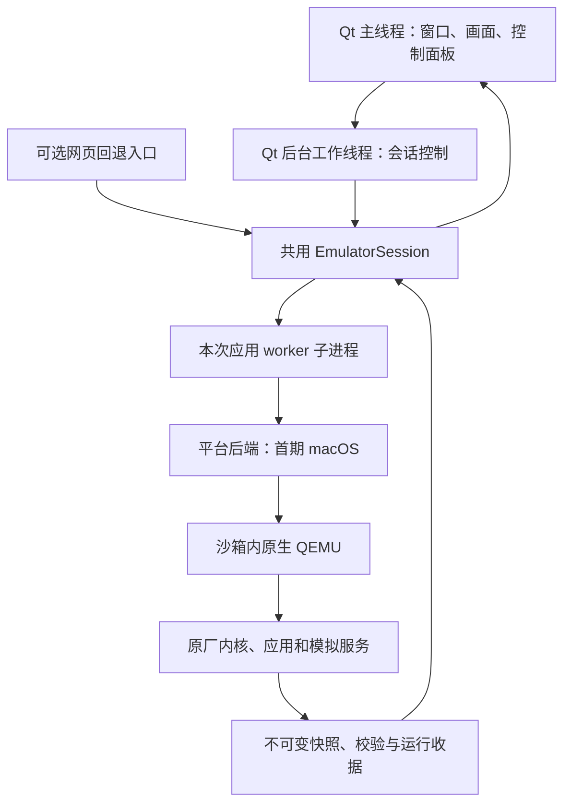

# 设计说明：PySide6 客户端、共用控制层与平台适配

## 元信息 Metadata

- Feature ID: `001-cross-platform-desktop`
- Status: `M1-M2-verified; M3-not-run`
- Related requirements: `requirements.md`
- Created: `2026-10-19`
- Updated: `2026-10-19`

## 设计摘要

采用 Python＋PySide6 的 Qt Widgets 桌面窗口，复用当前原厂快照和文件控制协议。先抽出不依赖 HTTP 的会话控制层，再连接桌面窗口，最后打包。QEMU 与客体先保持不变；平台后端和更多相机输入分别推进，避免同时改界面、固件和隔离。

备选方案：Swift/AppKit 已按用户要求排除；Tauri 需增加 Rust 和 Python sidecar 的构建协调；Electron 需要额外的 Chromium/Node.js 运行栈。现有后端为 Python，PySide6 可直接复用其控制逻辑，因此选择 Qt Widgets。这里是项目适配判断，不是通用框架性能排名。

## 已检索的实现

| 当前文件 | 可复用部分 | 需要调整 |
| --- | --- | --- |
| `tools/menu-ui.py` | Session 生命周期、状态、结构化命令、退出处理 | Session 从 HTTP 文件抽出，网页成为可选适配器 |
| `tools/menu_bridge.py` | 请求归档、快照持久化、状态/回执 | 复用现有通道；必要时加强版本、请求关联与停止路径 |
| `tools/menu_live.py` | 原厂事件注入、串口完成标记、监视器 | 六键原行为保持；候选和正式动作分开 |
| `tools/native_vm.py` | macOS QEMU 参数、沙箱、QMP 暂停/恢复、首次初始化 | M1 保持行为；后续通过平台接口接入 |
| `tools/vm_session.py` | 控制台、证据和退出流程 | POSIX 导入与进程回收不能泄漏到跨平台前端 |
| `tools/runtime_manifest.py` | 路径、长度与 SHA-256 固定输入校验 | M1 保持清单；M3 才设计平台二进制清单兼容 |
| `tests/accept-native.py`、`tests/check-menu-cycles.py` | 原始帧和基线比对、MENU/六键验收 | 新增 Qt 真实入口适配，复用同一套断言 |
| `logs/native-acceptance.json`、`logs/migration-completion.json` | 历史通过记录 | 只作基线；新验收输出独立目录，不覆盖原收据 |

## 架构与进程

普通客户端不启动网页服务。GUI 主线程只处理绘制与状态；阻塞启动、串口等待、快照检查和退出处理在后台执行。Qt 信号将不可变结果送回主线程，不从后台线程操作控件。

### 文件计划

下列均为计划路径，本轮只创建本 spec 的三份文档。

| 路径 | 操作 | 职责 | 需求 |
| --- | --- | --- | --- |
| `client/main.py` | 新增 | 源码模式和冻结模式的入口分流，worker 分支在导入 Qt 前分发 | REQ-001, REQ-008 |
| `client/window.py`、`client/controller.py` | 新增 | 主窗口、画面、后台任务和关闭协调 | REQ-001, REQ-002, REQ-003 |
| `client/control_panel.py` | 新增 | 相机控制布局、状态与禁用提示 | REQ-004, REQ-005 |
| `tools/emu_session.py` | 新增/抽取 | 去 HTTP 的会话控制和请求关联 | REQ-002, REQ-003, REQ-007 |
| `tools/input_registry.py`、`config/controls.json` | 新增 | 动作定义、证据、阶段状态和启用门槛 | REQ-004, REQ-005 |
| `tools/platform_backend.py` | 新增 | 纯 Python 能力探测及后端接口；惰性导入平台实现 | REQ-006, REQ-007 |
| `tools/app_paths.py` | 新增 | 分开处理只读资源根、可写运行目录和打包入口，消除对源码 `__file__`/当前目录的隐式依赖 | REQ-006, REQ-007, REQ-008 |
| `tools/native_vm.py`、`tools/vm_session.py` | 定向修改 | 现有 Mac 行为接入接口、隔离 POSIX 专用代码 | REQ-002, REQ-006, REQ-007 |
| `tools/menu-ui.py`、`tools/probe-app.py`、`tools/menu_bridge.py` | 定向修改 | 薄入口、worker 调用和共用控制层接线，保持已有协议语义 | REQ-002, REQ-003, REQ-008 |
| `requirements-desktop.txt`、`packaging/` | 新增 | 经验证锁定的 GUI/打包依赖、构建配置和资源清单 | REQ-001, REQ-008 |
| `启动A7R5原厂菜单.command`、网页回退入口、`.app` | 最后切换/新增 | 默认启动客户端；显式回退可用 | REQ-008 |
| `tests/test-session.py`、`tests/test-controls.py`、`tests/test-desktop.py` | 新增或合并 | 以行为结果覆盖会话、启用门槛和 UI 错误状态 | REQ-001, REQ-002, REQ-004, REQ-005 |
| `tests/accept-desktop.py` | 新增 | Qt 实际窗口的端到端验收与收据 | REQ-003, REQ-008 |
| 平台后端实现及其构建/隔离测试 | M3 新增 | 实际选择 Linux/Windows 运行与隔离方式后确定落点 | REQ-006, REQ-007 |
| `AGENTS.md`、`README.md`、`specs/.../verification.md` | 实施阶段更新 | 入口、平台规则与真实验证状态 | REQ-006, REQ-008 |

## 组件与接口

### 会话控制

`EmulatorSession` 提供 `start()`、`status()`、`tap(control_id)`、`request_stop()` 和结果事件。注册表能力通过 `capabilities()` 返回。未来扩展的 press/release/rotate/select 只在对应动作获得证据和测试后开放，不先做通用任意事件 RPC。

源码模式可沿用项目 Python 启动 worker；冻结后的 `sys.executable` 是客户端可执行文件，不能继续套用 `python -B probe-app.py`。打包阶段采用同一可执行文件的受限 worker 模式，例如 `--worker app --bridge <owned-directory>`，或工具实测支持的等价子入口。worker 参数只能选择固定工作流；内部命令仍由受信代码生成。该分流必须单独实测，不能用开发环境成功代替。

首期沿用 `runs/ui-<uuid>/` 中 `request.json`、`reply-<id>.json`、`status.json`、`frame.png` 和请求归档。所有路径由会话创建并校验；固定 schema、大小上限、原子发布、唯一请求 ID、一条在途命令、拒绝符号链接和越界路径。消费者不能在收到新 sequence、旧 PNG 尚未发布时显示错配的帧；应以状态关联的帧摘要/序列核对后更新。

### 状态与退出

客户端状态：`idle → starting → ready ↔ busy → stopping → stopped`，任意活动状态可进入 `failed`。对现有 worker 的 `running` 状态作显式映射，不混用字符串。

- 启动、按键、退出使用不同状态提示；当前阻塞操作的超时沿用既有上限并集中配置，不自动重试。
- 退出请求优先于新输入；已有操作到达可核对边界后停止。启动中关闭可使用现有 cancel 机制，由拥有 worker 的控制器统一回收。
- `stop` 的请求回执只代表已接收；必须再等 `exit.json` 和进程结束。QMP 退出失败的 TERM/KILL 仅操作本次拥有的进程组/平台等价对象，标记异常，不伪报正常退出。
- 有未释放输入时，先按已验证路径释放并核对；释放失败后不得盲发重复事件，保存错误并回收本次 VM。
- 新增键需要长按时，在整段输入完成及快照导出后再暂停；失焦、关闭、超时的释放与暂停顺序必须测试。

### 原厂画面

继续使用 `headless_osd_capture.decode_export` 与现有快照转换；Qt 读取经核对的 PNG，按 640×480 比例缩放。只缩放显示，不重画菜单内容。缩放后的屏幕截图不能替代原始像素验收。

错误或超时后最后一帧只允许以“历史快照/已停止”状态展示；不得保留“实时可操作”提示。GUI 冻结或退出未确认时不丢弃日志。

### 控制注册表

建议字段：`id`、`label`、`group`、`interaction`、`mapping_status`、`behavior_status`、`enabled_contexts`、`evidence`、`limitations`。状态分开表达：映射 `unknown/candidate/verified`，行为 `not_tested/pass/blocked/fail`。可用条件同时包含当前平台、固件输入指纹、交互类型、映射和指定场景证据；不能仅依据一个 `enabled: true`。

| 控制组 | 首期状态 | 后续验证重点 |
| --- | --- | --- |
| 方向、中心确认、MENU | 接入既有六键 | 真实原厂菜单、按下/释放对、四轮重新进入 |
| C4/删除、后控制轮等已有候选 | 候选禁用 | 核对 A7R5 数值、来源、旋转状态和上下文；不能沿用参考项目“删除=C2”标签 |
| Fn、播放、C1/C2/C3、AF-ON、AEL | 待映射 | 自定义分配和拍摄/回放上下文，依赖的页面/服务 |
| 摇杆、前拨轮、后拨轮 L/R、控制轮 | 待分别盘点 | 区分物理来源、方向、增量、中心按下、锁定状态 |
| 快门半按/全按、MOVIE | 功能受限 | 完整事件序列与固件接收；不据此宣称对焦、拍摄或录像成功 |
| 模式、照片/视频/S&Q、电源、触控 | 状态/专用协议待研究 | 状态机、触点与坐标，不能仅套普通按键消息 |
| 屈光调节等机械操作 | 记录范围与限制 | 没有数字事件时明确标注不适用，不虚构事件 |

面板先按实际控制命名布局，按下/释放对与自动重复抑制保持一致。允许首版完整展示禁用项，但“面板完整”不作为“全按键功能完成”的证据。每批研究明确候选、场景、预期和停止条件，不穷举未知键码。

### 平台接口与隔离

首期只提供可工作的 `macos-arm64` 后端。能力探测模块本身不得导入 `fcntl` 或触发 VM；未支持的平台允许打开客户端、查看说明/历史记录，但无法启动固件。

后端职责包括二进制及动态库定位、输入指纹、独占锁、沙箱、QMP 通道、拥有的进程管理和退出回执。`subprocess`、信号、文件锁、Unix 套接字路径长度均需按平台处理。

M3 优先形成 Linux 原生构建和隔离验收，再处理 Windows。Linux 评估受限命名空间/文件访问与网络隔离；Windows 先验证可行隔离方案，受限令牌和 Job Object 只覆盖部分能力，不能当作完整文件/网络沙箱。具体 QMP 传输、锁和隔离实现由对应主机上的技术验证确定；未达到门槛保持拒绝启动。

M1 保持现有运行清单。M3 如需多平台二进制清单，设计版本化和旧清单只读兼容，再更新 spec；禁止直接将 macOS 二进制摘要当成跨平台产物。

### 依赖、打包和资源

实施首步核对 PySide6 对 Python 3.14/macOS arm64 的轮子与部署工具兼容性，锁定经验证版本。依赖仅进入项目环境；若必须使用另一 Python 版本，先说明影响并更新计划，不覆盖当前环境。

首选评估 Qt 官方 `pyside6-deploy`/Nuitka；先做最小 worker 打包验证，再决定具体配置。若需改用其他打包工具且交付方式实质变化，更新设计后再执行。包内 GUI 和 worker 必须使用同一套受控依赖。

首期交付为自包含 `.app`；`bin/`、`runtime/`、`sdk/lib/libgpe.so` 与 QEMU 动态库放在 `Contents/Resources/a7r5/` 内。`.app` 自带其 Python/Qt 运行依赖，按相对资源根定位。固件归档仍保持一份。`AppPaths` 明确区分只读 `resource_root` 与可写 `data_root`，源码模式沿用项目 `runs/`，打包模式使用本用户的应用数据目录；worker 接收父进程确定并校验的路径，不能把 `__file__` 或冻结临时目录当作资源根。相应调整 bridge 的路径约束，继续限定在本次会话目录内。

打包阶段审计并封装需要的 QEMU 动态库，确认其摘要、许可证和 macOS 沙箱读取范围；不要依赖开发机 Homebrew/`.venv` 的绝对路径。如果重定位动态库会改变 QEMU 可执行文件，生成包内候选与对应清单、记录新摘要并复验，不覆盖已验证开发产物；内核、客体和设备树仍保持原摘要。沙箱只新增对已验证包内程序和动态库的必要读取规则，不允许整个用户目录访问。如果只做本机开发启动器，必须明确标为开发交付，不能算目录式包验收通过。

各平台独立构建包、独立验收，不从 Mac 的打包成功推断 `.exe` 或 Linux 包可用。签名公证和外部分发不包含在本轮规划。

## 边界承诺与回退

| 边界 | 允许 | 禁止/门槛 |
| --- | --- | --- |
| M1 客体输入 | 只读复用当前归档、内核、设备树 | 不重建或改写固件内容 |
| M2 模拟适配 | 有证据的候选模拟载荷、条目差异验证 | 不静默修改原厂应用/内核；不操作原件或设备 |
| UI 控制 | 注册动作、后台会话、状态与日志 | 不提供任意 shell/队列/原始事件编辑框 |
| 宿主隔离 | 原有默认拒绝策略与受控资源路径 | 不为打包或新平台运行而取消隔离 |
| 入口 | 新客户端独立入口，验收后再设默认 | 保留显式网页回退；不自动双开或隐式切换 |
| 历史资料 | 读取现有项目日志作基线 | 不改写过去的验收结论，不删除旧研究资料 |

回退按组件进行：GUI失败时正常关闭本次 VM，使用显式网页入口；输入适配失败时停用新增动作、恢复上一份已验证注册表/载荷；包构建失败保留开发入口和构建日志。回退不依赖已经删除的 Docker 资源。

## 需求追踪与最小充分验证

| Requirement | Acceptance Criteria | 设计落点 | 主要证据 |
| --- | --- | --- | --- |
| REQ-001 | AC-REQ-001-01, AC-REQ-001-02 | Qt 窗口、后台控制器、真实帧 | V-001 |
| REQ-002 | AC-REQ-002-01, AC-REQ-002-02 | 共用 Session、退出状态机 | V-002 |
| REQ-003 | AC-REQ-003-01, AC-REQ-003-02 | 六键与快照/暂停原链路 | V-001 |
| REQ-004 | AC-REQ-004-01, AC-REQ-004-02 | 控制注册表、官方布局与证据 | V-003 |
| REQ-005 | AC-REQ-005-01, AC-REQ-005-02 | 分批消息适配、释放和停止 | V-004, V-002 |
| REQ-006 | AC-REQ-006-01, AC-REQ-006-02 | 能力探测、平台后端、支持矩阵 | V-005, V-006 |
| REQ-007 | AC-REQ-007-01, AC-REQ-007-02 | 拒绝边界与输入/归档核对 | V-005, V-007 |
| REQ-008 | AC-REQ-008-01, AC-REQ-008-02 | 打包 worker、资源、回退与文档 | V-008 |

- 状态机和控制拒绝路径：V2 模块级参数化测试；新增协议、并发和隔离边界按 V3 失败场景覆盖。
- GUI 与固件真实行为：一个 Qt 端到端批次共享六键、四轮 MENU、原始帧/PNG、空闲暂停和正常退出证据。
- 独立窗口交互风险：真实窗口至少操作一次按键及关闭；假 UI、截图比对或离屏 Qt 测试不能代替此步骤。
- 网页回退：共享控制层改变后运行受影响 HTTP 契约测试，并做一次真实启动/一帧/退出冒烟；不重复整套四轮导航验收。
- 打包和平台是独立边界：分别验证 worker、资源定位、动态库与退出；未拿到相应主机的状态记 `NOT_RUN`。
- 没有新变更或失败证据时，复用已通过的验证记录，不在每个任务后重复全套。

## 参考资料

- [Qt for Python 部署与平台说明](https://doc.qt.io/qtforpython-6/deployment/index.html)
- [Qt Widgets](https://doc.qt.io/qtforpython-6/PySide6/QtWidgets/index.html)
- [pyside6-deploy](https://doc.qt.io/qtforpython-6/deployment/deployment-pyside6-deploy.html)
- [Sony A7R5 背面控制](https://helpguide.sony.net/ilc/2230/v1/en/contents/TP1000669448.html)
- [Sony A7R5 顶部控制](https://helpguide.sony.net/ilc/2230/v1/en/contents/TP1000669449.html)

资料用于确定平台、打包与实体标签；具体版本、接口和键码仍以实施时的实际包及固件证据验证。

## 设计质量门

- [x] 所有需求和验收 ID 有设计落点与验证策略。
- [x] 文件修改边界、冻结 worker、输入释放、资源去重及回退明确。
- [x] 首期不改客体；平台与按键未验证能力保持禁用。
- [x] 依赖与平台前置条件未写成已完成结果。

## 已实施的设计决策

M1、M2 使用 PySide6 Essentials 6.12.0 与 Nuitka 4.3.1；资源收纳在单个 `.app/Contents/Resources/a7r5`，数据写入用户应用目录，源码/打包程序共用用户级锁。冻结 worker 通过明确的包内可执行文件分派，避免 Python 占位路径。

正式输入增加 C4 菜单帮助；帮助弹层上下文结合本次真实帧核对，证据缺失时禁用。旋转、保持、快门、触摸等未验证语义不向公共注入层开放。完整实测与限制见 `verification.md`，M3 未实施。
