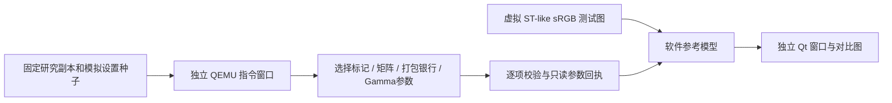

# 创意外观参数验证与虚拟测试图参考预览

> 最新结果见[矩阵内嵌整合DAT与验证边界](矩阵内嵌整合DAT与验证边界.md)：已完成等长CP、原厂参数/参考预览验证及离线DAT构建，保留旧声音和六款功能；完整启动与实机效果未验证。停止扩展硬件模型。

> 上一版内嵌候选记录见 [FL2／FL3矩阵内嵌与预览验收](FL2-FL3矩阵内嵌与预览验收.md)，现作为历史对照保留。

> **当前入口已升级为逐次执行版本。请先看 [实时参数与手动选图说明](实时参数与手动选图说明.md)。以下正文保留为首版验收记录，其中缓存、256基准、等距Gamma等说明已由新版本纠正，不能作为当前窗口行为说明。**

本轮完成独立的参数验证和软件参考预览，不再把完整 CP／ISP 启动作为此工具的前置条件。原厂 CP／ISP 研究保留，默认模拟器与运行清单未切换。

**已验证的是 AP／CP 原厂函数及候选挂钩在显式夹具中的指令行为；显示的是软件参考像素。没有验证原厂 ISP 像素、实机实时取景、照片色彩或整机拍摄。**

## 使用入口

在项目根目录双击 `启动创意外观参考预览.command`，打开独立 PySide6 窗口。窗口不会打开设备、网络、默认模拟器或重新运行 QEMU；它先校验已保存的指令现场，再使用只读参数快照进行软件渲染。

左侧是确定性生成的虚拟 ST-like sRGB 测试图，包含色块、灰阶、色相／明度渐变、类肤色和阴影区域；不是真实照片，也不是 Bayer RAW。右侧是参考输出，可切换：

- ST、FL2、FL3，以及六款外观；
- 夹具中的矩阵缺失／修复状态；
- 三个独立光源端点、16个矩阵子槽、8个 LUT 等级；
- 默认关闭的 Gamma 曲线诊断。

这是开发环境入口，复用项目 `.venv`、Pillow 和 PySide6；未安装新依赖，也没有重新打包默认模拟器应用。渲染在独立工作线程中执行，快速连续操作只显示最新选择的结果，关闭时回收工作线程。

## 两条链路及其边界



没有运行完整 AP 菜单、CP RTOS、UIPC、PCIe或ISP。AP 标记到 CP 输入由明确的测试夹具接续；原厂与候选函数均真实执行，但没有声称这些函数已经通过原厂完整消息链连接。没有固定成功 ACK、手写 `0x2040`、设备访问或硬件完成状态放行。

本次选用封存的六款色彩 CP 候选 `903bb046…`，AP 候选 `b051590a…` 中的80字节转换函数及12字节映射表。该 CP 与第三版整合 4.05 的 `fa52e3cb…` 相差且仅相差电子快门声字节 `0x377601: 0f→02`；已在内存中重建并核对整包 CP 摘要。色彩验证不执行该声音位置，也未修改输入文件。不能把此窗口执行称为索尼原厂未修改整机运行。

矩阵属性来自固定模拟归档的 `seed-backup.bin`，不是本轮实机新采集数据。仅导入该种子的 `0x02a4000d` 属性，未导入完整个人 Backup；校准输入明确构造为 `[256,256,256]`。

## 映射和矩阵核对结果

| 外观 | AP 发往下游的颜色标记 | 矩阵 profile（still／movie） | 修复后银行（still／movie） | Gamma ID（still／movie） |
| --- | --- | --- | --- | --- |
| ST | 0 | 0／0 | 原有银行0 | 0／10 |
| FL2 | 19 | 54／56 | 22／23 | 47／49 |
| FL3 | 20 | 55／57 | 24／25 | 48／50 |
| Classic Neg. | 249 | 参考基底 ST | 保留 ST，不套用 FL2／FL3 银行 | 0／10 |
| Classic Chrome | 250 | 同上 | 同上 | 0／10 |
| Nostalgic Neg. | 251 | 同上 | 同上 | 0／10 |
| Eterna | 252 | 同上 | 同上 | 0／10 |
| GR Positive Film | 253 | 同上 | 同上 | 0／10 |
| GR Negative Film | 254 | 同上 | 同上 | 0／10 |

六款自定义槽仍要求基础风格为 ST。204组 AP 转换结果核对了这一限制、原有12款映射和特殊选择器；没有把六个名称直接当成 CP 参数。

CP 的预览／照片两种显式上下文均选中对应的1215字节色表；96次打包结果逐字节符合独立格式模型，包含有符号七位解释、8个强度等级和405节点硬件排列。参考渲染从**真实指令输出的1620字节银行反解**参数，不在验证失败时回退到另一张色表。

矩阵窗口覆盖 ST及四个FL profile、16个子槽、缺失／修复两种状态，共160次；每次输出三个端点的27个系数。已复现原种子中 FL2／FL3 指向银行0、结果共用的问题；补齐22～25后，四档矩阵输出不同，并符合独立供体算术。这里只改变夹具 RAM，不更新机身设置，也不证明当前相机实际处于哪种状态。

## Gamma 核对结果

- 候选的完整／局部 Gamma 参数路径均执行，覆盖28种颜色输入、still／movie，共112次输出；同样112次核对源参数未被改写。
- 六个自定义标记只在 Gamma 输出副本中归为 ST，原始输入标记保留。六款因此共用 ST Gamma；这不意味着六款共用 CC1 色表。
- FL2／FL3 的 still 为47／48，movie为49／50，记录不同；仍保留原有路线。
- FL2 still 原576字节曲线与迁移后逐字节一致，六个旧引用全部指向新地址 `0x1195080`，未被自定义辅助代码覆盖。
- UI当前展示静态照片参考。离线审计还核对 movie 的代表记录（Gamma子槽6）；不把矩阵的16子槽与 Gamma的7子槽混用，也不为 Gamma 空指针猜测回退。

曲线前129个 u32 的读取有原厂消费者依据；**其完整分段横轴、硬件定点和输出编码仍未确认**。因此默认不把这组样本强行当作 Sony 像素 Gamma。`gamma-records.png` 的横轴仅为样本序号。

显式勾选 Gamma 诊断时，使用等距样本横轴和端点归一化，按相对 ST 的曲线进行实验；该开关会清楚标记此假设。它可以检查曲线方向和差异，不能验证实机 Gamma。ST 在诊断开关前后保持逐字节不变，避免对已编码图重复套用曲线。

## 参考渲染假设与发现

输入已经是 ST-like sRGB，先解码一次 sRGB，在参考线性空间使用 `Mlook × inverse(Mst)`，再编码一次，最后按已导出的 CC1 银行计算色表修正。ST 基线应原样返回。

首轮检查发现，把绝对传感器矩阵直接施加到该输入会重复颜色变换。已先保存失败用例，再改为相对 ST；回归证明 ST 输入逐字节保持。这是**参考模型自身的修复**，不是发现并修复相机固件的同一问题。

仍有三个明确假设：

1. 原厂矩阵在此工具中按线性 RGB 的3×3矩阵解释，真实 ISP 的作用空间及本机校准尚未证实。
2. 六款 CC1 插值沿用既有 BT.601 limited 坐标假设和 A7C II 单场景估计的响应矩阵；没有得到 A7R5 标定。
3. 富士／理光外观来自已有 DCP LookTable／tone 的拟合近似，未复现完整 DCP 渲染器或相应厂商原算法。

**FL2／FL3 相对矩阵在这套假设下会出现明显色偏和截断，所以其输出明确标为“矩阵数值诊断”。不能把这些颜色当作真实 FL2／FL3，也不能依据这些颜色反过来修改已核对正确的原厂系数。** 其用途是检查矩阵是否加载、是否共用、数值和银行是否正确；进一步还原外观需要确认矩阵坐标、校准和实际 ISP 应用顺序。

六款 LUT 参考画面可以比较拟合色表的区别、等级和映射错误；画面不同不是实拍准确性的证明。各图附带 sRGB 标记、参数回执和软件参考声明，不冒充原厂菜单或取景快照。

## 本轮实际证据

| 项目 | 结果与位置 |
| --- | --- |
| AP／CP 指令参数 | `runs/native-look-ap-qer9078i/`、`runs/native-look-cp-509uu886/`；汇总入口：后者的 `look-parameters.json`，内含原始日志路径及逐项结果 |
| 软件参考图 | `runs/look-reference-qo3ngzmk/`，九款对比、矩阵缺失对照、Gamma样本图及摘要 |
| 新功能与相关回归 | `logs/creative-look-reference-g41h_zx6/`：新功能9项、既有CP窗口3项、启动现场9项，共21项通过 |
| 原生 Qt | `runs/look-qt-accept-6kydylgl/`，平台 `cocoa`；九款键盘切换、修复／Gamma开关、参数控件、截图、正常关闭及渲染线程回收通过 |
| 原研究保留 | 同一日志目录 `preservation.json`，默认运行输入／库及独立CP／ISP模型源码、二进制身份仍符合原收据 |

两组 QEMU 窗口均以 semihosting完成并退出0；监督器的 `method=not-started` 表示本来就无须再走QMP关闭分支，不能解释为没有启动进程。构建命令、源摘要和运行PID分别保存。

失败现场保留：初次AP入口与自动设备树重叠；后续测试日志的未对齐访存、错误EL2访问；预览上下文地址写错；参考渲染重复矩阵变换。均未通过修改被测函数或忽略错误解决。早期参考图片是调试产物，本节列出的最终目录才是交付结果。

## 重现与后续

```sh
# 从项目内固定摘要副本准备材料；不读取已删除的根 analysis。
.venv/bin/python -B tools/look_reference.py prepare

# 使用上一条输出的新材料目录，执行两个独立指令窗口。
.venv/bin/python -B tools/look_reference.py capture --materials build/look-materials-cxo10pc8

# 参数读取失败则停止；不会调用完整 CP 启动或转向设备。
.venv/bin/python -B tools/look_reference.py render \
  --parameters runs/native-look-cp-509uu886/look-parameters.json

LOOK_REFERENCE_PARAMETERS="$PWD/runs/native-look-cp-509uu886/look-parameters.json" \
  .venv/bin/python -B tests/test-look-reference.py -v
```

重现新会话时使用各命令实际输出的路径，不覆盖旧目录。`session.json` 只选择这个独立参考窗口的已验收参数，不影响 `runtime/manifest.json`。

下一步宜针对矩阵坐标、Gamma分段横轴和成像顺序补证，再做独立的实拍／色卡对照。本轮没有申请或执行实机行为。完整原厂 CP／ISP 研究继续保留在 `003-virtual-media-and-imaging/`，其未完成项不因本工具交付而改为完成。

## 来源

材料保留六款表的原始来源、摘要及许可限制，见导入材料的 `six-looks.json`；未复制或分发 DCP 原文件。色表参考坐标和响应模型参考工程内固定上游 `looktool/native.py`、`rendering-model-v1.json`，仅为本机私有研究。相关来源说明仍保留在原研究材料 `vendor/UPSTREAM-NOTICE.md`／`UPSTREAM-LICENSE.txt`，不据此授权公开分发。
