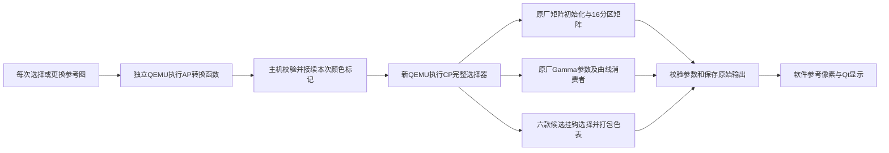

# 逐次 AP／CP 参数执行与手动选图

> 后续已接入原生CC1参数应用、BW去色并修复相机MPF JPG导入。当前增量、证据与未完成项见 [CC1与相机JPG预览核对](CC1与相机JPG预览核对.md)。本页的首批验收记录仍保留，BW／SE与图片格式范围以新说明为准。

> 最新默认入口使用[矩阵内嵌整合候选](矩阵内嵌整合DAT与验证边界.md)，无需模拟设置修复即可取得FL2／FL3目标矩阵；已完成离线DAT，完整启动与实机效果仍未验证。

当前参考窗口每次接受外观选择，都会重新运行独立 AP、CP 指令窗口，再使用本次返回的参数渲染。返回 ST 也重新执行，不从首版参数快照或画面缓存取结果。支持手动选择照片，原机十款、候选 FL2／FL3 和六个自定义外观均可选择。

**原厂参数实际执行和软件参考像素是两层证据。没有运行完整 AP／CP 消息通道、CP RTOS 或 ISP；矩阵颜色空间、色相相位及实际成像顺序仍有未验证项。**

## 启动与使用

双击项目根目录的 `启动创意外观参考预览.command`。`session.json` 现在指向最终等长整合候选 `build/look-materials-integrated-8wzq2z0r/`，与新DAT的CP摘要一致。不会切换默认相机菜单模拟器；旧材料保留为对照。

1. “选择参考图片…”导入 JPEG、PNG、单页 TIFF 或 WebP；“虚拟测试图”返回确定性色卡。图片在工作线程中读取，不改源文件，不解码 ARW/Bayer RAW。
2. 左侧是输入，右侧是软件参考输出。普通照片可能已经应用外观，作为 ST-like sRGB 输入是一个假设，不能当成原始传感器数据。
3. 切换外观后等待状态栏完成。每次在详情和 `runs/look-selection-*/` 中保存不同请求标识、AP／CP 运行目录及分段耗时。
4. 内嵌候选默认关闭“设置矩阵修复对照”，启用自动16分区参考和相对 Gamma。FL2／FL3在该开关前后应相同；手动子槽0～15、独立条件端点及 LUT 等级仍可作诊断。
5. 正常关闭会完成已接受的有限队列，等待自己的工作线程和 QEMU 退出；不结束其他模拟器进程。默认模拟器占用运行锁时，本次请求明确失败，不绕过锁或回退到缓存。

图片限制为普通文件、100 MB以内、8000万像素以内、单帧；预览最长384×256，不会对整张6100万像素照片逐像素反复运算。应用 EXIF 方向，有 ICC 时转换为 sRGB；无 ICC 明示假定 sRGB，无配置的 CMYK、损坏 ICC、损坏图片、符号链接和设备文件拒绝读取。PNG 输出及 Qt 图片标注 sRGB。输入失败会清空旧图，避免把上张照片冒充本次结果。

## 实际执行链



AP 在 ARM64 `0x43550354` 执行候选中原有80字节转换函数，使用原12字节映射表。CP 在 ARM32 执行 `0x232fe0` 完整外观选择器、`0x234344` 矩阵初始化、`0x71e41e` 矩阵生成、`0xaa81ca` Gamma 参数路径和 `0x41363c` Gamma 消费函数；六款使用已有候选挂钩和 `0x231654` 打包函数。真实依赖函数直接执行，没有补固定返回值或模拟硬件完成。

每次 CP 同时独立构造 ST 对照和当前外观，输出两组选择状态、16组各含三端点的矩阵、Gamma 参数、原始输入、129点横轴及曲线。自定义槽另外输出选择指针和1620字节打包银行。主机按完整记录集合、长度、重复项、指针和独立算术模型逐项核对；失败保留本次现场，不使用历史参数。

这是**主机显式接续的函数夹具**，不是原厂 UIPC／PCIe／DMA 已经联通。每次新建 QEMU 也不是相机整机重启。输入仍是封存 AP／CP 研究候选与模拟种子属性；未读取或修改原始分区镜像。

## 矩阵：本次纠正了什么

首版把算术测试的 `[256,256,256]` 当成参考校准向量，使用 Q8 解释矩阵。原厂标准条件在 `0x2344b8..0x2344c4` 写入三个1024；本次由该原厂初始化函数真正生成并校验，再交给原矩阵函数，不在主机硬塞对角基准。

原六系数展开应为：

```text
[1024+a+b, -a,       -b]
[-c,       1024+c+d, -d]
[-e,       -f,       1024+e+f]
```

FL2／FL3 补齐矩阵时分别选择 profile54／55；修复夹具分别进入银行22／24，未修复夹具复现同指银行0。当前每次核对16子槽、三端点的实际输出。三个端点代表独立条件，没有臆造白平衡／色温插值。

`0x02a4000d+0x100` 的16个坐标为0、64、…、960；原厂初始化函数也生成分区参数。首版把一个子槽施加整张图只能作数值诊断。现在默认沿图像色相选择相邻区并插值，保留单槽诊断入口。

**已确认：1024标准基准、16分区、profile／银行与原厂算术。尚未确认：矩阵实际作用空间、通道定义、色相坐标零点、硬件分区插值以及本机校准。** 软件仍采用线性 sRGB 中的 `Mlook × inverse(Mst)`，HSV 色相分区是明确的参考假设，不能宣称是实际 ISP 坐标。Q10 和分区修正使参考依据更充分，并不等于已标定实机颜色。

原静态总结曾位于父研究目录 `analysis/fl23-candidates-20261021/reference/analysis/R5_FL2_FL3固件色彩与RAW参数研究总结.md`，已于 2026-10-23 随根研究目录删除；当前运行证据以项目内选择回执为准。

## Gamma：横轴已由原厂指令生成

不再用样本序号作为等距横轴，也不再手选 Gamma 子槽0。使用本次原 Gamma 参数函数输出的 ID 和槽号，再调用实际消费者生成横轴和曲线。

当前照片上下文实际选择：ST的ID0、FL2的ID47、FL3的ID48，均为槽6。六款候选归一为ST Gamma，源颜色标记不被改写。

原消费者 `0x413910..0x4139ac` 读取12段宽度：

```text
32,32,64,128,256,512,1024,2048,4096,8192,16384,32768
```

每段步长由记录 `+0x204..+0x20f` 指数控制，生成129个非等距点，末点饱和65535。例如当前照片记录起点0、32、64、96、128，后段步长变大。主机独立解码后与**本次原厂函数生成的完整横轴、曲线**逐点比较。

默认相对 Gamma 用 ST 曲线反查输入坐标，再查所选曲线。这里确认的是**原厂消费者构造的坐标**；sRGB 与原厂曲线域的对应、输出编码、动态调整和矩阵前后顺序仍未知。不能把这个开关称为原厂硬件 Gamma 已复现。

额外视频上下文试跑发现记录段数不同，且当前夹具的全量 Gamma 路线不能直接等同先前叶函数 movie 输入。失败现场 `runs/look-selection-y0czd463/` 保留；新入口明确只支持照片参考，视频请求在执行前拒绝，未猜测截断或回退其他参数。

## 外观顺序与实现范围

前十项保持 [A7R5官方帮助指南](https://helpguide.sony.net/ilc/2230/v1/en/contents/TP0002911200.html) 的顺序：

`ST → PT → NT → VV → VV2 → FL → IN → SH → BW → SE`

当前候选 AP 原生12项表在末尾追加 `FL2 → FL3`；六个ST自定义槽再按候选顺序排列：Classic Neg.、Classic Chrome、Nostalgic Neg.、Eterna、GR Positive Film、GR Negative Film。没有根据另一台机型把 FL2／FL3 移到 FL 后面。

| 参考入口项目 | 每次原生参数执行 | 像素范围 |
| --- | --- | --- |
| ST | AP、CP、矩阵、Gamma | 相对ST基线保持输入 |
| FL2／FL3 | 各自profile、矩阵银行和Gamma | 线性RGB、分区坐标和相对Gamma参考；未实拍标定 |
| PT／NT／VV／VV2／FL／IN／SH | 各自CP选择、矩阵和Gamma | 仅已支持阶段；未复现完整原厂CC1、饱和度、锐化等 |
| BW／SE | 确实执行本次原生选择，返回profile53和Gamma4 | 单色／棕褐像素阶段未实现；当前图仍可能有彩色或共用输出，明确提示，不用手工灰度图冒充原厂 |
| 六款候选 | AP标记249～254、候选选表、原厂打包、ST基底 | 从本次银行反解；BT.601 limited坐标及A7CII响应矩阵仍是参考假设 |

“所有项目可选”不等于每项的完整相机效果已复现。详情中的 `partial_original_look_rendering`、`unsupported_pixel_stages` 和 `native_pixel_pipeline_verified=false` 保留这一边界。

## 验收与复现

最新验收位置见 `live-verification.json`。首版文档、参数快照、回归、失败现场及原CP／ISP研究保留；不将旧Q8或等距Gamma图当作当前输出。

```sh
# 每一项都重新执行两个QEMU并输出原生参数、参考图和摘要。
.venv/bin/python -B tools/look_live.py \
  --materials build/look-materials-77zf0trj --all

# 单张照片，不改源文件。
.venv/bin/python -B tools/look_live.py \
  --materials build/look-materials-77zf0trj --look FL2 --image /绝对路径/reference.jpg

# 实际Qt窗口交互、重复选择、选图、失败清屏和正常退出。
.venv/bin/python -B tests/accept-look-reference.py \
  --parameters build/look-materials-77zf0trj
```

所有 QEMU 均保留默认拒绝沙箱、固定输入摘要及运行锁。没有安装依赖、访问网络设备、相机或SD卡，也没有修改默认模拟器、原CP／ISP模型或原始镜像。参考图不同只能说明本工具使用了不同参数，不能证明实际照片已达到相同色彩。
