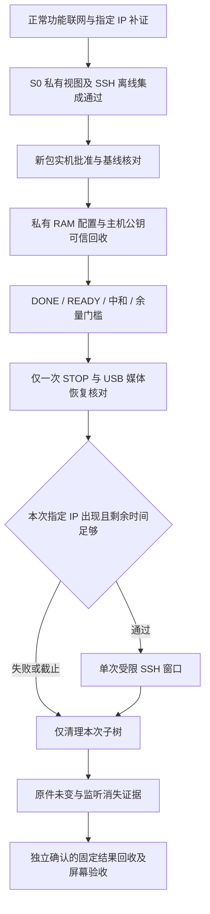

# A7R5 正常模式联网与私有视图 SSH 最小方案 v3

日期：2026-10-20（北京时间）。对象：ILCE-7RM5 / 4.00。

**本轮只完成离线分析和方案整理，没有查询相机、发送协议请求、写相机文件、启动 SSH 或修改账户。本文不是可直接执行的部署包，没有生成新的实机批准。**保留此前两阶段材料、批准、锁、原始收据和失败日志。

## 1. 结论与最短路线

已有实机证据支持私有挂载命名空间和受监督进程跨服务退出存活，原账户及父视图检查通过，私有子进程已回收。下一步应先使用 A7R5 原厂正常联网功能取得明确的相机地址，再研究独立 SSH 实例；没有必要先手动加载无线驱动或修改持久账户。

推荐顺序：

1. **N0：正常功能联网与单地址主机补证。**不需要上传载荷、认证/START 或 DEBUG。优先与 Mac 接入同一受控 Wi-Fi；确认当前机身显示的 IP 后，单次检查可达性。相机菜单设置、USB 拔插和主机网络请求均需后续明确确认，本轮不执行。
2. **根据 N0 决定是否需要 N1。**若正常 Wi-Fi 与已验证的 USB 海量存储状态能够并存，且模式切换后的恢复条件明确，准备后续 SSH 包时把“本次指定 IP 出现”作为监听硬门槛；不机械重复旧的无 SSH 实验。若 USB 会使无线关闭、需要退出后手工重新打开功能，或恢复时序不明确，则只准备一次新的无 SSH 有界观察包 N1，补齐该条件。
3. **S0：离线集成验证私有账户副本、原厂 sshd 和后代清理。**已有两个独立部件的通过记录，尚未完成它们在真实 NSS 配置下的组合验证。
4. **S1：另行批准一次受限 root SSH。**私有 RAM 账户副本只改 root shell，保留原账户；只允许指定密钥、指定地址、固定身份命令和短时窗口。交互 shell、PTY、文件传输及常驻服务不在首次范围内。

若 N0 失败，先停在正常产品联网层。不要用重复 DEBUG、覆盖无线配置、全局挂载或修改密码来补救。

## 2. 证据层级与本轮来源

| 编号 | 证据 | 已支持的结论 | 限制 |
|---|---|---|---|
| E1 | [两阶段实机验收](packages/isolation-once-20261020-01/result-collect/两阶段实机验收.md)、原始终态及轨迹 | 同一监督器 PID/启动 ticks；15 个样本；隔离、父视图及 passwd 未变、子进程回收回执；普通 USB/媒体恢复及人工屏幕正常 | 当次窗口没有非回环 IPv4；没有记录用户当时 Wi-Fi/遥控菜单状态 |
| E2 | [原始分区及提取清单](analysis/network-20261020-v1/sources.json) | 三份原始镜像 SHA-256 与分类清单一致；只读提取 A7R5 网络及 SSH 文件 | 分区来自此前转存时点，不代表现在相机上的所有文件均相同 |
| E3 | [A7R5 ELF 锚点](analysis/network-20261020-v1/elf/static-anchors.json)、对应符号和反汇编 | 网络角色、SSH 包装层及原厂按名称停止 sshd 的静态实现 | 没有恢复 A7R5 菜单到 SSH Manager 的完整调用链；不借用 A7C2 地址填补 |
| E4 | [既有 QEMU SSH 验证](verification/qemu-jx_1vzc1/result.json)及 [验证代码](qemu_verify.py) | 原厂 sshd 在模拟回环中接受正确密钥、拒绝错误密钥，固定 root 命令与有界退出通过 | 当时替换了 passwd/group/nsswitch 夹具，不是私有命名空间与真实 Sony NSS 的完整集成证明；本轮没有重跑 VM |
| E5 | a7c2-re 固定提交 `433737ae5a8a241ae86eb307a12bb6a2c33600c7` 的[报告](https://github.com/chocotan/a7c2-re/blob/433737ae5a8a241ae86eb307a12bb6a2c33600c7/report/2026-10-19-ssh-feasibility/REPORT.md)与[脚本](https://github.com/chocotan/a7c2-re/blob/433737ae5a8a241ae86eb307a12bb6a2c33600c7/report/2026-10-19-ssh-feasibility/ssh-camera.sh) | 参考机型已报告第二个 sshd 与密钥终端；可参考原厂程序、独立实例和分层验收 | 参考方案含持久账户改写，不能直接执行到 A7R5 |
| E6 | [Sony A7R5 正常遥控联网流程](https://helpguide.sony.net/ilc/2230/v1/en/contents/TP0002927440.html)、[按机型分类的连接教程](https://support.d-imaging.sony.co.jp/app/imagingedge/en/instruction/4_1_connection.php) | 同接入点 Wi-Fi 和遥控功能是分别设置的步骤；另有 Wi-Fi Direct 路径 | 在线帮助可能涵盖不同版本，菜单文字以当前 4.00 屏幕为准；不证明海量存储与 Wi-Fi 并存 |

GitHub API 查询遇到限流后，改用只读 `git ls-remote` 确认 main 仍是上述提交，并下载固定提交原文保存于 `analysis/network-20261020-v1/upstream/`。未执行上游脚本。现有包、程序源码及运行配置不改动。

## 3. A7R5 正常联网入口的静态依据

### 3.1 优先入口是原厂正常功能

Sony A7R5 官方流程分别要求接入 Wi-Fi 和开启遥控拍摄，并建议保留访问认证；手机连接会影响电脑遥控。Wi-Fi Direct 是另一种连接方式。USB 遥控属于另一套产品连接状态，不能把它等同于现有海量存储或服务 USB 通道。[官方帮助](https://helpguide.sony.net/ilc/2230/v1/en/contents/TP0002927440.html)

因此，下一次补证应先明确“用户选择了哪个正常网络角色、当前 IP 是什么、USB 接上后是否仍连通”。不能只检查服务模式下 `/proc/net/dev`，也不能假定插着海量存储 USB 时无线功能会自动恢复。

### 3.2 固件里有网络角色和管理组件

下列材料均直接来自 `cnflasha15.img` 的只读提取，而不是仅来自模拟器 initrd：

| 位置 | 核对结果 | 可作出的判断 |
|---|---|---|
| `/usr/lib/netconf/bss.conf:1–8` | 控制接口在 `/tmp_network/run/wpa_supplicant`，`update_config=0`、`ap_scan=0`、禁用 P2P | 存在受原厂控制的 BSS 配置；不是放入 SSID 就必然自动关联的通用模板 |
| `/usr/lib/netconf/p2p.conf:1–13` | P2P 配置、GO 意向、非持久重连字段 | 存在直连角色；不是相机当次地址或已经开启 AP 的证明 |
| `libNetService.so` | 导出 `NsBssFunc11StartAutoConnectAP@0x705e4`、`NsP2PStartGroupOwnerForPcRemote@0x76260`；有 supplicant 配置和 DHCP 命令字符串 | 接入点与 PC 遥控直连有原厂管理入口；不应直接调用未经验证的内部 ABI |
| `libWlanResource.so` | 导出 `loadWlanHostDrivers@0x76e0`、`loadWlanHostDrivers_qca6174a@0xa7c8` 等 | 无线驱动受资源/硬件层管理；模块存在不代表当次已加载或供电 |
| `/usr/sbin/sshd` | 767,408 字节，SHA-256 `a6b871ef0da3990ea0d25d7996ee79c3bfc29385d4eb1670892814c0e1472534` | 与既有实机预检及参考项目报告中的程序摘要一致；不证明网络和登录已可用 |

没有把 A7C2 报告中的 `run_supplicant.sh` 当作 A7R5 已核实入口。本轮在 A7R5 已核对目录及运行材料中没有取得该同名脚本，不能据此声称全固件绝不存在；已有 `libNetService` 的具体配置路径与符号足以支持先走原厂菜单。

### 3.3 原厂 SSH 与 root 终端是两件事

A7R5 `cnflasha10.img:/ssh/sshd_config` 明确包含：22 端口、`PermitRootLogin no`、`PubkeyAuthentication no`、`MaxSessions 0`，以及受限转发配置。`nsswitch.conf:6` 为 `passwd: files ssh`，PAM 配置含失败计数和 Sony 辅助程序。不得把菜单访问认证凭据当作 Linux root 密码，也不通过反复认证试探。

原始账户摘要与此前实机基线相符，root shell 为 `/bin/false`；保持此字段时，即便公钥认证成功，也不能假定 shell 命令能够执行。拟议的 `/bin/sh` 改动只存在于后续私有 RAM 副本，本轮没有实施。

### 3.4 新发现：原厂停止逻辑可能结束实验 sshd

在 A7R5 `libInfraSSHManager.so` 中：

- `startSshd@0x908c` 将地址 `0xb172` 的 `/usr/sbin/sshd` 交给 `executeIMSystem`。
- `stopSshd@0x95d4` 在对应条件下，将地址 `0xb0ef` 的 `/bin/busybox killall sshd` 交给同一执行层；调用点在 `0x9640`。

这已由[参数地址解析](analysis/network-20261020-v1/elf/static-anchors.json)和[停止函数反汇编](analysis/network-20261020-v1/elf/sshd-stop.disassembly.txt)相互核对。条件何时由当前菜单触发尚未闭合，但它说明“独立配置、独立端口”不保证进程生命周期完全独立。未来若原厂模式切换结束了本次实例，应记录失败并清理，不改原厂管理器、不改程序名绕过、不自动重启。

## 4. 上次没有网络能说明什么

75 秒内 15 个样本只见 lo、gre0、gretap0、tunl0，IPv4 只有 127.0.0.1，路由无条目。监督器在 STOP 后仍采样，排除了“仅因为任务在 STOP 时立即退出而没有后续样本”的解释。

目前不能在以下假设中定因：

1. 普通 Wi-Fi/遥控功能原本未开启或未进入联网角色。
2. 服务或海量存储状态使原厂无线链路停止，返回普通 USB 后没有自动重新启用。
3. 需要在正常模式重新选择遥控/直连功能，观察期内没有发生该操作。
4. 原厂网络初始化存在其他条件或故障。

“只有回环接口”更接近无线接口尚未出现的状态，不能直接归为 DHCP 失败；也没有证据支持先改驱动、静态地址或防火墙。N0 先区分正常产品联网是否成立，再决定是否需要一次模式切换补证。

## 5. N0：最小联网补证，默认不需要新载荷

**未来确认范围**：用户通过正常菜单选择网络；必要时按已确认步骤正常弹出媒体并断开 USB；Mac 对用户指定单个 IPv4 做有限检查。不会执行本节中的动作，直到另行确认。

### 操作设计

1. 记录现有 Wi-Fi、遥控、手机连接及 USB 模式，区分“读现状”和“改变设置”。优先使用已有受控接入点，避免新增网络凭据；若要登记新 AP，须明确其可能持久保存，密码只在相机本机输入。
2. 依据当前机身菜单按官方流程启用 Wi-Fi/遥控，并保留访问认证。菜单名称可能显示“遥控拍摄”或 PC Remote，以屏幕为准。不复位网络、不清除配对、不改变相机账户。
3. Mac 接入同一网络，取得当前机身显示或用户控制的路由器租约所确认的相机 IPv4。没有可靠地址就停止，不猜 `192.168.*`、不扫描网段。Wi-Fi Direct 仅作 AP 路线不可用时的替代，后续独立确认 Mac 切网影响。
4. 主机检查只针对该 IP：一个有超时的 TCP 22 连接，可读取至多 256 字节 SSH banner，不提交凭据、不完成 SSH 登录。若明确拒绝或超时，可按事先批准范围补一包 ICMP；不循环连接，不以广播发现代替已知身份。
5. 有限检查的解读：明确 SSH banner 支持原厂服务可达；TCP 拒绝只表示该时点未接受 22；ICMP 成功支持当前地址可达。ICMP 不通不能独立证明网络不通。22 是否开放不是独立 2222 实例的必备前提。
6. 记录正常网络和 USB 是否可以并存。若为联网必须断开 USB或改 USB 模式，不让脚本自行切回海量存储；先完成这一小阶段，再评估后续模式切换窗口。

### 通过与停止

- 通过：明确的目标身份、正常网络角色和 IP，加上有时间戳的单目标可达性证据。
- 不通过：没有确定地址、正常产品联网失败、相机提示异常或需格式化/修复。停在此处，不部署 root 网络任务。
- 本阶段无需相机内部文件写入、START、DEBUG 或 STOP。正常网络功能可能自行更新用户设置、密钥或运行文件；不能将此描述为“整机无任何写入”。

## 6. N1：只在模式切换条件未决时准备一次新观察包

如果 N0 已建立正常联网，但服务退出后恢复条件还不明确，准备新的 nonce 和一次性包；旧包已消耗，不能删除锁复用。

- 沿用实机验证过的 `CLONE_NEWNS → 递归私有传播 → 私有 /var tmpfs → 原字节 passwd 只读 bind`，账户副本保持原字节，不启动 SSH。
- 仍只接受精确 512 换行预加载基线，固定小载荷/启动器完整读回、一次 DEBUG、DONE/READY/推进心跳、中和及一次有条件 STOP；持久残留清点沿用原纪律。
- 默认不改无线配置、不加载模块、不执行 wpa_cli 命令、不改路由/防火墙。原厂菜单操作若需要在退出后发生，应写入该新包的人工检查单并单独授权。
- 增加有限的只读证据：接口名/状态、IPv4、路由摘要、WLAN 模块是否出现、原厂网络进程的 comm/启动标识。禁止记录进程完整参数、SSID/PSK 配置、访问凭据、shadow 或私钥；不直接发无线 ioctl 改配置。
- 如需给人工切换留时间，候选总寿命为 **180 秒**，每 5 秒只保存精简固定字段，36 个样本连同元数据预算不超过 24 KiB，硬上限仍 32 KiB。180 秒和新编码尚未实现、未验证；不能只修改旧常量，旧解析器的样本上限也需同步审查。
- 最坏预算必须覆盖 READY 门槛、一次 STOP、USB/媒体恢复最长等待、人工恢复联网及清理。余量不足则放弃，不跳过恢复检查、不续期、不拉起第二个观察器。
- 结果留 RAM。跨模式的最终结果仍需另一次明确批准的固定只读回收，不能自动开启服务会话。

若 N0 已证明所需并存条件，且新的 SSH 状态机能在本次指定地址未出现时保持不监听并到时清理，可以省略单独 N1。是否省略应在包审查时用 N0 记录决定，不能把“曾经有地址”当成本次监听条件。

## 7. S0/S1：不持久改账户的 SSH 部署设计

### 私有账户与运行目录

保持原挂载命名空间及网络命名空间中的原厂程序。监督器在外部视图核对原账户、原 SSH 配置摘要、相关挂载及临时目录权限。只有私有子视图挂载新的 `/var` tmpfs，创建 root 所有的运行目录及 `/var/empty`。

在 RAM 副本中只将唯一 root 记录最后字段 `/bin/false` 改成 `/bin/sh`，其他字节不变；再只读 bind 到该子视图 `/etc/passwd`。UID/GID、home、密码字段和 sshd 账户均不改。保留真实 `nsswitch.conf` 和 Sony NSS 库，不用纯 files 夹具替代集成验收。若锁定或 NSS 行为拒绝合法公钥则停止，不解锁、不改 shadow、不清失败计数。

这是**私有账户视图字段变化**，仍需在未来实机批准中明确接受；不能称为完全没有账户变化。目标是原始持久 passwd 不写回，私有视图释放后消失。

运行文件位于私有 `/var/run/a7r5-ssh-N/`，目录 0700、文件 0600；`/var/empty` 为 root:root 0755 空目录。私有 `/var` tmpfs 容量上限候选 4 MiB，写前可用空间至少 2 MiB；这是待集成验证的门槛，不改全局 `/tmp_network` 的 1777 权限，不扩大原有挂载。

客户端私钥仅存 Mac；仅指定公钥进入私有目录。相机主机密钥在私有 RAM 现场生成，私钥不导出；公钥在服务退出前经已验证 USB 通道回收，绑定 nonce、IP、端口和包摘要。客户端使用独立 known_hosts 严格核对，不能依赖无验证的 keyscan 或关闭指纹检查。

### 第一次 SSH 的限定能力

- 独立使用原厂 `/usr/sbin/sshd`，端口 2222，只绑定 N0 确认且本次内核重新观察到的精确 IPv4，不监听所有地址，不动原厂 22 端口配置。
- 保留 `StrictModes yes`；仅指定公钥认证、仅 root；禁用密码、交互认证、PAM、PTY、转发、隧道及用户环境；无 SFTP 子系统。
- 固定命令为 `/bin/busybox cat /proc/self/status`，验收 UID/GID 四项均为 0，不接受客户端指定任意命令。参考配置见既有 [lab.py](lab.py)，路径改为私有目录后必须重新验证。
- 先在私有视图进行 `sshd -t` 和有效配置核对，再准备 READY；解析通过不等于网络、认证或会话可用。
- 仅当本次指定接口/IP 出现、父视图/账户仍通过、剩余窗口充足时，启动一次前台 `sshd -D -e -f`。没有 IP 就等待到有界截止，不绑定 0.0.0.0 兜底。
- Mac 只建立一次指定身份的 SSH 连接，不使用 agent 批量试钥；绑定预先回收的主机公钥。错密钥、转发、PTY、命令注入及异常路径只在隔离模拟环境验收。

这些配置的用途依据 [OpenSSH 同时期手册](https://man.openbsd.org/OpenBSD-6.5/sshd_config.5)，Sony 二进制的实际接受值、NSS、re-exec 和降权行为仍须测试，不凭版本字符串宣称等价。

### 状态与寿命

SSH 的候选总寿命也可按 N1 最坏预算评估至 180 秒，其中连接窗口最多 20 秒并预留至少 10 秒清理；最终值由 N0/N1 时序与离线故障测试确定。当前 75 秒观察器与旧 5–30 秒监督器都不能直接作为这份状态机使用。

`sshd` 会产生认证/会话后代，现有“不 fork 的命名空间保持子进程”清理能力不能直接推广。新监督器需要 subreaper、受控进程组、PID/启动 ticks 与亲缘核对、有界 TERM/KILL/wait，以及监听归属检查；不能只杀父 sshd 就宣布清理完毕，也不使用 pid 文件或进程名作为唯一依据。

## 8. 影响、停止与恢复

| 对象 | 后续计划影响 | 停止与恢复边界 |
|---|---|---|
| 原厂正常网络设置 | 用户通过菜单启用或切换；可能持久保存 AP/配对设置 | 记录前值；不自动复位或回写；需与新载荷写入分别说明和批准 |
| `/tmp/jiritsu` 固定新 nonce 文件 | 新载荷、启动器、状态和受限输出，可能持久残留 | 完整回读；失败保留，不覆写历史、不自动删除 |
| `/etc/ld.so.preload` | 精确基线→本次载荷→512 换行 | 未知内容不覆盖；协议失步不盲写；中和不等于出厂还原 |
| 私有 `/var` 和 `/etc/passwd` 视图 | RAM 文件、私有 shell 字段、密钥及日志 | 原件前后不变；仅清理本次确认亲缘的进程，释放私有挂载引用 |
| 网络监听 | 指定 IPv4:2222、指定密钥、有限窗口 | IP 不符/未知监听/指纹不符/原件变化即停止；不重连或自动重启 |
| 原厂 SSH 管理器 | 保持原有行为；可能结束自建 sshd | 记录被结束，不修改原厂生命周期或自动拉起 |
| USB/媒体 | START/STOP 导致切换，正常媒体需要恢复 | STOP 至多一次；Pipe error 原样保存，主机独立观察恢复，不自动拔插/断电 |
| SD 卡、原始固件镜像、更新区 | 不操作 | 包不得包含挂卡、块设备写、格式化、固件更新或修复命令 |

网络可达不等于身份可信；SSH 登录成功不等于清理完成或固件救援可靠。挂载命名空间不是恶意 root 命令的安全沙箱，若以后开放任意 shell，仍可能访问其他共享持久路径，必须另行限定范围。

## 9. 本轮已完成及尚未完成

已完成：原始镜像摘要/只读提取、A7R5 网络角色与 SSH 停止路径静态核对、上游固定提交复核、既有实机与 QEMU 证据边界审查、N0/N1/S0/S1 方案及失败门槛整理。离线校验命令及结果见 [下一阶段清单](analysis/network-20261020-v1/下一阶段清单.md)。

尚未完成：当前机身正常 Wi-Fi 状态与 IP、海量存储共存、真实 NSS 下的私有账户 SSH 集成、新监督器/新观察编码、主机公钥可信回收与 SSH 窗口联动、实机 SSH。**没有新增可执行实机包、没有新增实机批准，也未改变任何旧一次性包。**

最小下一步是先准备并确认 N0 的正常菜单/单地址检查范围，不直接进入账户变更或服务部署。拿不到 N0 正常联网证据时，不继续扩大底层入口研究。
