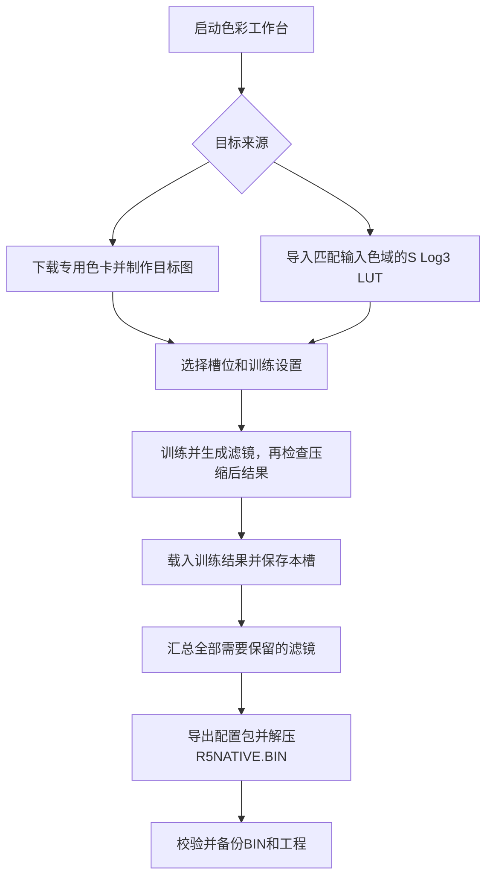

# R5NATIVE.BIN 使用说明：从训练到导出

更新日期：2026-11-03。适用于本仓库已经完成24槽适配、安装PyTorch并启用Metal／MPS的本地Color Lab。

最终需要得到的文件是 **`R5NATIVE.BIN`**。推荐操作顺序为：准备目标 → 选择槽位 → 训练并生成滤镜 → 检查结果 → 载入并保存本槽 → 导出配置包 → 解压并校验BIN。全部训练和生成操作都在电脑上完成，无需连接相机。

## 1. 先了解三个对象

| 对象 | 用途 | 是否可以直接作为相机配方 |
|---|---|---|
| 目标色卡TIFF／JPG或 `.cube` | 定义希望模拟的颜色效果 | 不能，需要先拟合 |
| `native_config.json` | 保存槽号、名称、原生参数及工程来源信息 | 不能直接改名为BIN |
| `R5NATIVE.BIN` | 包含一组可供兼容固件读取的滤镜配方 | 是，需与固件支持的格式匹配 |

一个BIN可以保存多款滤镜。**配置槽位最多24个，原厂编辑基线仍为12种**；不要把两者混淆。电脑上的torch只参与训练，不会被写进BIN。



## 2. 启动工具

### 本机正常启动

在Finder中打开 `sony-r5-colorlab/R5ColorLab/`，双击 [启动R5色彩工作台.command](R5ColorLab/启动R5色彩工作台.command)。也可以在 `a7r5-rea` 根目录执行：

```sh
sony-r5-colorlab/R5ColorLab/.venv/bin/python \
  sony-r5-colorlab/R5ColorLab/launcher.py
```

浏览器访问 `http://127.0.0.1:4180`。保持启动工具的终端窗口打开；停止服务时在该终端按 `Ctrl+C`。

当前启动入口默认请求Metal／MPS。界面应显示MPS训练状态，原生整数验收显示CPU参考实现，这是当前已验证的正常组合。CPU／GPU会采用不同的数值求解路径，不要求每次训练都产生完全相同的参数。

如需CPU模式：

```sh
sony-r5-colorlab/R5ColorLab/.venv/bin/python \
  sony-r5-colorlab/R5ColorLab/launcher.py --cpu
```

端口被占用时追加 `--port 4181`，随后访问 `http://127.0.0.1:4181`。其他电脑的环境准备及GPU边界见 [MPS训练说明](MPS训练与离线验证.md)。

## 3. 准备训练目标

两种来源任选其一。先制作一款、确认流程走通，再组织批量训练。

### 路线A：使用软件处理后的专用色卡

适合在RAW处理软件中制作胶片风格、模拟其他相机风格，或者将已有调色预设转换为配方。

1. 将“目标来源”设为 **“软件处理后的测试色卡”**。
2. 在“训练与色卡”使用 **v4.5 · 5300K · 一亿像素**。旧版 v4 仅用于查看历史任务。
3. 从页面下载当前版本的RAF、ARW或DNG色卡，使用调色软件支持的格式。这里使用的是工具提供的合成色卡，不需要现场拍摄。
4. 在软件中打开色卡，施加想要训练的风格或预设，保持拍摄白平衡。不要仅凭软件显示的色温数字强行重设5300K。
5. 导出完整尺寸 **11648×8736** 的RGB TIFF或JPG。优先使用16位RGB TIFF；8位TIFF或JPG也支持。
6. 保持方向、尺寸和色块位置。不要裁切、缩放、加边框、旋转或应用局部蒙版、几何变形。
7. 在页面选择 **“导入处理后的目标图”**，等待目标色块检查完成。单图上限为1 GiB。

应看到文件名、位深以及目标色块已就绪的提示。工具支持带RGB ICC的目标图；无ICC的图片按sRGB解释。普通风景、人像照片不能放到这个入口替代专用色卡。

### 路线B：使用 `.cube` LUT

1. 将“目标来源”设为 **“S-Log3 LUT”**。
2. 导入3D `.cube` 文件，文件上限为64 MiB。
3. 在输入色域中选择与LUT要求一致的 **S-Gamut3** 或 **S-Gamut3.Cine**。
4. 检查页面已经识别文件，再进入训练。

该入口按所选色域和S-Log3建立训练目标。使用LUT前需确认它的输入规范；不能把要求Rec.709输入的LUT直接当作S-Log3 LUT使用，也不能仅修改文件名完成转换。

## 4. 选择槽位、名称和训练设置

### 槽位和名称

从顶部打开或新建工程。点击左侧 1～24 中的目标槽位。空槽可点“创建配方”进入编辑，再设置名称。

| 字段 | 示例 | 规则 |
|---|---|---|
| 左侧简写 | `ASTIA`、`经典负片` | 1～23个UTF-8字节，常用汉字通常每字3字节 |
| 右侧全称 | `ASTIA Soft` | 1～63个UTF-8字节 |
| 配置编号 | 1或24 | 一个工程内不能重复 |

导入目标图后，“训练与色卡”会按文件名建议训练简称和全称。可以在训练面板覆盖建议，空槽会保持为空。

“编辑基线”用于载入编辑器中的原厂参数，**不会把训练模型改成当前下拉框所选的外观**。新任务的拟合基线由所选色卡和任务来源绑定，默认使用v4.5对应的PT颜色上下文。

### 建议先保留当前网页默认设置

| 设置 | 当前默认值 |
|---|---|
| 速度优先 | 关闭 |
| 每阶段评估上限 | 2000 |
| 搜索起点 | 12 |
| 动态权重轮数 | 8 |
| Gamma／色彩交替 | 3轮 |
| 整数量化微调 | 3轮 |
| 参数平滑／输出连续性 | 30／30 |
| 感知色差权重 | 0.35 |
| 随机、正色、灰阶、24色、矩阵16色相权重 | 各1 |
| PC色彩补偿／三维颜色网格 | 开启 |
| PC补偿方案 | 明暗曲线＋灰阶染色 |
| 网格响应模型 | R5无专家共享C1，2026-11-02 |
| 白平衡联合训练 | 关闭 |
| 第129点Gamma导出端点 | 131071 |

评估上限是每个阶段的预算，不是训练总轮数。不同目标、机器和设置的耗时不同，不要根据小预算自检的用时估计完整训练时长。

白平衡联合训练属于实验功能，BIN不保存该项偏移；制作配方时先保持关闭。Gamma端点留空会保留原ST端点；如果它低于拟合曲线末端，导出会被拒绝。首次操作保持页面默认131071。

## 5. 单款滤镜的完整训练与导出

### 第一步：点击“训练并生成滤镜”

目标已导入、槽位和名称已设置后，点击 **“训练并生成滤镜”**。这条入口会自动依次进行原生参数拟合、PC补偿和最终单一5×9×9网格训练，适合需要生成完整配方的操作。

原生拟合只运行一次。新设置的 MPS Adam 默认使用学习率 `0.015` 和 `2000` 步，已有工程保存的步数继续生效。最终网格的整数微调仍按验证集色差、灰阶和双域过渡验收；没有更好的合格网格时保留本次训练的起始网格。

等待任务完成，期间保持本地服务运行。需要中断时使用页面的“取消当前训练”。

页面已合并为一个训练入口，无需先拟合再点击压缩。提交和运行期间会阻止重复点击；本页相同目标、槽号、名称与训练设置已成功生成滤镜时，再次点击会复用该结果。改变输入或设置会创建新任务；失败后可以重试。复用记录仅在当前页面有效，刷新后请从历史任务选择已有结果，避免重新提交。

未导入目标时，选择已完成的 PC 补偿历史任务后，点击同一按钮可仅继续压缩，不再拟合；已有压缩结果时直接加载该结果，保留它记录的模型。生成的配方会作为候选结果显示，确认载入并保存本槽后才进入工程导出。

### 第二步：检查实际将写入BIN的结果

1. 在“结果对比”中选择 **“压缩后 · 原生参数＋单一网格”**。
2. 比较目标颜色与拟合结果，查看平均绝对误差、均方根误差和95%误差分位。
3. 重点看灰阶、肤色附近色块、阴影和高光，检查明显偏色、断层或色相跳变。
4. 查看“压缩训练报告”，确认当前任务已经有有效的单一网格结果。

“压缩前 · 原生参数＋完整PC补偿”适合分析搜索过程；最终BIN使用的是单一整数网格。应以“压缩后”结果判断本次导出，而不能只看压缩前效果。

色卡指标和电脑预览用于比较拟合效果，不能直接等同于相机JPEG成像。工具不会给出适合所有风格的统一合格阈值。

### 第三步：保存配方到槽位

压缩完成后，点右侧的 **“保存训练结果到第 N 槽”**。N 是提交任务时的槽号，浏览其他槽位时也会保持。已有配方或草稿时，确认后才替换。需要先调整参数时，可点 **“载入为草稿”**，再点 **“保存本槽”**。

在“任务与工程记录”可查看已完成的结果。工程内再次提交相同输入和设置时，可复用已验证的压缩配方。新任务会保留训练请求，也可以明确选择用同一目标和设置重训。

### 第四步：导出配置包

点击顶部 **“导出 BIN”**，先查看两种方式各自的槽位清单、排除的草稿和 v4／v5 格式。工程有导入来源时，可选择一份原始 BIN 查看新增、修改及移除的槽位。再选择只导出已保存的槽位，或保存全部草稿并导出。解压下载的 `r5-native-config.zip`：

```text
R5NATIVE.BIN
native_config.json
export_audit.json
```

BIN 是相机配方，JSON 是已导出的参数，校验回执记录槽号、格式、大小与摘要。压缩报告中的单项配置包只包含当前配方。合成多款滤镜时，从工程顶部统一导出。

## 6. 原厂网格与手动调参

在“滤镜编辑”选择原厂网格，或直接调整 129 点 Gamma、CC1、16 色相矩阵及 5×9×9 网格。点击“保存本槽”时会检查参数范围和 Gamma 单调性。导入的配方也可以按同样方式调整和导出，直接使用保存后的参数。

“效果对比”中的训练快照与“RAW／Edit 验证”使用所选任务的配方。已有保存配方且产生草稿时，可以另选 B、A1 或 A2，比较同一组 96 个留出色块。电脑模型使用前 128 点 Gamma，最后一点的变化单独显示。

## 7. 批量训练并合成一个BIN

批量入口用于多个**专用色卡目标图**，不用于整批 `.cube`。

1. 用同一版本的专用色卡，分别制作每种目标风格，导出JPG／TIFF。
2. 放进一个干净的文件夹，文件名去掉扩展名后作为简称，控制在23个UTF-8字节内；避免只差大小写的重复名。
3. 页面选择相同的“训练色卡版本”，设置好本批次共用的训练参数。
4. 展开“文件夹批量训练”，点击 **“选择目标文件夹”**。
5. 核对文件名和目标槽号，可手动调整每张图的槽号。最多 24 张，文件名和槽号均需唯一。
6. 点击 **“批量训练、压缩并合并BIN”**。
7. 任务结束后，可点 **“保存成功项到工程”**。部分任务失败时，可点 **“只重试失败项”**。整批成功后也可以单独下载整批 BIN。

前端按文件名自然排序，优先分配空槽。可以使用如下命名控制顺序，最终以提交前的槽位映射为准：

```text
targets/
├── 01_ASTIA.tif
├── 02_CLASSIC_CHROME.tif
└── 03_CLASSIC_NEG.tif
```

该入口会对每款执行训练和压缩，默认并发数为2；全部成功后才生成整批合并BIN。刷新页面可恢复批次显示，终止服务会中断未完成任务。批量完成后可直接下载整批 BIN，再导入为工程或合并到空槽。

如需稀疏编号，例如只使用 1、13、24 号，在提交前调整槽位映射。

## 8. 确认v4／v5格式及完整替换规则

新建库默认导出按**最大槽号**选择格式，不按配方数量选择。导入 BIN／JSON 时保留原 v5 格式，即使当前只含低槽或空库也不会自动降级；导入 v4 库后增加高槽则自动升级为 v5。

| 工程已保存配方 | 自动格式 | 兼容性 |
|---|---|---|
| 所有项都在1～12号 | v4 | 原十二槽实现和当前24槽候选可读取 |
| 出现任意13～24号 | v5 | 需要支持该格式的24槽实现 |
| 只有24号一款 | v5 | 仍需要24槽实现 |
| 空工程 | 128 字节，格式随工程 | 机内导入会清空配方库 |

### 从现有 R5NATIVE.BIN 恢复到页面

1. 在顶部选择 **“导入 R5NATIVE.BIN”**。支持十二槽 v4、二十四槽 v5、不连续的槽号和有效的 128 字节空库。
2. 核对导入预览，选择 **“导入为新工程”**，或按原槽号 **“合并到空槽”**。已有配方或草稿的槽位会阻止合并。
3. 在左侧区分 **已保存、空槽、未保存修改**。编辑后点击 **“保存本槽”**，也可在右侧将旧版本恢复为草稿。
4. 如需调整槽号，在右侧输入目标空槽，再选择复制或移动。工程保存会保留原始导入 BIN，重新编译输出使用当前工程保存的配方。

BIN仅包含最终配方，不含目标图、LUT、训练日志和误差报告。导入后会退出旧训练任务预览，不能据此恢复原训练对比图；文件校验通过也不代表实机颜色验收。

配方文件大小为 `128＋2452×实际配方数量` 字节。满十二款为29,552字节，满二十四款为58,976字节；无需填满所有槽。相机原厂官方固件不具备这个自定义文件的导入能力，不能只依靠系统版本号判断兼容。

**导入是完整替换。** 例如原来有1～12号，只导出24号再导入，不会自动保留原十二款。要得到1～12号加24号的库，应先组织成包含全部十三项的导出集。

当前库选择恢复还绑定整库身份，更换BIN后不能仅因槽号相同就假定继续使用旧滤镜。八项微调按单配方色彩身份保存，不写入原始BIN；相同配方改名或换槽可保留微调，改变色彩内容则按新配方处理。

## 9. 校验生成的R5NATIVE.BIN

先看 `export_audit.json` 中的格式版本、配方槽号、文件大小和SHA256。不同入口的摘要字段可能叫 `binary_sha256` 或 `sha256`。

也可在仓库根目录使用以下只读命令。将 `/path/to/R5NATIVE.BIN` 替换为电脑上的实际文件路径，保留路径外的引号：

```sh
.venv/bin/python - "/path/to/R5NATIVE.BIN" <<'PY'
from pathlib import Path
import hashlib
import importlib.util
import json
import sys

# 使用项目自己的严格解码器，不修改输入文件。
source = Path("sony-r5-colorlab/R5ColorLab/compilers/custom_filter_v4.py")
spec = importlib.util.spec_from_file_location("r5_recipe_check", source)
codec = importlib.util.module_from_spec(spec)
spec.loader.exec_module(codec)
raw = Path(sys.argv[1]).read_bytes()
config = codec.unpack(raw)
print(json.dumps({
    "schema": config["schema"],
    "bytes": len(raw),
    "sha256": hashlib.sha256(raw).hexdigest(),
    "slots": [entry["number"] for entry in config["entries"]],
    "names": [entry["full_name"] for entry in config["entries"]],
}, ensure_ascii=False, indent=2))
PY
```

命令成功会列出版本、槽号、名称和摘要，并完成CRC及参数格式校验。若报错，先保留出错文件和对应工程，重新检查导出结果；不要手动改BIN头或CRC来绕过检查。

## 10. 保存工程，便于以后继续调整

工程按项目保存在 `R5_RUNS_DIR/_projects/`，未指定时使用 `R5ColorLab/web/runs/_projects/`。槽位修改会自动写为草稿，“保存本槽”把该槽纳入下一次 BIN 导出。

使用 **“备份 .r5proj”** 保存工程。备份包含配方、草稿、训练选项、近期槽位版本、导入的原始 BIN 及记录。另一台电脑可用 **“恢复 .r5proj”** 建立独立工程，并直接继续编辑和导出。训练任务的目标图、LUT、RAW 与诊断文件保存在原训练目录中，需要重放时请同时保留相应目录与输入文件。

## 11. 命令行重新生成BIN

网页导出已包含BIN，通常无需再编译。下面用于已有**合规原生配方JSON**的情况，只打包参数，不执行色彩训练：

```sh
.venv/bin/python sony-r5-colorlab/R5ColorLab/compilers/custom_filter_v4.py \
  "/path/to/compile_config.json" --output "/path/to/R5NATIVE.BIN"
```

编译输入只允许五个顶层字段：`schema`、`model`、`baseline_ap_sha256`、`baseline_cp_sha256`、`entries`。网页工程的 `native_config.json` 常带有 `export_sources`，不能直接传给这个严格编译器；应保留原工程和审计，另存仅含上述字段的编译副本。这条命令不能替代网页对训练来源、原厂网格和压缩结果的验证。

编译器文件名保留 `custom_filter_v4.py`，当前已支持v4／v5。默认自动选择最小兼容格式，也可追加 `--format 4` 或 `--format 5`。强制v4时遇到13～24号会拒绝，不会截断；输出文件已存在时拒绝覆盖，应使用一个尚不存在的新路径。JSON声明 `/4` 时不能包含13～24号，应使用合规 `/5` 配方。

## 12. 常见问题

| 现象 | 处理方法 |
|---|---|
| “保存本槽”不能点击 | 先创建配方、载入训练结果或编辑现有配方，使槽位产生草稿 |
| 训练结束但下载包没有BIN | 确认下载的是右侧配置包或批量合并BIN；拟合参数与日志包本身不含BIN |
| 提示参数与压缩结果不一致 | 原生参数或网格已在压缩后修改；重新压缩，或重新选择原厂网格 |
| 导入工程提示缺少压缩任务／来源失效 | 恢复原任务目录和结果，不能只恢复工程JSON |
| 目标图尺寸或版本不符 | 使用页面所选版本的专用色卡重新导出，保持完整尺寸和方向 |
| 提示简称过长或重复名 | 缩短文件名／简称，按UTF-8字节限制检查，并去除批量同名项 |
| Gamma末端不单调，拒绝生成 | 检查第129点不低于前一点；新任务优先保留默认131071 |
| 显示CPU模式 | 检查是否使用工具专用环境、是否传入 `--cpu` 或设置了 `R5_GPU_TRAINING=0` |
| MPS已启用，但整数验收显示CPU | 当前正常设计；浮点训练用MPS，原生整数验收保留CPU参考实现 |
| 界面页尾还写“仅支持v4／4.23／自定义滤镜关闭” | 这些是上游遗留静态提示；当前格式以导出状态、审计及本说明为准，当前机内入口按本地固件实现判断 |

## 13. 交付前检查

- 导出集包括所有希望保留的槽，槽号和名称正确，没有误导出空集。
- 检查的是压缩后单一网格结果，或有意使用已选定的原厂网格。
- 解压后文件名为 `R5NATIVE.BIN`，校验成功，摘要与导出审计一致。
- 固件支持实际导出的v4／v5格式，工程和训练资料已备份。

到这里，本机训练和BIN生成已经完成。若后续准备在相机使用，文件需要放到兼容固件所读取的SD卡根目录，沿用冷启动导入流程；该文件不是 `BODYDATA.DAT` 升级包，也不是保存选择编号的 `R5FILTER.BIN`。本文操作不连接相机，不包含固件安装或实机成像验收。

实现与验证依据：[训练设置](R5ColorLab/TRAINING.md)、[网页操作](R5ColorLab/web/static/app.js)、[批量流程](R5ColorLab/web/batch_training.py)、[导出校验](R5ColorLab/web/export_policy423.py)、[配方编解码器](R5ColorLab/compilers/custom_filter_v4.py)、[24槽适配说明](24槽适配说明.md)、[MPS离线验证](MPS训练与离线验证.md)。
